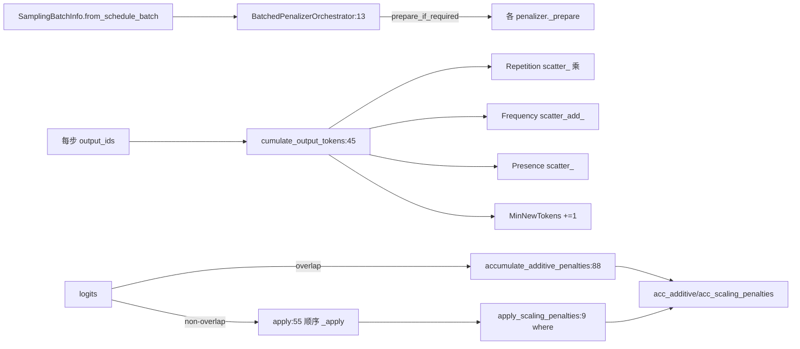

# 11.2 penalty 库

## 定位

`penaltylib` 是采样控制链中"对已生成 token 计惩罚"的批级实现。它由 `SamplingBatchInfo` 装配，被 `Sampler._preprocess_logits` 与 `apply_logits_bias` 调用，把 repetition/frequency/presence/min_new_tokens 四类惩罚以批化张量方式叠加到 logits 上。设计目标是让"无 penalty 的请求"几乎零开销，并支持 overlap 调度下的预累积。

## 职责

- `BatchedPenalizerOrchestrator`：统一持有一组 `_BatchedPenalizer`，弱引用 `ScheduleBatch`，对外提供 `apply`/`accumulate_additive_penalties`/`accumulate_scaling_penalties`/`filter`/`merge`/`release`。
- 区分 additive（frequency/presence/min_new_tokens，做 `logits.sub_`）与 multiplicative/scaling（repetition，做 `logits*=s` 或 `/s`）两条路径，便于 overlap 模式把 scaling penalty 累乘成单张量。
- 每个 penalizer 自检 `_is_required`，未被任何请求需要则不 prepare；`filter`/`merge` 维护连续批调度下的状态连续性。

## 关键类与函数

| 名称 | 定义位置 | 说明 |
|---|---|---|
| `BatchedPenalizerOrchestrator` | `sampling/penaltylib/orchestrator.py:13` | 批级惩罚编排器 |
| `BatchedPenalizerOrchestrator.apply` | `sampling/penaltylib/orchestrator.py:55` | 顺序应用所有 penalizer，支持 spec decoding `repeat` 展开 |
| `BatchedPenalizerOrchestrator.accumulate_additive_penalties` | `sampling/penaltylib/orchestrator.py:88` | 仅累加非乘性惩罚（overlap 用） |
| `BatchedPenalizerOrchestrator.accumulate_scaling_penalties` | `sampling/penaltylib/orchestrator.py:94` | 累乘乘性惩罚为单张量 |
| `BatchedPenalizerOrchestrator.merge` | `sampling/penaltylib/orchestrator.py:148` | 合并另一 orchestrator（须在 batch.reqs 更新前调用） |
| `_BatchedPenalizer` | `sampling/penaltylib/orchestrator.py:167` | ABC，`is_multiplicative=False` |
| `BatchedRepetitionPenalizer` | `sampling/penaltylib/repetition_penalty.py:18` | `is_multiplicative=True`，`scatter_` 累乘 |
| `apply_scaling_penalties` | `sampling/penaltylib/repetition_penalty.py:9` | `@torch.compile` 的 `where` 实现，负 logit 乘、正 logit 除 |
| `BatchedFrequencyPenalizer` | `sampling/penaltylib/frequency_penalty.py:6` | additive，`scatter_add_` 累加 |
| `BatchedPresencePenalizer` | `sampling/penaltylib/presence_penalty.py:6` | additive，`scatter_` 累加 |
| `BatchedMinNewTokensPenalizer` | `sampling/penaltylib/min_new_tokens.py:6` | 未达 `min_new_tokens` 时把 stop token 置 -inf |

## 子模块树

- `sampling/penaltylib/`
  - `orchestrator.py` — 编排器与 ABC
  - `repetition_penalty.py` — 乘性 repetition + `apply_scaling_penalties`
  - `frequency_penalty.py` — additive frequency
  - `presence_penalty.py` — additive presence
  - `min_new_tokens.py` — 长度门槛惩罚
  - `__init__.py` — 统一导出

## 数据流 / 控制流

`apply(logits, repeat)` 在普通路径逐 penalizer `_apply`；在投机解码路径按 `repeat` 把 additive 捕获到 zeros 张量再 `repeat_interleave` 相加，scaling 则累乘后展开调 `apply_scaling_penalties`。`repetition` 与 frequency/presence 的差异在 `scatter` 操作：repetition 用 `scatter_`（覆盖为系数，即"出现过的 token 乘以 penalty"），frequency 用 `scatter_add_`（按次数累加），presence 用 `scatter_`（一次性加系数）。`min_new_tokens` 用 `torch.where` 而非布尔索引，避免数据依赖造成的 device-to-host 同步，并以 `-inf` mask 屏蔽 stop token。

## 交叉引用

- 上游: [11.1 SamplingBatchInfo](11.1-sampling-params-sbi.md) — 装配并持有 orchestrator
- 下游: [11.4 Sampler 层](11.4-sampler-layer.md) — `apply_logits_bias`/`_preprocess_logits` 消费
- 相关: [`03.4.5 run_batch 前向`](../03-orchestration/03.4.5-scheduler-run-batch-forward.md) — overlap 模式触发 `copy_for_forward` 预累积
- 相关: [`10 投机解码`](../10-speculative/index.md) — `apply(repeat=...)` 展开路径

## 进一步阅读

- 源码: `python/sglang/srt/sampling/penaltylib/`
