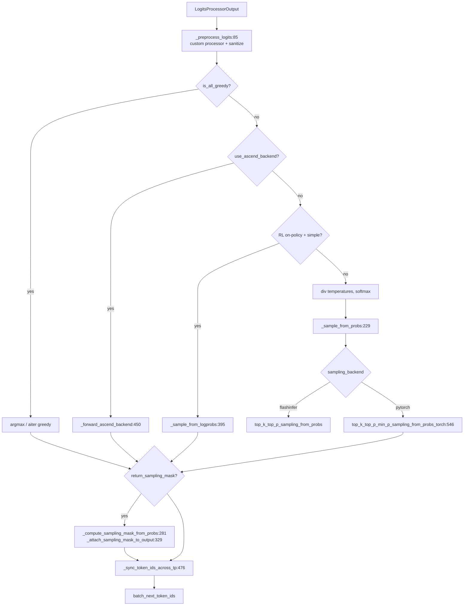

# 11.4 Sampler 层

## 定位

`Sampler` 是采样控制链的执行终端，把 `LogitsProcessorOutput` 转成 `batch_next_token_ids`。它是 `nn.Module`，由 [04 ModelRunner](../04-model-execution/04.1-model-runner.md) 持有并在每步 decode 调用。它与 [06.10 Sampler 层](../06-layers/06.10-sampler-layer.md) 是同一份源码的两侧描述：06 子系统把它当作 Layers 的最后一个 `nn.Module`，本页从"采样控制"视角补全它在 11 子系统数据流中的角色与分支。

## 职责

- `forward`：根据 `SamplingBatchInfo.is_all_greedy` / `need_top_*_sampling` 分派 greedy / 经典采样 / RL mask / ascend backend 四条路径，并在最后 `_sync_token_ids_across_tp`。
- `_preprocess_logits`：先跑 `apply_custom_logit_processor`，再 `sanitize_nan_logits`。
- `_sample_from_probs`：按 `sampling_backend`(`flashinfer`/`pytorch`) 选 top-k/top-p/min-p 实现；simple 走 `sampling_from_probs_torch`。
- `_compute_sampling_mask_from_probs`：RL on-policy 路径，返回排序 token、排序 prob、keep mask，供训练回放采样支撑集。
- `_sync_token_ids_across_tp`：attn_tp>1 或使用 grammar 时用 `all_reduce(MIN)` 强制各 rank 一致。
- backend 工厂：`register_sampler_backend`/`create_sampler` 让 ascend/aiter/torch 注册。
- 确定性采样：`multinomial_with_seed` 用 murmur hash + gumbel 噪声实现可复现 multinomial。

## 关键类与函数

| 名称 | 定义位置 | 说明 |
|---|---|---|
| `Sampler(nn.Module)` | `layers/sampler.py:69` | 采样器本体 |
| `Sampler.forward` | `layers/sampler.py:94` | 总入口，分派各路径 |
| `Sampler._preprocess_logits` | `layers/sampler.py:85` | custom processor + NaN 清理 |
| `Sampler._sample_from_probs` | `layers/sampler.py:229` | flashinfer/pytorch 概率采样 |
| `Sampler._compute_sampling_mask_from_probs` | `layers/sampler.py:281` | RL mask 采样支撑集 |
| `Sampler._attach_sampling_mask_to_output` | `layers/sampler.py:329` | 把 mask/logprob 回写到 `LogitsProcessorOutput` |
| `Sampler._sample_from_logprobs` | `layers/sampler.py:395` | Gumbel 确定性采样入口 |
| `Sampler._forward_ascend_backend` | `layers/sampler.py:450` | ascend NPU 路径 |
| `Sampler._sync_token_ids_across_tp` | `layers/sampler.py:476` | `all_reduce(MIN)` 同步 |
| `Sampler.compute_logprobs_only` | `layers/sampler.py:493` | 不采样、只算 logprob |
| `register_sampler_backend` | `layers/sampler.py:510` | backend 注册装饰器 |
| `create_sampler` | `layers/sampler.py:524` | 按 `sampling_backend` 构造 |
| `top_k_top_p_min_p_sampling_from_probs_torch` | `layers/sampler.py:546` | torch 顶层采样 helper |
| `multinomial_with_seed` | `layers/sampler.py:666` | `@torch.compile`，murmur+gumbel 确定性采样 |
| `apply_custom_logit_processor` | `layers/sampler.py:742` | 按 batch mask 调 [11.3](11.3-custom-logit-processor.md) |

## 子模块树

- `layers/sampler.py` — 采样器主体 + helper + backend 注册
- 依赖内核: `sglang.kernels.ops.sampling.murmur_hash`、`sglang.kernels.ops.grammar.bitmask_ops`（见 [15 内核](../15-kernels-hardware/15.2-sgl-kernel-aot.md)）

## 数据流 / 控制流

`forward:94` 先预处理 logits，随后按 `is_all_greedy` 走 argmax（含 aiter fast path），否则依 `use_ascend_backend`/`use_log_softmax_logprob`/标准 softmax 三选一。标准路径就地 `div_` temperature 后 `softmax`，再由 `_sample_from_probs` 根据 `simple_sampling_case` 与 `sampling_backend` 调用 flashinfer 联合过滤或 torch 排序实现。RL on-policy 路径用 log_softmax 算 logprob 再 `multinomial_with_seed` 以匹配训练侧。`return_sampling_mask` 为真时额外调 `_compute_sampling_mask_from_probs` 重建支撑集并 `effective_keep_mask | sampled_matches_all` 保证回放包含实际采样 token。`_sync_token_ids_across_tp` 默认关闭以省一次 all-reduce，但 grammar 场景或 `SYNC_TOKEN_IDS_ACROSS_TP` 开启时强制同步，避免 TP rank 因采样核非确定性发散。

## 交叉引用

- 语义对应: [06.10 Sampler 层](../06-layers/06.10-sampler-layer.md) — Layers 视角的同一文件
- 上游: [11.1 SamplingBatchInfo](11.1-sampling-params-sbi.md) — `SamplingBatchInfo` 驱动分派
- 上游: [11.2 penalty 库](11.2-penalty-lib.md) / [11.3 custom processor](11.3-custom-logit-processor.md) — 在 `apply_logits_bias`/`_preprocess_logits` 注入
- 上游: [`04.1 ModelRunner`](../04-model-execution/04.1-model-runner.md) — `ModelRunner.sample` 调用
- 下游: [`03.4.6 结果处理`](../03-orchestration/03.4.6-scheduler-process-result.md) — 采样 ids 回流
- 下游: [`15 bitmask 内核`](../15-kernels-hardware/15.2-sgl-kernel-aot.md) — apply_token_bitmask/murmur_hash

## 进一步阅读

- 源码: `python/sglang/srt/layers/sampler.py`
- 类: `python/sglang/srt/layers/sampler.py:69`
