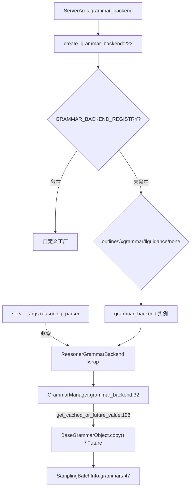

# 11.5.1 受限解码基类与注册表

## 定位

`base_grammar_backend.py` 定义受限解码（constrained decoding）的抽象契约：`BaseGrammarObject` 是每个请求持有的"语法状态机"接口，`BaseGrammarBackend` 是编译与缓存工厂，`create_grammar_backend` 是按 `ServerArgs.grammar_backend` 拼装实例的总入口。所有具体后端（xgrammar/outlines/llguidance）与 `ReasonerGrammarBackend` 包装器都实现这套接口，[11.5.6 GrammarManager](11.5.6-constrained-grammar-manager.md) 只依赖基类 API。

## 职责

- `BaseGrammarObject`：定义 `accept_token`/`rollback`/`allocate_vocab_mask`/`fill_vocab_mask`/`apply_vocab_mask`/`try_jump_forward`/`jump_and_retokenize` 等方法，`maybe_init_reasoning` 钩子供 reasoner 包装器初始化状态。
- `BaseGrammarBackend`：持有 `ThreadPoolExecutor` 与 `cache: Dict[(type, string), BaseGrammarObject]`；`get_cached_or_future_value` 命中即 `copy()`，未命中则 `executor.submit(_init_value_dispatch)`，编译在后台线程进行。
- `dispatch_*`：json/regex/ebnf/structural_tag 四类 key_type 的派发钩子，默认 `_not_supported` 返回 `InvalidGrammarObject`。
- `create_grammar_backend`：注册表优先、内置四选一（outlines/xgrammar/llguidance/none），并在 `reasoning_parser` 配置时套一层 `ReasonerGrammarBackend`。

## 关键类与函数

| 名称 | 定义位置 | 说明 |
|---|---|---|
| `BaseGrammarObject` | `constrained/base_grammar_backend.py:42` | 语法对象 ABC |
| `BaseGrammarObject.maybe_init_reasoning` | `constrained/base_grammar_backend.py:49` | reasoner 状态初始化钩子 |
| `InvalidGrammarObject` | `constrained/base_grammar_backend.py:120` | 编译失败的占位对象 |
| `BaseGrammarBackend` | `constrained/base_grammar_backend.py:131` | 编译工厂基类 |
| `BaseGrammarBackend.get_cached_or_future_value` | `constrained/base_grammar_backend.py:198` | 命中 copy/未命中 future |
| `BaseGrammarBackend.set_cache` | `constrained/base_grammar_backend.py:209` | 由 GrammarManager 写回编译结果 |
| `BaseGrammarBackend.is_support_token_filter` | `constrained/base_grammar_backend.py:147` | 是否支持 [11.5.5](11.5.5-constrained-token-filter.md) token filter |
| `GRAMMAR_BACKEND_REGISTRY` | `constrained/base_grammar_backend.py:216` | 自定义后端注册表 |
| `register_grammar_backend` | `constrained/base_grammar_backend.py:219` | 注册函数 |
| `create_grammar_backend` | `constrained/base_grammar_backend.py:223` | 按 ServerArgs 拼装总入口 |

## 子模块树

- `constrained/`
  - `base_grammar_backend.py` — ABC 与工厂、注册表（本页）
  - `xgrammar_backend.py` — 见 [11.5.2](11.5.2-constrained-xgrammar-outlines-llguidance.md)
  - `outlines_backend.py` — 见 [11.5.2](11.5.2-constrained-xgrammar-outlines-llguidance.md)
  - `llguidance_backend.py` — 见 [11.5.2](11.5.2-constrained-xgrammar-outlines-llguidance.md)
  - `reasoner_grammar_backend.py` — 见 [11.5.3](11.5.3-constrained-reasoner.md)
  - `outlines_jump_forward.py` — 见 [11.5.4](11.5.4-constrained-fsm-jump.md)
  - `grammar_manager.py` — 见 [11.5.6](11.5.6-constrained-grammar-manager.md)

## 数据流 / 控制流

`GrammarManager.process_req_with_grammar` 把 `sampling_params.json_schema/regex/ebnf/structural_tag` 翻成 `(key_type, key_string)` tuple，调 `get_cached_or_future_value`：命中缓存则 `value.copy()` 并 `maybe_init_reasoning(require_reasoning)`，未命中则提交后台编译并进 `grammar_queue`。`ReasonerGrammarBackend` 在 `create_grammar_backend` 末尾由 `reasoning_parser` 与 `think_end_id` 触发包装，其 `_init_value_dispatch` 先调底层 backend 编译再 `_make_grammar_object` 套上 THINKING/GENERATION 状态机（见 [11.5.3](11.5.3-constrained-reasoner.md)）。`is_support_token_filter` 是 strict-thinking 的硬性前置：仅 xgrammar 等支持 bitmask 写位的 backend 才能在思考段做 token 过滤。

## 交叉引用

- 下游: [11.5.2 xgrammar/outlines/llguidance](11.5.2-constrained-xgrammar-outlines-llguidance.md) — 具体后端
- 下游: [11.5.3 Reasoner 包装器](11.5.3-constrained-reasoner.md) — 在此之上 wrap
- 下游: [11.5.6 GrammarManager](11.5.6-constrained-grammar-manager.md) — 消费 `get_cached_or_future_value`
- 上游: [`16 config-runtime`](../16-config-runtime/index.md) — `ServerArgs.grammar_backend`/`reasoning_parser`
- 相关: [11.6.1 reasoning parser](11.6.1-parser-reasoning.md) — `ReasoningParser` 喂入 reasoner wrap

## 进一步阅读

- 源码: `python/sglang/srt/constrained/base_grammar_backend.py`
