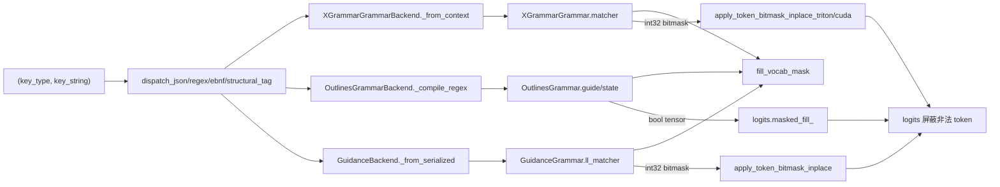

# 11.5.2 xgrammar / outlines / llguidance 后端

## 定位

这是受限解码的三套具体后端实现，都满足 [11.5.1](11.5.1-constrained-base-registry.md) 的 `BaseGrammarObject`/`BaseGrammarBackend` 契约，由 `create_grammar_backend` 按 `ServerArgs.grammar_backend` 选择。三者差异在底层约束引擎、vocab mask 表示与 token filter 支持：xgrammar 用 `GrammarMatcher` + int32 bitmask 且支持 [11.5.5](11.5.5-constrained-token-filter.md)；outlines 用 `RegexGuide` FSM + bool 向量且支持 [11.5.4](11.5.4-constrained-fsm-jump.md) 跳跃；llguidance 用 `LLMatcher` + `llguidance.torch` bitmask。

## 职责

- `XGrammarGrammar`/`XGrammarGrammarBackend`：基于 xgrammar `GrammarMatcher`，`allocate_token_bitmask` 产出 int32 位掩码，`apply_vocab_mask` 调 triton/cuda bitmask kernel，`set_token_filter` 提供 token 级写位。
- `OutlinesGrammar`/`OutlinesGrammarBackend`：基于 outlines `RegexGuide`，`fill_vocab_mask` 用 bool 向量 scatter，`try_jump_forward`/`jump_forward_str_state` 接 compressed FSM。
- `GuidanceGrammar`/`GuidanceBackend`：基于 llguidance `LLMatcher`，`fill_next_token_bitmask` 由 rust 库直接填充，`apply_token_bitmask_inplace` 应用，`try_jump_forward` 用 `compute_ff_tokens`。

## 关键类与函数

| 名称 | 定义位置 | 说明 |
|---|---|---|
| `XGrammarGrammar` | `constrained/xgrammar_backend.py:59` | xgrammar 语法对象，`MAX_ROLLBACK_TOKENS=200` |
| `XGrammarGrammarBackend` | `constrained/xgrammar_backend.py:188` | 工厂，`is_support_token_filter=True` |
| `XGrammarGrammarBackend.apply_vocab_mask` | `constrained/xgrammar_backend.py:237` | triton/cuda bitmask 就地应用 |
| `XGrammarGrammarBackend.set_token_filter` | `constrained/xgrammar_backend.py:248` | 调 triton 或 torch 写位（11.5.5） |
| `OutlinesGrammar` | `constrained/outlines_backend.py:42` | outlines 语法对象 |
| `OutlinesGrammar.fill_vocab_mask` | `constrained/outlines_backend.py:65` | bool 向量 fill/scatter |
| `OutlinesGrammarBackend` | `constrained/outlines_backend.py:114` | 工厂，json→regex→`RegexGuide` |
| `GuidanceGrammar` | `constrained/llguidance_backend.py:48` | llguidance 语法对象 |
| `GuidanceGrammar.fill_vocab_mask` | `constrained/llguidance_backend.py:86` | `fill_next_token_bitmask` |
| `GuidanceBackend` | `constrained/llguidance_backend.py:129` | 工厂，json/regex/ebnf/structural_tag 派发 |

## 子模块树

- `constrained/`
  - `xgrammar_backend.py` — xgrammar backend（支持 token filter）
  - `outlines_backend.py` — outlines backend（支持 FSM jump）
  - `llguidance_backend.py` — llguidance backend
  - `outlines_jump_forward.py` — 仅供 outlines（见 [11.5.4](11.5.4-constrained-fsm-jump.md)）
  - `torch_ops/token_filter_torch_ops.py` — torch fallback（见 [11.5.5](11.5.5-constrained-token-filter.md)）

## 数据流 / 控制流

三套后端在同一抽象下并行：`dispatch_*` 把 key 翻成各自引擎对象（xgrammar `CompiledGrammar`→`GrammarMatcher`；outlines `build_regex_from_schema`→`RegexGuide`；llguidance `grammar_from`/`LLMatcher.grammar_from_json_schema`）。mask 表示决定 apply 路径：xgrammar/llguidance 用 int32 位掩码走 bitmask kernel（见 [15 内核](../15-kernels-hardware/15.2-sgl-kernel-aot.md)），outlines 用 bool 张量走 `masked_fill_`。`XGrammarGrammarBackend.is_support_token_filter=True` 是它能在 [11.5.3](11.5.3-constrained-reasoner.md) strict-thinking 下被选中的前提；`set_token_filter:248` 在 HIP/非 CUDA 设备退回 torch 实现，否则用 triton。outlines 的 `try_jump_forward`/`jump_forward_str_state`/`jump_and_retokenize` 是压缩 FSM 跳跃的入口（详见 [11.5.4](11.5.4-constrained-fsm-jump.md)），llguidance 则用 `compute_ff_tokens` 直接给 fast-forward token 列表。

## 交叉引用

- 上游: [11.5.1 基类与注册表](11.5.1-constrained-base-registry.md) — 契约来源
- 下游: [11.5.3 Reasoner 包装器](11.5.3-constrained-reasoner.md) — 套在 `grammar_backend` 之外
- 下游: [11.5.4 压缩 FSM 跳跃](11.5.4-constrained-fsm-jump.md) — outlines 专属
- 下游: [11.5.5 token filter 内核](11.5.5-constrained-token-filter.md) — xgrammar 专属
- 相关: [`15 bitmask 内核`](../15-kernels-hardware/15.2-sgl-kernel-aot.md) — apply/set bitmask kernel

## 进一步阅读

- 源码: `python/sglang/srt/constrained/xgrammar_backend.py`、`outlines_backend.py`、`llguidance_backend.py`
