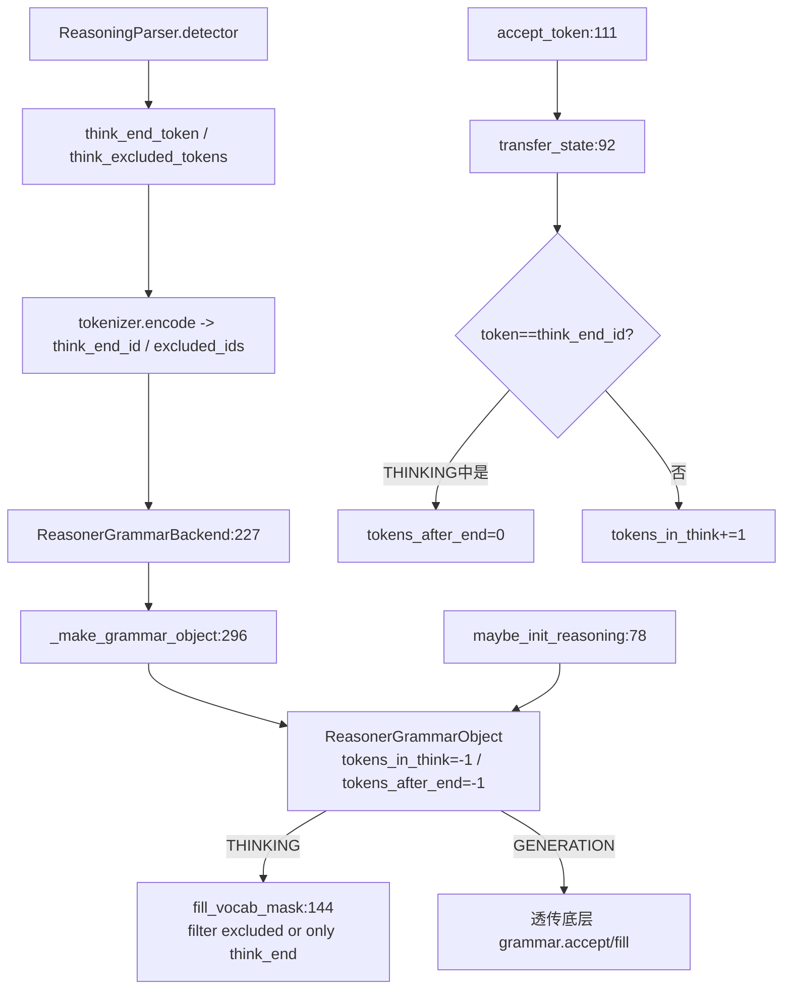

# 11.5.3 Reasoner 语法包装器

## 定位

`ReasonerGrammarBackend` 套在 [11.5.1](11.5.1-constrained-base-registry.md) 的任意 `grammar_backend` 之外，为"思考型模型"提供 THINKING/GENERATION 两阶段状态机。它在 `create_grammar_backend:299` 由 `server_args.reasoning_parser` 与 `think_end_id` 触发包装，与 [11.6.1 reasoning parser](11.6.1-parser-reasoning.md) 协同：parser 提供思考区起止 token 与排除集，reasoner grammar 在思考段做 token 过滤、在生成段才把控制权交给底层 grammar。

## 职责

- `ReasonerGrammarObject`：维护 `tokens_in_think`/`tokens_after_end` 双计数器，在 THINKING 段不向底层 grammar 查询，可选过滤；在 GENERATION 段 `accept_token`/`fill_vocab_mask` 透传给底层 grammar。
- `maybe_init_reasoning`：按 `require_reasoning` 把状态置成 THINKING(`tokens_in_think=0`) 或直接 GENERATION(`tokens_after_end=0`)。
- `fill_vocab_mask`：strict 模式下思考段用 `token_filter_fn` 排除 `think_excluded_token_ids`，预算耗尽时只允许 `think_end_id`；非 strict 思考段为 no-op。
- `ReasonerGrammarBackend`：从 `ReasoningParser.detector` 提取 `think_end_token`/`think_excluded_tokens`，编码成 token id，装配 `_make_grammar_object`。

## 关键类与函数

| 名称 | 定义位置 | 说明 |
|---|---|---|
| `ReasonerGrammarObject` | `constrained/reasoner_grammar_backend.py:34` | 状态机语法对象 |
| `ReasonerGrammarObject.maybe_init_reasoning` | `constrained/reasoner_grammar_backend.py:78` | 初始化 THINKING/GENERATION |
| `ReasonerGrammarObject.transfer_state` | `constrained/reasoner_grammar_backend.py:92` | 根据 token 推进状态 |
| `ReasonerGrammarObject._can_think_more` | `constrained/reasoner_grammar_backend.py:137` | `max_think_tokens` 预算检查 |
| `ReasonerGrammarObject.fill_vocab_mask` | `constrained/reasoner_grammar_backend.py:144` | 思考段过滤 / 生成段透传 |
| `ReasonerGrammarObject.accept_token` | `constrained/reasoner_grammar_backend.py:111` | 仅生成段透传底层 grammar |
| `ReasonerGrammarBackend` | `constrained/reasoner_grammar_backend.py:227` | 包装器工厂 |
| `ReasonerGrammarBackend._get_think_excluded_token_ids` | `constrained/reasoner_grammar_backend.py:275` | 编码排除 token 列表 |
| `ReasonerGrammarBackend._make_grammar_object` | `constrained/reasoner_grammar_backend.py:296` | 组装状态机对象 |
| `ReasonerGrammarBackend.init_strict_reasoning_grammar` | `constrained/reasoner_grammar_backend.py:313` | 无底层 grammar 的纯过滤对象 |

## 子模块树

- `constrained/reasoner_grammar_backend.py` — 包装器对象与 backend
- 依赖 `parser.reasoning_parser.ReasoningParser`（[11.6.1](11.6.1-parser-reasoning.md)）取得 detector

## 数据流 / 控制流

`enable_token_filter` 仅在 strict-thinking 且底层 backend `is_support_token_filter` 为真时开启（见 [11.5.2](11.5.2-constrained-xgrammar-outlines-llguidance.md) 的 xgrammar）。`fill_vocab_mask:144` 的三条分支：THINKING+非 strict 直接 return；THINKING+`_can_think_more` 用 `is_allowed=False` 排除思考段不该出现的 token；THINKING+预算耗尽用 `is_allowed=True` 仅放开 `think_end_id` 强制退出思考。`accept_token` 在生成段才 `grammar.accept_token`，思考段只更新自身状态；`rollback` 按生成段实际步数回滚底层 grammar，并按总步数回滚自身状态。`init_strict_reasoning_grammar` 用于"无 schema 但要 strict 过滤"场景，构造 `grammar=None` 的纯过滤对象，仅靠 `token_filter_fn` 工作。

## 交叉引用

- 上游: [11.5.1 基类与注册表](11.5.1-constrained-base-registry.md) — `create_grammar_backend` 触发包装
- 上游: [11.6.1 reasoning parser](11.6.1-parser-reasoning.md) — 提供 `detector` token 信息
- 下游: [11.5.5 token filter 内核](11.5.5-constrained-token-filter.md) — `token_filter_fn` 实现
- 下游: [11.5.6 GrammarManager](11.5.6-constrained-grammar-manager.md) — `_apply_request_reasoning_budget` 设 `max_think_tokens`
- 相关: [11.3 custom processor](11.3-custom-logit-processor.md) — `ThinkingBudgetLogitProcessor` 是另一条预算路径

## 进一步阅读

- 源码: `python/sglang/srt/constrained/reasoner_grammar_backend.py`
