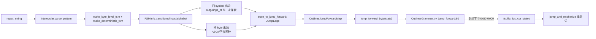

# 11.5.4 压缩 FSM 跳跃

## 定位

`outlines_jump_forward.py` 实现 outlines 后端的"压缩有限状态机跳跃"优化，参考文献的 compressed FSM 思路。当 FSM 某状态只有单一确定性出边时，可一次性输出一段确定字符串/字节，免去做 vocab mask + 采样 + accept 的逐 token 往返。它仅在 [11.5.2 outlines](11.5.2-constrained-xgrammar-outlines-llguidance.md) 后端可用，xgrammar/llguidance 用各自的 fast-forward 机制。

## 职责

- `init_state_to_jump_forward`：用 interegular 解析正则，经 `make_byte_level_fsm`/`make_deterministic_fsm` 得到 `FSMInfo`，扫描转移表找出"单一出边"状态，构造 `state → JumpEdge` 映射（含 symbol 与 byte 两条）。
- `OutlinesJumpForwardMap`：基于该映射提供 `jump_forward_symbol`（拼字符串）与 `jump_forward_byte`（拼字节序列）查询。
- `OutlinesGrammar.try_jump_forward`/`jump_forward_str_state`/`jump_and_retokenize`：消费跳跃结果，处理 UTF-8 续字节的剥离与重分词。

## 关键类与函数

| 名称 | 定义位置 | 说明 |
|---|---|---|
| `JumpEdge` | `constrained/outlines_jump_forward.py:47` | dataclass，含 symbol/byte 双出边 |
| `init_state_to_jump_forward` | `constrained/outlines_jump_forward.py:62` | `@disk_cache`，构造状态→边映射 |
| `OutlinesJumpForwardMap` | `constrained/outlines_jump_forward.py:142` | 查询接口 |
| `OutlinesJumpForwardMap.jump_forward_symbol` | `constrained/outlines_jump_forward.py:146` | 沿 symbol 边拼字符串 |
| `OutlinesJumpForwardMap.jump_forward_byte` | `constrained/outlines_jump_forward.py:159` | 沿 byte 边拼字节序列 |
| `OutlinesJumpForwardMap.is_jump_forward_symbol_state` | `constrained/outlines_jump_forward.py:174` | 判定是否可 symbol 跳跃 |
| `OutlinesGrammar.try_jump_forward` | `constrained/outlines_backend.py:80` | 剥离续字节、转 token id |
| `OutlinesGrammar.jump_forward_str_state` | `constrained/outlines_backend.py:104` | 取 symbol 串与下一状态 |
| `OutlinesGrammar.jump_and_retokenize` | `constrained/outlines_backend.py:108` | 重设 `self.state` |

## 子模块树

- `constrained/outlines_jump_forward.py` — FSM 解析与跳跃映射
- 仅被 `constrained/outlines_backend.py` 引用

## 数据流 / 控制流

`init_state_to_jump_forward` 用 `outgoings_ct` 计数剔除多出边状态：只有出边数恰为 1（终态默认 +1）的状态才进入映射，保证跳跃确定性。symbol 边处理单字符（`len(c)==1`），byte 边同时处理 ASCII（`ord(c)<0x80`）与多字节表示（`int(symbols[0][1:], 16)`），两条边共存于同一 `JumpEdge`。`try_jump_forward:80` 把首字节在 `0x80-0xC0` 续字节区间的边剥成 `suffix_bytes`，转成 `<0xHH>` token id 返给调度器做一次性多 token 输出；`jump_forward_str_state` 取 symbol 串与下一状态供 `jump_and_retokenize`。`@disk_cache` 默认禁用（`SGLANG_DISABLE_OUTLINES_DISK_CACHE` 默认 true），跳跃映射在进程内每次构造。

## 交叉引用

- 上游: [11.5.2 outlines backend](11.5.2-constrained-xgrammar-outlines-llguidance.md) — 唯一消费者
- 相关: [11.5.1 基类](11.5.1-constrained-base-registry.md) — `try_jump_forward` 是 `BaseGrammarObject` 抽象方法
- 相关: [`03.4.5 run_batch`](../03-orchestration/03.4.5-scheduler-run-batch-forward.md) — 跳跃结果用作多 token draft

## 进一步阅读

- 源码: `python/sglang/srt/constrained/outlines_jump_forward.py`
- 参考: compressed FSM blog（lmsys 2024-02-05）
