# 11.5.5 受限解码 token filter 内核

## 定位

token filter 是 [11.5.3 Reasoner 包装器](11.5.3-constrained-reasoner.md) strict-thinking 模式的底层实现：在思考段按 token id 增删 int32 bitmask 的位，让 [11.4 Sampler](11.4-sampler-layer.md) 的 `apply_vocab_mask` 只允许/禁止指定 token。它有两条实现：triton kernel（CUDA）与 torch fallback（HIP/非 CUDA），由 `XGrammarGrammarBackend.set_token_filter` 按设备分派。

## 职责

- `set_token_filter_torch`：纯 torch 实现，按 `token_id//32`/`%32` 把 token id 翻成 (元素索引, 位掩码)，用 `bitwise_or`/`bitwise_and` 写位。
- `set_token_filter_triton`：triton kernel，CUDA 上的高效写位，位于 `sglang.kernels.ops.grammar.token_filter_ops`。
- `XGrammarGrammarBackend.set_token_filter`：设备分派器，决定 torch vs triton。

## 关键类与函数

| 名称 | 定义位置 | 说明 |
|---|---|---|
| `set_token_filter_torch` | `constrained/torch_ops/token_filter_torch_ops.py:27` | torch fallback 写位 |
| `XGrammarGrammarBackend.set_token_filter` | `constrained/xgrammar_backend.py:248` | 设备分派入口 |
| `set_token_filter_triton` | `sglang/kernels/ops/grammar/token_filter_ops.py` | triton kernel（见 15 内核） |

## 子模块树

- `constrained/torch_ops/`
  - `token_filter_torch_ops.py` — torch fallback
- `sglang/kernels/ops/grammar/token_filter_ops.py` — triton kernel（[15 内核](../15-kernels-hardware/15.2-sgl-kernel-aot.md)）

## 数据流 / 控制流

```mermaid
flowchart LR
    RG["ReasonerGrammarObject.fill_vocab_mask:144"] -->|"THINKING 预算未满"| EXC["think_excluded_token_ids"]
    RG -->|"预算耗尽"| KEEP["_think_end_id_list"]
    EXC & KEEP --> TFN["token_filter_fn = backend.set_token_filter"]
    TFN --> STF["XGrammarGrammarBackend.set_token_filter:248"]
    STF -->DEV{"device.type"}
    DEV -->|"HIP 或 non-cuda"| TOR["set_token_filter_torch:27"]
    DEV -->|"CUDA"| TRI["set_token_filter_triton"]
    TOR --> OPS["bitwise_or/and 写 int32 位"]
    TRI --> OPS
    OPS --> VM["vocab_mask row 更新"]
    VM --> AVM["apply_vocab_mask:237 屏蔽 logits"]
```

`set_token_filter_torch` 的 `is_allowed` 参数决定方向：`is_allowed=True` 用 `bitwise_or` 把目标 token 位置 1（其余先 `fill_(0)` 清零，等价"仅允许"），`is_allowed=False` 用 `bitwise_and` 把目标位清 0（等价"禁止"）。`reset_vocab_mask=True` 时先整行 `fill_(-1)`(禁止方向) 或 `fill_(0)`(允许方向) 重置。token 列表通常很小（思考段排除集 < 10），用 Python 聚合重复索引后再一次张量写位，避免逐 token 操作的 kernel launch 开销。`ctypes.c_int32` 把 `~mask` 转回有符号 int32 以匹配 bitmask 的存储约定。`XGrammarGrammarBackend` 的 `is_support_token_filter=True` 是 reasoner grammar 选择 xgrammar 作底层的硬条件（见 [11.5.1](11.5.1-constrained-base-registry.md)）。

## 交叉引用

- 上游: [11.5.2 xgrammar backend](11.5.2-constrained-xgrammar-outlines-llguidance.md) — `set_token_filter:248` 分派
- 上游: [11.5.3 Reasoner 包装器](11.5.3-constrained-reasoner.md) — `token_filter_fn` 来源
- 下游: [`15 bitmask 内核`](../15-kernels-hardware/15.2-sgl-kernel-aot.md) — triton kernel 与 `apply_token_bitmask_inplace`
- 相关: [11.4 Sampler 层](11.4-sampler-layer.md) — `apply_vocab_mask` 消费最终 mask

## 进一步阅读

- 源码: `python/sglang/srt/constrained/torch_ops/token_filter_torch_ops.py`、`python/sglang/srt/constrained/xgrammar_backend.py:248`
