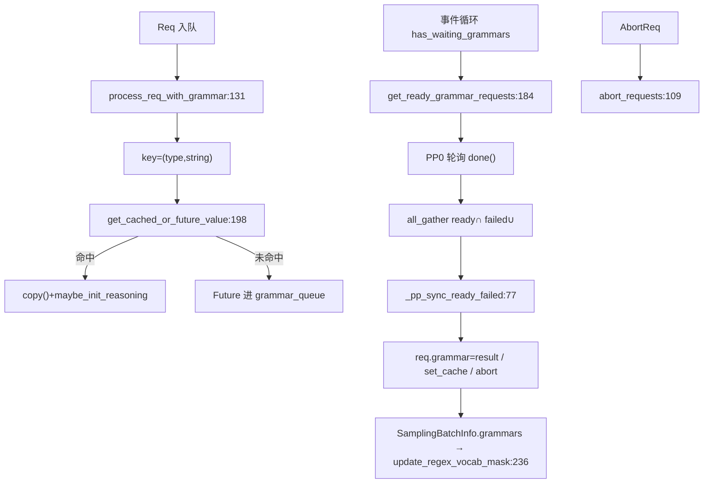

# 11.5.6 GrammarManager

## 定位

`GrammarManager` 是受限解码在调度循环中的"调度器侧协作者"，挂在 `Scheduler` 上（见 [03.4.1 Scheduler 结构](../03-orchestration/03.4.1-scheduler-structure.md)）。它负责把请求侧的 grammar key 提交后台编译、轮询就绪、跨 DP/TP/PP 同步就绪集合，并把结果写回 `req.grammar`，最终由 `SamplingBatchInfo.update_regex_vocab_mask` 消费。它还管 thinking budget 的注入与请求 abort。

## 职责

- `process_req_with_grammar`：把 `sampling_params.json_schema/regex/ebnf/structural_tag` 翻成 key，调 `grammar_backend.get_cached_or_future_value`；未命中则进 `grammar_queue`；strict-thinking 无 schema 时调 `init_strict_reasoning_grammar`。
- `get_ready_grammar_requests`：轮询 `grammar_queue` 中 `Future.done()`，超时（`SGLANG_GRAMMAR_MAX_POLL_ITERATIONS`）判失败；PP0 在 DP/TP 组 all_gather 求 ready 交集与 failed 并集，再沿 PP 流水线异步下发；其余 PP rank 接收 PP0 决策。
- `_apply_request_reasoning_budget`：把 `custom_params.thinking_budget` 写入 `ReasonerGrammarObject.max_think_tokens`。
- `abort_requests`/`clear`：取消未完成 Future、释放 backend cache。

## 关键类与函数

| 名称 | 定义位置 | 说明 |
|---|---|---|
| `GrammarManager` | `constrained/grammar_manager.py:26` | 调度侧 grammar 协作者 |
| `GrammarManager.__init__` | `constrained/grammar_manager.py:27` | 调 `create_grammar_backend`、绑定同步组 |
| `GrammarManager.process_req_with_grammar` | `constrained/grammar_manager.py:131` | 入队/缓存命中/strict 分支 |
| `GrammarManager.get_ready_grammar_requests` | `constrained/grammar_manager.py:184` | 轮询+DP/TP/PP 同步 |
| `GrammarManager._pp_sync_ready_failed` | `constrained/grammar_manager.py:77` | PP 流水线 ready/failed 传播 |
| `GrammarManager._apply_request_reasoning_budget` | `constrained/grammar_manager.py:124` | 写 `max_think_tokens` |
| `GrammarManager.abort_requests` | `constrained/grammar_manager.py:109` | 取消 Future 并 abort |
| `GrammarManager.has_waiting_grammars` | `constrained/grammar_manager.py:69` | 调度循环就绪判据 |

## 子模块树

- `constrained/grammar_manager.py` — 调度侧管理器
- 依赖 `base_grammar_backend.create_grammar_backend`（[11.5.1](11.5.1-constrained-base-registry.md)）与 `ReasonerGrammarObject`（[11.5.3](11.5.3-constrained-reasoner.md)）

## 数据流 / 控制流

`process_req_with_grammar` 的三条分支：有 schema 类 key 走 `get_cached_or_future_value`（命中直接 copy 并 `_apply_request_reasoning_budget`，未命中进队列）；无 schema 但 `_enable_strict_thinking` 走 `init_strict_reasoning_grammar`；都没有则不入队。`get_ready_grammar_requests` 在 PP0 用 `SGLANG_GRAMMAR_POLL_INTERVAL` 的 while 循环轮询，超时请求进 `failed_req_idxs` 并被缓存为 `InvalidGrammarObject`。跨 rank 同步语义：DP/TP 组内 all_gather 后取 ready 交集（所有 rank 都就绪才算就绪）与 failed 并集（任一 rank 失败即失败），保证同一批在各 rank 行为一致；PP 方向用 `recv_object`/`send_object(async_send=True)` 链式下发，`_drain_pp_sync_work` 等待上一轮异步发送完成。就绪请求 `req.grammar = req.grammar.result()` 并 `set_cache` 供后续命中复用。

## 交叉引用

- 上游: [`03.4.1 Scheduler 结构`](../03-orchestration/03.4.1-scheduler-structure.md) — `Scheduler.grammar_manager`
- 上游: [`03.4.3 事件循环`](../03-orchestration/03.4.3-scheduler-event-loop.md) — `has_waiting_grammars` 判据
- 上游: [11.5.1 基类与注册表](11.5.1-constrained-base-registry.md) — `create_grammar_backend`/`get_cached_or_future_value`
- 上游: [11.5.3 Reasoner 包装器](11.5.3-constrained-reasoner.md) — `_apply_request_reasoning_budget`
- 下游: [11.1 SamplingBatchInfo](11.1-sampling-params-sbi.md) — `update_regex_vocab_mask:236`
- 相关: [`08 分布式`](../08-distributed/index.md) — DP/TP/PP 同步语义

## 进一步阅读

- 源码: `python/sglang/srt/constrained/grammar_manager.py`
