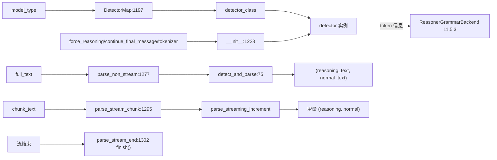

# 11.6.1 reasoning parser

## 定位

`ReasoningParser` 把模型输出切分成"思考区(reasoning)"与"正文(normal)"两段，供 `/chat/completions` 流式与非流式响应分别填充 `reasoning_content` 与 `content`。它同时是 [11.5.3 Reasoner grammar](11.5.3-constrained-reasoner.md) 的 token 信息来源——`create_grammar_backend` 用它的 `detector.think_end_token`/`think_excluded_tokens` 构造 strict 过滤。

## 职责

- `BaseReasoningFormatDetector`：定义一次性 `detect_and_parse` 与流式 `parse_streaming_increment` 两套接口，维护 `_in_reasoning`/`_buffer` 状态，处理 `continue_final_message` 续写与 `force_nonempty_content`。
- `ReasoningParser`：按 `model_type` 从 `DetectorMap` 选具体 detector，处理 `force_reasoning`/`continue_final_message`/`tokenizer` 等参数透传。
- `parse_non_stream`/`parse_stream_chunk`/`parse_stream_end`：对外三入口，分别对应一次性、增量、收尾 flush。

## 关键类与函数

| 名称 | 定义位置 | 说明 |
|---|---|---|
| `StreamingParseResult` | `parser/reasoning_parser.py:9` | `normal_text`/`reasoning_text` 容器 |
| `BaseReasoningFormatDetector` | `parser/reasoning_parser.py:21` | detector ABC |
| `BaseReasoningFormatDetector.detect_and_parse` | `parser/reasoning_parser.py:75` | 一次性解析入口 |
| `ReasoningParser` | `parser/reasoning_parser.py:1186` | 顶层解析器 |
| `ReasoningParser.DetectorMap` | `parser/reasoning_parser.py:1197` | model_type → detector 类映射（21 项） |
| `ReasoningParser.__init__` | `parser/reasoning_parser.py:1223` | 参数透传与 force_reasoning 特例 |
| `ReasoningParser.parse_non_stream` | `parser/reasoning_parser.py:1277` | 一次性返回 (reasoning, normal) |
| `ReasoningParser.parse_non_stream_blocks` | `parser/reasoning_parser.py:1282` | 块序列形式 |
| `ReasoningParser.parse_stream_chunk` | `parser/reasoning_parser.py:1295` | 增量解析 |
| `ReasoningParser.parse_stream_end` | `parser/reasoning_parser.py:1302` | flush 残余 buffer |

## 子模块树

- `parser/reasoning_parser.py` — ABC、`DetectorMap` 与顶层入口（本页）
- 内含约 21 个 detector 类定义（`DeepSeekR1Detector`/`Glm45Detector`/`Qwen3Detector`/`KimiK2Detector`/`GptOssDetector`/`MistralDetector`/`MiniMaxM3Detector`/`HunyuanDetector`/`Nemotron3Detector`/`Gemma4Detector`/`CohereCommand4Detector` 等，同文件内）
- 依赖 `parser/harmony_parser.HarmonyParser`（[11.6.3](11.6.3-parser-harmony.md)）与 `function_call.hunyuan_detector.resolve_hunyuan_tokens`

## 数据流 / 控制流

`DetectorMap` 用 model_type 字符串映射到 detector 类，部分 model_type 共用同一类（如 `step3`/`step3p5`→`DeepSeekR1Detector`，`minimax`→`Qwen3Detector`）。`__init__` 对 `qwen3-thinking`/`gpt-oss`/`minimax` 强制 `force_reasoning=True`，对 `minimax-m3` 按 `thinking_mode` 决定。`continue_final_message` 场景把上一条 assistant 消息作为 `previous_content` 注入 detector，使其正确恢复 `_in_reasoning` 状态。流式路径依赖 detector 的 `_buffer` 与 `_saw_text_end` 等内部状态跟踪跨 chunk 的 think 标签拆分，`parse_stream_end` 调 `finish()` flush 残留。`detect_and_parse_block_sequence`（部分 detector 实现）支持返回有序块序列供前端按 `type` 分段渲染。

## 交叉引用

- 下游: [11.5.3 Reasoner 包装器](11.5.3-constrained-reasoner.md) — 消费 `detector.think_end_token`/`think_excluded_tokens`
- 下游: [`02.3.2 openai chat`](../02-server-api/02.3.2-openai-base-chat-completions.md) — 响应装配 `reasoning_content`
- 相关: [11.6.5 模板检测](11.6.5-parser-template-manager-detection.md) — `REASONING_PARSER_RULES` 自动推断 parser
- 相关: [11.6.3 Harmony parser](11.6.3-parser-harmony.md) — gpt-oss 通道解析复用于此

## 进一步阅读

- 源码: `python/sglang/srt/parser/reasoning_parser.py`
