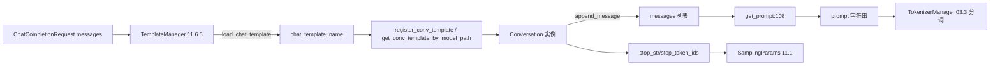

# 11.6.2 conversation 模板

## 定位

`conversation.py` 定义 SGLang 的对话模板体系，把多轮 `messages` 渲染成模型可吃的 prompt 字符串。它是 `/chat/completions`（[02.3.2](../02-server-api/02.3.2-openai-base-chat-completions.md)）请求处理的第一步，决定 system/user/assistant 角色分隔符、stop 串、image/audio/video 占位 token。模板可来自预置注册表、HuggingFace `chat_template` 或用户 jinja/json 文件，统一由 [11.6.5 TemplateManager](11.6.5-parser-template-manager-detection.md) 装配。

## 职责

- `SeparatorStyle`：枚举各模型分隔符风格（ADD_COLON/CHATML/LLAMA3/CHATGLM/DEEPSEEK_CHAT/GEMMA3 等）。
- `Conversation` dataclass：持有 `system_template`/`roles`/`messages`/`sep`/`sep2`/`stop_str`/`image_token` 等字段，`get_prompt` 按 `sep_style` 渲染。
- 注册表 helpers：`register_conv_template`/`get_conv_template_by_model_path`/`chat_template_exists`，支持 model_path 模糊匹配预置模板。

## 关键类与函数

| 名称 | 定义位置 | 说明 |
|---|---|---|
| `SeparatorStyle` | `parser/conversation.py:41` | 分隔风格 `IntEnum`（28 项） |
| `Conversation` | `parser/conversation.py:74` | 模板 dataclass |
| `Conversation.get_prompt` | `parser/conversation.py:108` | 按 `sep_style` 渲染 prompt |
| `register_conv_template` | `parser/conversation.py`（同文件） | 注册预置模板 |
| `get_conv_template_by_model_path` | `parser/conversation.py`（同文件） | 按 model_path 推断模板名 |

## 子模块树

- `parser/conversation.py` — 模板定义、注册表与预置模板（本页）
- 由 `parser/template_manager.py`（[11.6.5](11.6.5-parser-template-manager-detection.md)）统一调用

## 数据流 / 控制流

`Conversation` 的 `get_prompt` 按 `sep_style` 选择拼接逻辑：`ADD_COLON_SINGLE` 在每条消息后接 `sep`，`ADD_COLON_TWO` 在末轮用 `sep2`，`CHATML` 用 `<|im_start|>role\n...<|im_end|>\n`，`LLAMA3`/`LLAMA4` 用各自特殊 token。`stop_str` 与 `stop_token_ids` 直接流入 `SamplingParams`（[11.1](11.1-sampling-params-sbi.md)）的 `normalize`/`verify`，由 `stop_str_max_len` 决定 detokenizer 端的回溯匹配窗口。`image_token`/`audio_token`/`video_token` 占位在多模态请求时由 03.3 分词阶段替换为实际占位 id。文件末尾注册了大量预置模板（`chatml`/`llama-3`/`qwen-2.5`/`deepseek`/`glm-4` 等），`get_conv_template_by_model_path` 用路径关键字模糊命中。

## 交叉引用

- 上游: [`02.3.2 openai chat`](../02-server-api/02.3.2-openai-base-chat-completions.md) — 请求来源
- 上游: [11.6.5 TemplateManager](11.6.5-parser-template-manager-detection.md) — 装配入口
- 下游: [`03.3.3 分词与多模态`](../03-orchestration/03.3.3-tm-tokenize-mm.md) — prompt→token
- 下游: [11.1 SamplingParams](11.1-sampling-params-sbi.md) — `stop_str` 流入
- 相关: [`12 多模态`](../12-multimodal/index.md) — image/audio/video token 占位

## 进一步阅读

- 源码: `python/sglang/srt/parser/conversation.py`
- 参考: FastChat conversation.py（文件头注明 adapted from）
