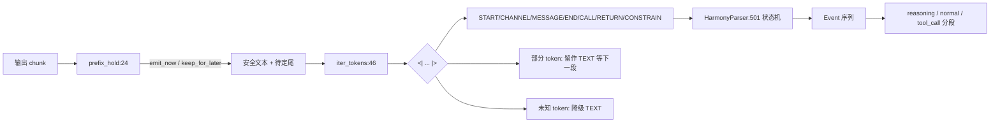

# 11.6.3 Harmony parser

## 定位

`harmony_parser.py` 解析 gpt-oss 系列的 Harmony 协议输出。Harmony 用 `<|start|>`/`<|channel|>`/`<|message|>`/`<|constrain|>`/`<|end|>`/`<|call|>`/`<|return|>` 等结构 token 划分通道与消息边界，使思考、正文、工具调用能在同一条 token 流中交错。它既被 [11.6.1 reasoning parser](11.6.1-parser-reasoning.md) 的 `GptOssDetector` 复用，也可独立驱动流式响应分段。

## 职责

- `Event`/`Token` dataclass：分别表示解析事件与结构 token 的 span。
- `prefix_hold`：在流式场景保留可能是结构 token 前缀的尾部字符串，避免把半截 `<|sta` 当作正文发出。
- `iter_tokens`：从左到右扫描文本，yield 结构 `Token`（START/CHANNEL/MESSAGE/END/CALL/...）与夹缝中的 TEXT，并处理未知 token 与部分 token。
- `HarmonyParser`：在 token 流上跑状态机，产出 `Event` 序列供上层切分 reasoning/normal/tool_call。

## 关键类与函数

| 名称 | 定义位置 | 说明 |
|---|---|---|
| `Event` | `parser/harmony_parser.py:6` | 解析事件（event_type/content/raw_text） |
| `Token` | `parser/harmony_parser.py:15` | 结构 token span（type/start/end） |
| `prefix_hold` | `parser/harmony_parser.py:24` | 保留最长可作 token 前缀的尾部 |
| `iter_tokens` | `parser/harmony_parser.py:46` | 扫描器，yield TEXT + 结构 token |
| `HarmonyParser` | `parser/harmony_parser.py:501` | 状态机解析器 |

## 子模块树

- `parser/harmony_parser.py` — Harmony 协议解析（本页）
- 被 `parser/reasoning_parser.py` 的 `GptOssDetector` 导入（[11.6.1](11.6.1-parser-reasoning.md)）

## 数据流 / 控制流

`prefix_hold` 对每个结构 token 检查文本末尾是否为该 token 的真前缀，取最长匹配 hold back，确保跨 chunk 的结构 token 不被误当作正文流出。`iter_tokens` 用 `text.find("<|", pos)` 定位候选 token，逐一比对 7 个已知字面量；命中则 yield 对应类型，未命中且尾部是某个 token 的真前缀则整段作 TEXT（等下一 chunk 补全），否则把 `<|` 视作 TEXT 并向后找 `|>` 跳过未知体。`HarmonyParser` 在此 token 流上维护 channel 状态（如 `analysis`/`final`/`tool`），把 START→CHANNEL 切换后的内容归入对应段，END 触发分段边界。这与 [11.7.1 function call](11.7.1-function-call-parser.md) 的 gpt-oss detector 协同：Harmony 的 `<|call|>`/`<|return|>` 通道被映射成工具调用结构。

## 交叉引用

- 下游: [11.6.1 reasoning parser](11.6.1-parser-reasoning.md) — `GptOssDetector` 复用
- 相关: [11.7.2 function-call detectors](11.7.2-function-call-detectors.md) — `GptOssDetector` 工具调用侧
- 相关: [11.6.5 模板检测](11.6.5-parser-template-manager-detection.md) — `gpt_oss_channel_markers` 规则检测 `<|channel|>`

## 进一步阅读

- 源码: `python/sglang/srt/parser/harmony_parser.py`
