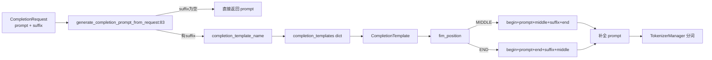

# 11.6.4 completion / FIM 模板

## 定位

`code_completion_parser.py` 处理 `/completions` 端点的 FIM（fill-in-the-middle）代码补全。当请求带 `suffix` 时，需把 `prompt`(前缀) 与 `suffix`(后缀) 用模型专属的 fim_begin/middle/end token 包成单一补全串，使模型在中间生成。模板由 [11.6.5 TemplateManager](11.6.5-parser-template-manager-detection.md) 的 `load_completion_template` 装配。

## 职责

- `FimPosition`：枚举 middle token 的两种位置约定——`MIDDLE`（begin+prompt+middle+suffix+end）与 `END`（begin+prompt+end+suffix+middle）。
- `CompletionTemplate` dataclass：定义 `fim_begin_token`/`fim_middle_token`/`fim_end_token`/`fim_position`。
- 注册表 helpers：`register_completion_template`/`completion_template_exists`/`set_completion_template`，预置 `deepseek_coder`/`star_coder`/`qwen_coder` 三套。
- `generate_completion_prompt`：按 `fim_position` 拼接最终 prompt。

## 关键类与函数

| 名称 | 定义位置 | 说明 |
|---|---|---|
| `FimPosition` | `parser/code_completion_parser.py:27` | `MIDDLE`/`END` 位置枚举 |
| `CompletionTemplate` | `parser/code_completion_parser.py:35` | 模板 dataclass |
| `completion_templates` | `parser/code_completion_parser.py:55` | 全局注册表 dict |
| `register_completion_template` | `parser/code_completion_parser.py:58` | 注册函数 |
| `generate_completion_prompt_from_request` | `parser/code_completion_parser.py:83` | 从 `CompletionRequest` 生成 prompt |
| `generate_completion_prompt` | `parser/code_completion_parser.py:93` | 按 `fim_position` 拼接 |
| 预置模板 | `parser/code_completion_parser.py:109`/`:120`/`:130` | deepseek_coder/star_coder/qwen_coder |

## 子模块树

- `parser/code_completion_parser.py` — FIM 模板定义与注册（本页）
- 由 `parser/template_manager.py`（[11.6.5](11.6.5-parser-template-manager-detection.md)）装配

## 数据流 / 控制流

`generate_completion_prompt` 两条拼接路径对应不同模型的 fim 约定：`MIDDLE`（deepseek_coder）把 middle token 放在 prompt 与 suffix 之间，模型在 middle 之后生成；`END`（star_coder/qwen_coder）把 end token 放在 prompt 与 suffix 之间，middle 放最后，模型在 end 之后生成。`generate_completion_prompt_from_request` 在 `suffix==""` 时短路直接返回 prompt（等价普通补全）。模板名通过 `set_completion_template` 写入模块全局 `completion_template_name`，`is_completion_template_defined` 作为是否启用 FIM 的判据。`TemplateManager._load_json_completion_template` 支持从 json 文件注册自定义模板（含 `fim_position` 字段解析）。

## 交叉引用

- 上游: [`02 服务入口`](../02-server-api/index.md) — `/completions` 请求
- 上游: [11.6.5 TemplateManager](11.6.5-parser-template-manager-detection.md) — `load_completion_template` 装配
- 下游: [`03.3.3 分词与多模态`](../03-orchestration/03.3.3-tm-tokenize-mm.md) — prompt→token
- 相关: [11.6.2 conversation 模板](11.6.2-parser-conversation-template.md) — `/chat` 侧的模板对应物

## 进一步阅读

- 源码: `python/sglang/srt/parser/code_completion_parser.py`
