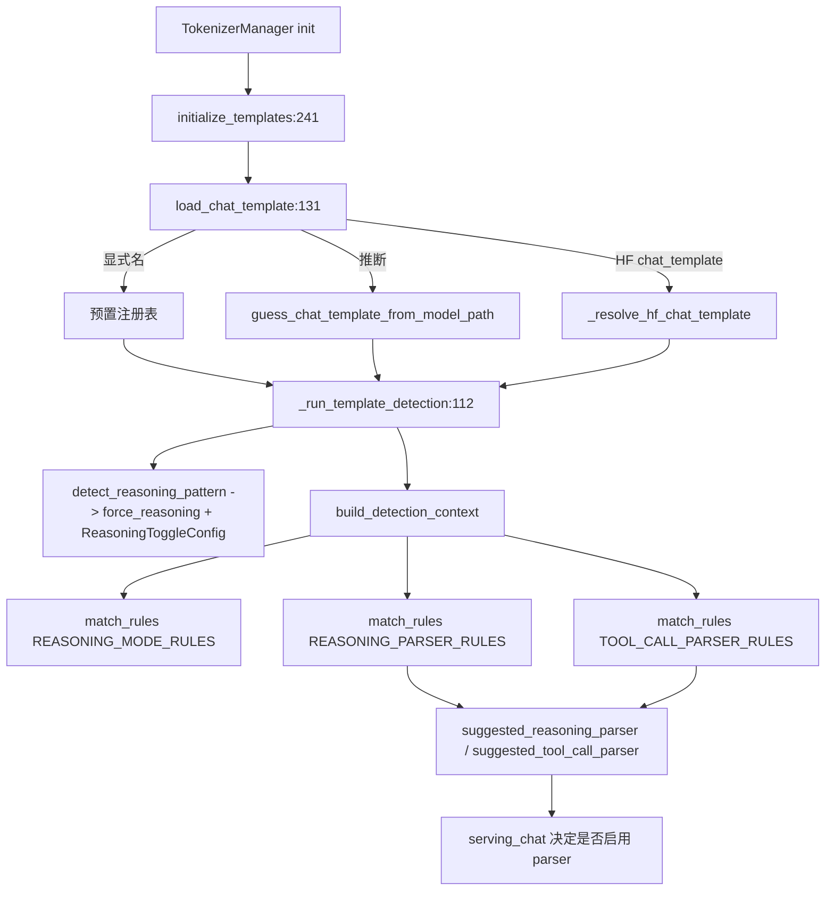

# 11.6.5 模板管理与检测

## 定位

`TemplateManager` 是模板相关状态的集中持有者，消除原先散落的全局变量；`template_detection.py` 提供规则引擎，从 chat template 字符串与 tokenizer 词表自动推断 reasoning toggle 配置、reasoning parser、tool-call parser。二者在 `TokenizerManager` 初始化时被调用，产出的 `suggested_*` 既喂入 [11.6.1 reasoning parser](11.6.1-parser-reasoning.md) 与 [11.7.1 function call](11.7.1-function-call-parser.md)，也影响 strict-thinking 与 [11.5.3 Reasoner grammar](11.5.3-constrained-reasoner.md)。

## 职责

- `TemplateManager`：持有 `chat_template_name`/`completion_template_name`/`jinja_template_content_format`/`force_reasoning`/`reasoning_config`/`suggested_reasoning_parser`/`suggested_tool_call_parser`，提供 `initialize_templates`/`load_chat_template`/`load_completion_template`。
- `TemplateDetectionContext`：把 template/`ReasoningToggleConfig`/`force_reasoning`/vocab 封装成不可变上下文，提供 `has_text`/`has_vocab`/`has_pattern`/`has_vocab_pattern` 谓词。
- `DetectionRule`：`(name, value, predicate)` 三元组，`match_rules` 按序匹配返回首个命中 value。
- 规则集：`REASONING_MODE_RULES`（推断 toggle 配置）、`REASONING_PARSER_RULES`、`TOOL_CALL_PARSER_RULES`。

## 关键类与函数

| 名称 | 定义位置 | 说明 |
|---|---|---|
| `TemplateManager` | `parser/template_manager.py:54` | 模板状态管理者 |
| `TemplateManager.load_chat_template` | `parser/template_manager.py:131` | 显式/推断/HF 三路装配 |
| `TemplateManager._run_template_detection` | `parser/template_manager.py:112` | 跑 reasoning pattern + parser 检测 |
| `TemplateManager.initialize_templates` | `parser/template_manager.py:241` | chat+completion 总入口 |
| `TemplateDetectionContext` | `parser/template_detection.py:35` | 不可变检测上下文 |
| `DetectionRule` | `parser/template_detection.py:56` | 规则 dataclass |
| `ReasoningToggleConfig` | `parser/template_detection.py:62` | toggle_param/default_enabled/effort_kwarg |
| `REASONING_MODE_RULES` | `parser/template_detection.py:78` | reasoning toggle 规则集 |
| `REASONING_PARSER_RULES` / `TOOL_CALL_PARSER_RULES` | `parser/template_detection.py`（同文件） | parser 推断规则集 |
| `detect_reasoning_pattern` / `match_rules` / `build_detection_context` | `parser/template_detection.py`（同文件） | 检测工具函数 |

## 子模块树

- `parser/template_manager.py` — 状态管理与装配（本页）
- `parser/template_detection.py` — 规则引擎（本页）
- `parser/jinja_template_utils.py` — `detect_jinja_template_content_format`
- 依赖 `parser/conversation.py`（[11.6.2](11.6.2-parser-conversation-template.md)）与 `parser/code_completion_parser.py`（[11.6.4](11.6.4-parser-completion-fim.md)）

## 数据流 / 控制流

`load_chat_template` 三条路径：显式名命中 `chat_template_exists` 直接用；路径推断走 `get_conv_template_by_model_path`；都失败则取 HuggingFace `chat_template`（含多模板 dict 的选择），并 `detect_jinja_template_content_format` 判定 `string`/`openai`。装配后 `_run_template_detection` 先 `detect_reasoning_pattern` 得 `force_reasoning` 与 `ReasoningToggleConfig`（如 `enable_thinking` 默认值、`effort_kwarg`、`special_case=always`），再用同一 `ctx` 跑两个 parser 规则集。`REASONING_MODE_RULES:78` 用正则匹配 jinja 模板内的 `enable_thinking` 默认赋值分支、`<|channel|>` 通道标记、`[THINK]`/`reasoning_effort` 等特征。命中结果经日志输出后由 serving_chat 决定是否真正启用对应 parser 与 [11.5.3](11.5.3-constrained-reasoner.md) grammar。

## 交叉引用

- 上游: [`03.3.1 TokenizerManager`](../03-orchestration/03.3.1-tokenizer-manager.md) — 初始化时调 `initialize_templates`
- 下游: [11.6.1 reasoning parser](11.6.1-parser-reasoning.md) — `suggested_reasoning_parser` 启用
- 下游: [11.7.1 FunctionCallParser](11.7.1-function-call-parser.md) — `suggested_tool_call_parser` 启用
- 下游: [11.5.3 Reasoner 包装器](11.5.3-constrained-reasoner.md) — `force_reasoning`/`reasoning_config` 影响
- 相关: [`02.3.2 openai chat`](../02-server-api/02.3.2-openai-base-chat-completions.md) — 消费检测结果

## 进一步阅读

- 源码: `python/sglang/srt/parser/template_manager.py`、`python/sglang/srt/parser/template_detection.py`
