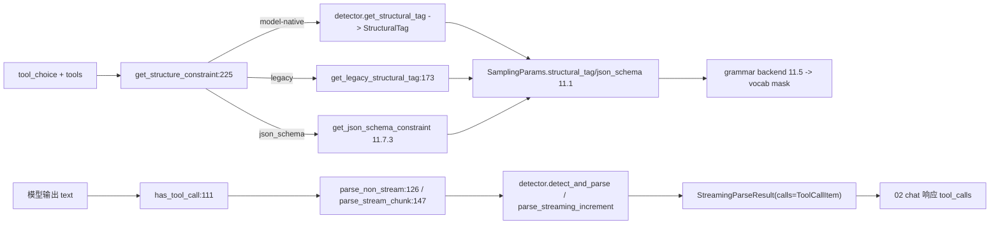

# 11.7.1 FunctionCallParser

## 定位

`FunctionCallParser` 是工具调用解析的顶层入口，把模型输出里的工具调用片段切分成结构化 `ToolCallItem` 列表，同时在请求侧把 `tool_choice` 翻译成约束（structural_tag/json_schema）喂入 [11.5 受限解码](11.5.1-constrained-base-registry.md)。它由 serving_chat（[02.3.2](../02-server-api/02.3.2-openai-base-chat-completions.md)）在请求处理两端调用：前向生成前拿约束、生成后拿 tool calls。

## 职责

- `FunctionCallParser`：按 `tool_call_parser` 名从 `ToolCallParserEnum` 选 detector，转发 `has_tool_call`/`parse_non_stream`/`parse_stream_chunk`。
- `get_structure_constraint`：按 `tool_choice`(required/named/auto) 与 `tool_strict_level` 决定约束类型，优先 model-native structural_tag，回退 legacy structural_tag，最后 json_schema。
- `get_legacy_structural_tag`：把每个 tool 翻成 `StructuresResponseFormat`(begin/schema/end) + triggers，供 xgrammar structural_tag 后端使用。

## 关键类与函数

| 名称 | 定义位置 | 说明 |
|---|---|---|
| `FunctionCallParser` | `function_call/function_call_parser.py:52` | 顶层解析器 |
| `FunctionCallParser.ToolCallParserEnum` | `function_call/function_call_parser.py:61` | parser 名→detector 类（约 31 项） |
| `FunctionCallParser.__init__` | `function_call/function_call_parser.py:95` | 选 detector 并透传 tokenizer |
| `FunctionCallParser.has_tool_call` | `function_call/function_call_parser.py:111` | 委托 detector 判定 |
| `FunctionCallParser.parse_non_stream` | `function_call/function_call_parser.py:126` | 一次性解析返回 (text, calls) |
| `FunctionCallParser.parse_stream_chunk` | `function_call/function_call_parser.py:147` | 流式增量解析 |
| `FunctionCallParser.get_legacy_structural_tag` | `function_call/function_call_parser.py:173` | 构造 legacy structural_tag |
| `FunctionCallParser.get_structure_constraint` | `function_call/function_call_parser.py:225` | tool_choice→constraint 总入口 |

## 子模块树

- `function_call/function_call_parser.py` — 顶层入口（本页）
- `function_call/base_format_detector.py` — [11.7.2](11.7.2-function-call-detectors.md)
- `function_call/<vendor>_detector.py` — 约 30 个 detector 实现
- `function_call/utils.py` — [11.7.3](11.7.3-function-call-constraint-gen.md)
- `function_call/core_types.py` — `ToolCallItem`/`StreamingParseResult`/`StructureInfo`

## 数据流 / 控制流

`ToolCallParserEnum` 用 parser 名映射 detector 类，部分名共用（`glm`/`glm45`→`Glm4MoeDetector`，`qwen`/`qwen25`→`Qwen25Detector`，`step3p5`→`Qwen3CoderDetector`）。`get_structure_constraint:225` 的优先级：`is_required`(required/named) 或 `should_constrain_auto`(strict tool 或 strict level ≥ FUNCTION) 时，先试 `detector.get_structural_tag`（model-native，如 xgrammar 的 `get_model_structural_tag`）；返回 None 则在 `supports_structural_tag()` 时退 legacy structural_tag；仍不可用且 required/named 时退 `get_json_schema_constraint`。`tool_strict_level`（`SGLANG_TOOL_STRICT_LEVEL`）控制 auto 场景是否约束以及 schema 严格度。`parse_non_stream` 在 `tools` 为空时直接返回原文，否则调 detector 返回 `normal_text` 与 `calls`，无调用则返回原文空列表。

## 交叉引用

- 下游: [11.7.2 detector 族](11.7.2-function-call-detectors.md) — `BaseFormatDetector` 与各 vendor 实现
- 下游: [11.7.3 约束生成](11.7.3-function-call-constraint-gen.md) — `get_json_schema_constraint`
- 下游: [11.5.1 受限解码基类](11.5.1-constrained-base-registry.md) — structural_tag/json_schema 走 grammar backend
- 上游: [`02.3.2 openai chat`](../02-server-api/02.3.2-openai-base-chat-completions.md) — 请求侧装配与响应侧解析
- 上游: [11.6.5 模板检测](11.6.5-parser-template-manager-detection.md) — `suggested_tool_call_parser` 自动推断

## 进一步阅读

- 源码: `python/sglang/srt/function_call/function_call_parser.py`、`python/sglang/srt/function_call/core_types.py`
