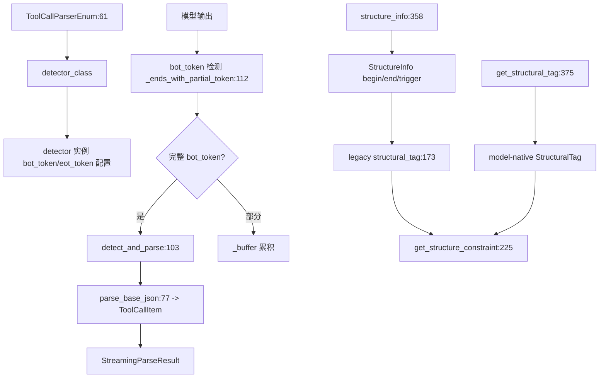

# 11.7.2 function-call detector 族

## 定位

`BaseFormatDetector` 是所有工具调用格式 detector 的抽象基类，约 30 个子类按各模型专属的工具调用语法（hermes/qwen/llama3/glm/deepseekv3/mistral/kimik2/gpt_oss/minimax/pythonic/step3/cohere/gemma/hunyuan/gigachat/internlm/trinity 等）实现它。每个 detector 既负责把模型输出切回 `ToolCallItem`，又负责提供约束生成所需的结构信息，由 [11.7.1 FunctionCallParser](11.7.1-function-call-parser.md) 统一调度。

## 职责

- `BaseFormatDetector` ABC：定义 `detect_and_parse`/`has_tool_call`/`structure_info` 抽象方法，提供 `parse_streaming_increment` 模板方法、`parse_base_json` 通用 JSON 转换、`supports_structural_tag`/`get_structural_tag`/`get_structural_tag_name` 钩子。
- 流式状态：`_buffer`/`prev_tool_call_arr`/`current_tool_id`/`current_tool_name_sent`/`streamed_args_for_tool` 跨 chunk 维护工具调用增量。
- 具体子类：覆盖 `bot_token`/`eot_token`/`tool_call_separator` 与各抽象方法，实现格式特定解析（hermes 的标签包裹、qwen 的函数调用块、mistral 的列表首标记、pythonic 的可执行调用语法、gpt-oss 的 Harmony 通道、glm 的 card JSON）。

## 关键类与函数

| 名称 | 定义位置 | 说明 |
|---|---|---|
| `BaseFormatDetector` | `function_call/base_format_detector.py:32` | detector ABC |
| `BaseFormatDetector.detect_and_parse` | `function_call/base_format_detector.py:103` | 一次性解析抽象方法 |
| `BaseFormatDetector.parse_base_json` | `function_call/base_format_detector.py:77` | 通用 JSON 到 ToolCallItem |
| `BaseFormatDetector.parse_streaming_increment` | `function_call/base_format_detector.py:125` | 流式模板方法 |
| `BaseFormatDetector._ends_with_partial_token` | `function_call/base_format_detector.py:112` | 部分 bot_token 判定 |
| `BaseFormatDetector.has_tool_call` | `function_call/base_format_detector.py:347` | 判定抽象方法 |
| `BaseFormatDetector.structure_info` | `function_call/base_format_detector.py:358` | 返回 StructureInfo 工厂 |
| `BaseFormatDetector.supports_structural_tag` | `function_call/base_format_detector.py:353` | 默认 True |
| `BaseFormatDetector.get_structural_tag` | `function_call/base_format_detector.py:375` | model-native tag 钩子 |
| `HermesDetector` | `function_call/hermes_detector.py` | hermes 格式 |
| `Qwen25Detector` / `Qwen3CoderDetector` | `function_call/qwen25_detector.py` / `qwen3_coder_detector.py` | qwen 系列 |
| `Llama32Detector` | `function_call/llama32_detector.py` | llama3 工具调用 |
| `Glm4MoeDetector` / `Glm47MoeDetector` | `function_call/glm4_moe_detector.py` / `glm47_moe_detector.py` | GLM 系列 |
| `DeepSeekV3Detector` 等 | `function_call/deepseekv3*.py` | DeepSeek 系列四个版本 |
| `MistralDetector` | `function_call/mistral_detector.py` | mistral 工具调用格式 |
| `KimiK2Detector` | `function_call/kimik2_detector.py` | kimi k2 |
| `GptOssDetector` | `function_call/gpt_oss_detector.py` | gpt-oss Harmony 通道 |
| `MinimaxM2Detector` / `MinimaxM3Detector` | `function_call/minimax_m2.py` / `minimax_m3.py` | minimax 系列 |
| `PythonicDetector` | `function_call/pythonic_detector.py` | Pythonic 调用语法 |
| 其余 vendor | `function_call/<name>_detector.py` | step3/trinity/cohere_command4/gemma4/hunyuan/gigachat3/internlm/mimo/minicpm5/poolside_v1/lfm2/apertus2509 |

## 子模块树

- `function_call/`
  - `base_format_detector.py` — ABC（本页）
  - 约 30 个 vendor detector — 具体格式实现
  - `core_types.py` — `ToolCallItem`/`StreamingParseResult`/`StructureInfo`（[11.7.3](11.7.3-function-call-constraint-gen.md)）

## 数据流 / 控制流

`parse_streaming_increment:125` 是流式模板方法：用 `_ends_with_partial_token:112` 判断 buffer 尾部是否为 `bot_token` 真前缀（部分格式如 mistral 的 bot_token 不在词表），部分则继续累积，完整则进入解析。`parse_base_json:77` 把 JSON 对象翻成 `ToolCallItem(tool_index, name, parameters)`，未知工具按 `SGLANG_FORWARD_UNKNOWN_TOOLS` 决定跳过或保留。`structure_info` 返回的工厂函数按工具名给出 `begin/end/trigger`，驱动 `get_legacy_structural_tag` 构造每个 tool 的 `StructuresResponseFormat`。`get_structural_tag:375` 在子类覆盖 `get_structural_tag_name` 时调 xgrammar `get_model_structural_tag` 取模型原生 structural tag，`thinking_mode` 控制是否带 reasoning 前缀（与 [11.5.3](11.5.3-constrained-reasoner.md) 协同，避免双层约束）。

## 交叉引用

- 上游: [11.7.1 FunctionCallParser](11.7.1-function-call-parser.md) — 持有并调度 detector
- 下游: [11.7.3 约束生成](11.7.3-function-call-constraint-gen.md) — `get_json_schema_constraint` 与 `StructureInfo`
- 相关: [11.6.3 Harmony parser](11.6.3-parser-harmony.md) — `GptOssDetector` 复用
- 相关: [11.5.1 受限解码基类](11.5.1-constrained-base-registry.md) — structural_tag 走 grammar backend

## 进一步阅读

- 源码: `python/sglang/srt/function_call/base_format_detector.py` 及同目录各 detector
