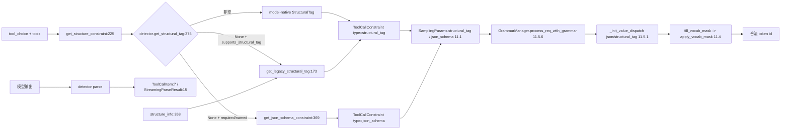

# 11.7.3 function-call 约束生成

## 定位

本页串联"工具调用约束"的整条生成链：从请求侧 `tool_choice` 出发，经 `get_json_schema_constraint` 或 `get_legacy_structural_tag` 产出约束，写入 `SamplingParams`（`json_schema`/`structural_tag`），再由 [11.5 受限解码](11.5.1-constrained-base-registry.md) 编译成 grammar 对象、生成 vocab mask，最终在 [11.4 Sampler](11.4-sampler-layer.md) 屏蔽非法 token。同时说明 `core_types.py` 的数据结构如何贯穿解析与约束两端。

## 职责

- `get_json_schema_constraint`：按 `tool_choice`(ToolChoice/required) 与 `parallel_tool_calls` 构造 JSON schema（array of tool call），named 走单 tool schema，required 走 anyOf 全工具。
- `FunctionCallParser.get_structure_constraint`：约束类型分派，优先 model-native structural_tag、回退 legacy structural_tag、最后 json_schema。
- `core_types`：`ToolCallItem`/`StreamingParseResult`/`StructureInfo`/`_GetInfoFunc` 是解析端与约束端共享的数据契约。

## 关键类与函数

| 名称 | 定义位置 | 说明 |
|---|---|---|
| `ToolCallItem` | `function_call/core_types.py:7` | 解析出的工具调用（pydantic） |
| `StreamingParseResult` | `function_call/core_types.py:15` | 流式解析结果（normal_text + calls） |
| `StructureInfo` | `function_call/core_types.py:22` | dataclass，begin/end/trigger |
| `_GetInfoFunc` | `function_call/core_types.py:34` | `Callable[[str], StructureInfo]` 别名 |
| `get_json_schema_constraint` | `function_call/utils.py:369` | tool_choice→JSON schema |
| `FunctionCallParser.get_structure_constraint` | `function_call/function_call_parser.py:225` | 约束类型总分派 |
| `FunctionCallParser.get_legacy_structural_tag` | `function_call/function_call_parser.py:173` | legacy structural_tag 构造 |
| `_get_tool_schema` / `_get_tool_schema_defs` | `function_call/utils.py` | 单 tool schema 与公共 defs 提取 |

## 子模块树

- `function_call/`
  - `core_types.py` — 共享数据结构（本页）
  - `utils.py` — schema 构造与 JSON 工具（本页）
  - `function_call_parser.py` — [11.7.1](11.7.1-function-call-parser.md) 调用上述
  - `base_format_detector.py` — [11.7.2](11.7.2-function-call-detectors.md) 提供 `structure_info`

## 数据流 / 控制流

`get_json_schema_constraint:369` 两条分支：`ToolChoice`（named）返回 `{"type":"array","minItems":1,"items": <单 tool schema>}`，`parallel_tool_calls=False` 时加 `maxItems:1`；`"required"` 返回 `items` 为全工具 `anyOf` 的数组，并合并各 tool 公共 `$defs`。`get_structure_constraint:225` 的优先级与 [11.7.1](11.7.1-function-call-parser.md) 一致：先 model-native，再 legacy structural_tag（由 `StructureInfo.begin/end/trigger` 拼出 `StructuresResponseFormat`），最后 json_schema。约束以 `ToolCallConstraint` 元组形式回写 `SamplingParams`，进入 [11.5.6 GrammarManager](11.5.6-constrained-grammar-manager.md) 的 `process_req_with_grammar`：json_schema 走 `dispatch_json`、structural_tag 走 `dispatch_structural_tag`，由 [11.5.2](11.5.2-constrained-xgrammar-outlines-llguidance.md) 各后端编译。输出端 `ToolCallItem` 与 `StreamingParseResult` 由 detector 产出，供 serving 装配 OpenAI `tool_calls` 响应字段。`StructureInfo` 同时被解析端（标识 begin/end）与约束端（构造 structural_tag 结构）复用，是两端的关键耦合点。

## 交叉引用

- 上游: [11.7.1 FunctionCallParser](11.7.1-function-call-parser.md) — `get_structure_constraint` 调用方
- 上游: [11.7.2 detector 族](11.7.2-function-call-detectors.md) — `structure_info`/`get_structural_tag` 来源
- 下游: [11.5.1 受限解码基类](11.5.1-constrained-base-registry.md) — `dispatch_json`/`dispatch_structural_tag`
- 下游: [11.5.6 GrammarManager](11.5.6-constrained-grammar-manager.md) — 消费 `SamplingParams` 约束
- 下游: [11.1 SamplingParams](11.1-sampling-params-sbi.md) — `json_schema`/`structural_tag` 字段
- 上游: [`02.3.2 openai chat`](../02-server-api/02.3.2-openai-base-chat-completions.md) — `tool_choice`/`parallel_tool_calls` 来源

## 进一步阅读

- 源码: `python/sglang/srt/function_call/utils.py`、`python/sglang/srt/function_call/core_types.py`
