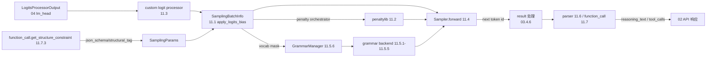

# 11 采样与解码控制

## 子系统定位

子系统 11 覆盖模型 logits 产出之后、token id 回流之前的整条"解码链"。它把 `LogitsProcessorOutput`（来自 04 模型执行的 `lm_head`）转成最终采样 token，同时在中间插入四类修改力：temperature/top-k/top-p/min-p 等经典采样参数、penalty（repetition/frequency/presence/min_new_tokens）、受限解码的 vocab mask（JSON schema/regex/EBNF/structural_tag）、以及用户自定义 logit processor。除此之外，本子系统还承担"回写端"的文本解析：reasoning 解析、对话模板、FIM 代码补全、Harmony 流式解析、function call 解析与约束生成。这些解析器既喂入前向（structural_tag→grammar backend→vocab mask），又回收输出（token→reasoning_text/tool_calls）。

## 解码链总览

## 子系统导航

- [11.1 采样参数与 SamplingBatchInfo](11.1-sampling-params-sbi.md) — `SamplingParams` 校验/归一化与批量采样信息装配
- [11.2 penalty 库](11.2-penalty-lib.md) — `BatchedPenalizerOrchestrator` 与四类 penalizer
- [11.3 自定义 logit processor](11.3-custom-logit-processor.md) — dill IPC 传输的用户处理器
- [11.4 Sampler 层](11.4-sampler-layer.md) — `Sampler.forward` 采样执行核心
- 受限解码
  - [11.5.1 基类与注册表](11.5.1-constrained-base-registry.md) — `BaseGrammarObject` / `BaseGrammarBackend` / `create_grammar_backend`
  - [11.5.2 xgrammar / outlines / llguidance](11.5.2-constrained-xgrammar-outlines-llguidance.md) — 三套后端实现
  - [11.5.3 Reasoner 包装器](11.5.3-constrained-reasoner.md) — THINKING/GENERATION 状态机
  - [11.5.4 压缩 FSM 跳跃](11.5.4-constrained-fsm-jump.md) — outlines jump forward
  - [11.5.5 token filter 内核](11.5.5-constrained-token-filter.md) — bitmask 写位操作
  - [11.5.6 GrammarManager](11.5.6-constrained-grammar-manager.md) — 编译队列与 DP/TP/PP 同步
- 文本解析
  - [11.6.1 reasoning parser](11.6.1-parser-reasoning.md) — `ReasoningParser` 与 detector 族
  - [11.6.2 conversation 模板](11.6.2-parser-conversation-template.md) — `Conversation` / `SeparatorStyle`
  - [11.6.3 Harmony parser](11.6.3-parser-harmony.md) — gpt-oss 通道流式解析
  - [11.6.4 completion / FIM](11.6.4-parser-completion-fim.md) — 代码补全模板
  - [11.6.5 模板管理与检测](11.6.5-parser-template-manager-detection.md) — `TemplateManager` 与规则检测
- function call
  - [11.7.1 FunctionCallParser](11.7.1-function-call-parser.md) — 解析入口与 `ToolCallParserEnum`
  - [11.7.2 detector 族](11.7.2-function-call-detectors.md) — `BaseFormatDetector` ABC 与约 30 个格式
  - [11.7.3 约束生成](11.7.3-function-call-constraint-gen.md) — `tool_choice` → constraint → grammar 链条

## 交叉引用

- 上游: [`04 模型执行`](../04-model-execution/index.md) — `ModelRunner.forward` 产出 logits
- 上游: [`03 核心编排`](../03-orchestration/index.md) — `Scheduler.run_batch` 调用 `Sampler`、消费 `SamplingBatchInfo`
- 下游: [`06 Layers`](../06-layers/index.md) — `Sampler` 作为 `nn.Module` 的语义对应页 [06.10](../06-layers/06.10-sampler-layer.md)
- 下游: [`15 内核与硬件`](../15-kernels-hardware/index.md) — bitmask/murmur_hash 等采样内核
- 相关: [`02 服务入口`](../02-server-api/index.md) — `/chat/completions` 把 `tool_choice` 翻译为约束并消费解析结果

## 进一步阅读

- 源码: `python/sglang/srt/sampling/`、`python/sglang/srt/constrained/`、`python/sglang/srt/parser/`、`python/sglang/srt/function_call/`
