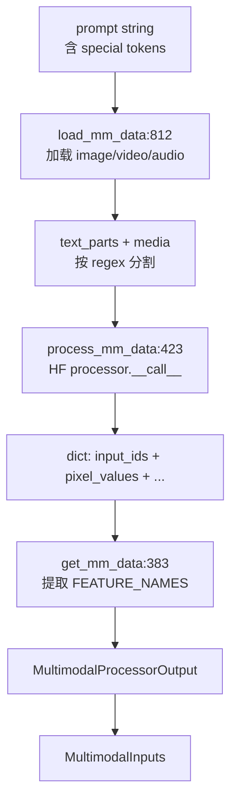

# 12.1 基础多模态处理器

## 定位

`BaseMultimodalProcessor` 是所有 per-model 多模态处理器的抽象基类，定义了从原始媒体输入到模型可用 token 序列 + feature 张量的完整处理框架。它位于 `multimodal/processors/base_processor.py`，被 TokenizerManager 在 tokenize 阶段调用。

## 职责

- 定义多模态处理的生命周期：`load_mm_data` 加载媒体 → `process_mm_data` 调用 HF processor → `get_mm_data` 构造返回结构。
- 管理特殊 token 的识别与插入：通过 `MultimodalSpecialTokens` 描述 image/video/audio placeholder token。
- 支持 GPU 图像解码（`gpu_image_decode`）、CPU/CUDA-IPC 两种 feature 传输模式（`transport_mode`）。
- 提供属性名到模态类型的映射（`ATTR_NAME_TO_MODALITY`），将 `pixel_values`、`audio_features` 等映射到 IMAGE/VIDEO/AUDIO。
- 维护线程池与进程池执行器（`io_executor`/`cpu_executor`）用于异步 IO 和 CPU 密集预处理。

## 关键类与函数

| 名称 | 定义位置 | 说明 |
|---|---|---|
| `BaseMultiModalProcessorOutput` | `multimodal/processors/base_processor.py:49` | 处理输出结构，含 `input_text`/`input_ids`/`images`/`videos`/`audios` |
| `MultimodalSpecialTokens` | `multimodal/processors/base_processor.py:85` | 描述 image/video/audio placeholder token 的正则模式与 token id |
| `BaseMultimodalProcessor` | `multimodal/processors/base_processor.py:180` | 抽象基类，持有 `hf_config`/`_processor`/`transport_mode` |
| `get_mm_data` | `multimodal/processors/base_processor.py:383` | 从 process 结果提取 feature 并组装 `MultimodalInputs` |
| `process_mm_data` | `multimodal/processors/base_processor.py:423` | 同步调用 HF processor 处理 text+image+video+audio，返回 dict |
| `process_mm_data_async` | `multimodal/processors/base_processor.py:514` | 抽象方法，子类实现异步处理入口 |
| `load_mm_data` | `multimodal/processors/base_processor.py:812` | 加载原始媒体（base64/URL/bytes → PIL/Tensor），分割 text 与 special tokens |

## 数据流 / 控制流

`load_mm_data` 接收 prompt 与 multimodal_tokens，先用正则将 prompt 分割为纯文本段与特殊 token 段，然后在 IO executor 上并行加载图像/视频/音频。加载完成后调用 `process_mm_data`，后者把 text 与 media 一起喂给 HF 的 AutoProcessor（或 SGLang 的 fast image processor），产出 `input_ids` 和 feature 张量。`get_mm_data` 从结果中按 `FEATURE_NAMES` 提取需要的张量，组装成跨进程可序列化的 `MultimodalInputs`。`process_mm_data_async` 是子类必须实现的异步入口，通常先调 `load_mm_data` 再调 `process_mm_data`，最后用 `get_mm_data` 返回。

## 子模块树

- `processors/base_processor.py` — 基类与数据结构定义
- `managers/multimodal_processor.py` — `PROCESSOR_MAPPING` 注册与 `get_mm_processor` 分发（见 [12.2](12.2-per-model-processors.md)）
- `managers/schedule_batch.py:415/499` — `MultimodalProcessorOutput`/`MultimodalInputs` 运行时结构

## 交叉引用

- 上游: [`03.3 TokenizerManager`](../03-orchestration/03.3.1-tokenizer-manager.md) — 在 tokenize 阶段调用 `process_mm_data_async`
- 下游: [12.2 每模型处理器](12.2-per-model-processors.md) — 子类实现
- 下游: [12.6 媒体加载](12.6-media-loading.md) — `load_mm_data` 的媒体解码细节
- 下游: [12.8 多模态传输](12.8-mm-transport.md) — `transport_mode` 与 feature 传输

## 进一步阅读

- 源码: `python/sglang/srt/multimodal/processors/base_processor.py`
