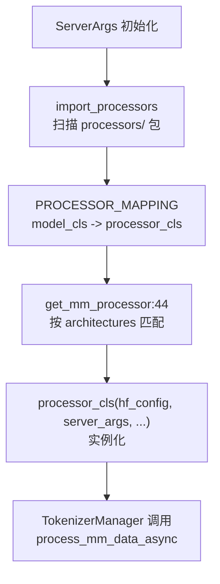

# 12.2 每模型处理器

## 定位

`multimodal/processors/` 目录下有 49 个处理器文件，每个文件定义一个或多个继承 `BaseMultimodalProcessor` 的子类，通过 `models = []` 类属性声明支持的模型架构。`managers/multimodal_processor.py` 在启动时自动扫描注册，构建 `PROCESSOR_MAPPING` 从模型类到处理器类的映射。

## 职责

- 为每个支持的模型架构实现 `process_mm_data_async`，将多模态输入转换为 token 序列与 feature 张量。
- 每个处理器可以覆盖 `FEATURE_NAMES`、`ATTR_NAME_TO_MODALITY` 等基类属性以匹配模型的输入格式。
- 部分处理器实现 GPU 图像预处理（`gpu_image_decode`）以加速 decode。
- 通过 `models = []` 声明关联的模型架构类，在启动时被 `import_processors` 扫描注册。

## 关键类与函数

| 名称 | 定义位置 | 说明 |
|---|---|---|
| `PROCESSOR_MAPPING` | `managers/multimodal_processor.py:13` | 全局 dict，模型架构类 → 处理器类 |
| `import_processors` | `managers/multimodal_processor.py:16` | 启动时扫描 `processors/` 包，按 `models` 注册 |
| `get_mm_processor` | `managers/multimodal_processor.py:44` | 按 `hf_config.architectures` 查找匹配的处理器实例 |
| `QwenVLImageProcessor` | `multimodal/processors/qwen_vl.py:260` | Qwen2-VL/Qwen2.5-VL/Qwen3-VL 处理器，SGLangBaseProcessor 子类 |
| `LlavaMultimodalProcessor` | `multimodal/processors/llava.py:230` | LLaVA 系列处理器 |
| `InternVLProcessor` | `multimodal/processors/internvl.py` | InternVL 处理器 |
| `PixtralProcessor` | `multimodal/processors/pixtral.py` | Pixtral 处理器 |
| `MllamaImageProcessor` | `multimodal/processors/mlama.py:11` | Llama 3.2 Vision 处理器 |
| `WhisperProcessor` | `multimodal/processors/whisper.py:133` | Whisper 语音处理器 |
| `TransformersAutoMultimodalProcessor` | `multimodal/processors/transformers_auto.py:34` | transformers backend fallback 处理器 |

## 子模块树

- `processors/` — 49 个处理器文件
  - `qwen_vl.py` — Qwen2-VL / Qwen2.5-VL / Qwen3-VL（含 `smart_resize`/`smart_nframes`）
  - `llava.py` — Llava 通用处理器
  - `internvl.py` — InternVL（含动态预处理）
  - `pixtral.py` — Mistral Pixtral
  - `mlama.py` / `mllama4.py` — Llama 3.2 Vision / Llama 4 Vision
  - `gemma3.py` / `gemma3n.py` / `gemma4.py` — Gemma 系列
  - `glm4v.py` / `glm_image.py` / `glmasr.py` — GLM 系列
  - `kimi_vl.py` / `kimi_k25.py` — Kimi 系列
  - `phi4mm.py` — Phi-4 多模态
  - `voxtral.py` — Voxtral 语音
  - `whisper.py` — Whisper 语音
  - `qwen_audio.py` / `qwen3_asr.py` — Qwen 音频
  - `mimo_v2.py` / `mimo_audio.py` / `mimo_v2_asr.py` — MiMo 系列
  - `transformers_auto.py` — transformers backend fallback

## 数据流 / 控制流

`get_mm_processor` 遍历 `PROCESSOR_MAPPING`，将 `hf_config.architectures` 中的架构名与映射键的 `__name__` 匹配。若使用 transformers backend 且无匹配的 sglang 原生处理器，则 fallback 到 `TransformersAutoMultimodalProcessor`，直接委托 HF AutoProcessor。

## 交叉引用

- 上游: [12.1 基础处理器](12.1-base-mm-processor.md) — `BaseMultimodalProcessor` 基类
- 下游: [`03.3 TokenizerManager`](../03-orchestration/03.3.1-tokenizer-manager.md) — 调用 `get_mm_processor` 获取处理器
- 相关: [`05 模型加载`](../05-model-loading/index.md) — 模型架构注册
- 相关: [12.7 自定义处理器注册](12.7-custom-processor-registration.md) — HF processor 级自定义

## 进一步阅读

- 源码: `python/sglang/srt/multimodal/processors/`
- 注册逻辑: `python/sglang/srt/managers/multimodal_processor.py:16`
