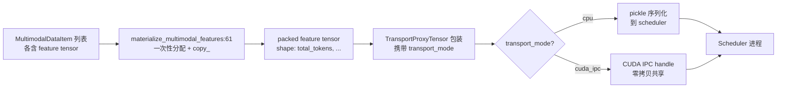

# 12.3 多模态工具函数

## 定位

多模态工具函数分布在两个文件中：`multimodal/mm_utils.py` 提供媒体预处理与特征拼接的低层工具，`managers/mm_utils.py` 提供跨进程传输与 padding 模式等运行时基础设施。两者共同支撑 processor 产出的 feature 张量到 scheduler 进程的安全传递与高效拼接。

## 职责

- `multimodal/mm_utils.py`：图像分辨率选择、特征张量拼接、numpy 转换、有效性检查，以及 DP 分片 vision model 运行辅助。
- `managers/mm_utils.py`：`TransportProxyTensor` 实现跨进程零拷贝 CUDA tensor 传输，padding 模式管理 placeholder token 到 feature 的映射，GPU feature buffer 管理。

## 关键类与函数

| 名称 | 定义位置 | 说明 |
|---|---|---|
| `ensure_numpy` | `multimodal/mm_utils.py:48` | 将 `torch.Tensor` 转 numpy（v5 兼容） |
| `has_valid_data` | `multimodal/mm_utils.py:53` | 递归检查嵌套 list 中是否有有效数据 |
| `materialize_multimodal_features` | `multimodal/mm_utils.py:61` | 将可变长度 feature tensor 列表拼接为一个目标 buffer，直接 `copy_` 避免临时分配 |
| `select_best_resolution` | `multimodal/mm_utils.py:114` | 从候选分辨率中选最佳匹配（用于 anyres） |
| `TransportProxyTensor` | `managers/mm_utils.py:109` | `torch.Tensor` 子类，携带 metadata 并支持 CUDA-IPC 序列化 |
| `MultiModalityDataPaddingPattern` | `managers/mm_utils.py:228` | padding 模式基类，描述 placeholder token 到 feature 的映射规则 |
| `TensorTransportMode` | `managers/mm_utils.py:51` | 类型别名 `"cuda_ipc" / "auto" / "default"` |
| `init_feature_buffer` | `managers/mm_utils.py:60` | 初始化 GPU feature 共享 buffer |

## 数据流 / 控制流

`materialize_multimodal_features` 先计算所有 feature 的总 token 数，一次分配目标 buffer，然后逐个 `copy_` 每个 feature 到对应 slice——避免了先 `to` 再 `cat` 产生的 N 个临时张量。`TransportProxyTensor` 在 pickle 时根据 `transport_mode` 决定序列化策略：`cuda_ipc` 模式通过 `storage._share_cuda_()` 获取 IPC handle，接收进程通过 handle 重建 tensor 视图实现零拷贝；`default` 模式则走标准 CPU pickle。

`MultiModalityDataPaddingPattern` 有两个子类：`MultiModalityDataPaddingPatternTokenPairs`（token 对映射）和 `MultiModalityDataPaddingPatternMultimodalTokens`（多模态 token 映射），它们在 scheduler 侧将 placeholder token 位置与实际 feature offset 对齐。

## 子模块树

- `multimodal/mm_utils.py` — 媒体预处理工具（resize/pad/anyres/DP shard）
- `managers/mm_utils.py` — 运行时传输基础设施（TransportProxyTensor/padding/buffer）

## 交叉引用

- 上游: [12.1 基础处理器](12.1-base-mm-processor.md) — processor 产出 feature 后调用这些工具
- 下游: [`03.4.1 Scheduler`](../03-orchestration/03.4.1-scheduler-structure.md) — scheduler 侧接收并 padding
- 相关: [12.8 多模态传输](12.8-mm-transport.md) — transport_mode 的完整传输链路
- 相关: [`08 分布式`](../08-distributed/index.md) — DP 分片 vision model

## 进一步阅读

- 源码: `python/sglang/srt/multimodal/mm_utils.py`、`python/sglang/srt/managers/mm_utils.py`
