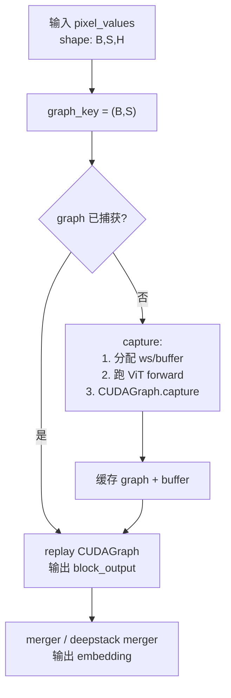

# 12.4 ViT CUDA Graph

## 定位

ViT CUDA Graph Runner 将视觉 Transformer（ViT）encoder 的 forward 捕获为 CUDA Graph，在相同输入 shape 的后续 forward 中直接 replay，省去 kernel launch 开销。这对于 decode 阶段频繁调用 ViT 的多模态推理尤其重要。SGLang 提供两个 runner：通用的 `ViTCudaGraphRunner`（用于 Qwen2.5-VL/Qwen3-VL 等）和 `InternViTCudaGraphRunner`（用于 InternVL）。

## 职责

- `ViTCudaGraphRunner`：捕获 ViT 的 blocks + merger + deepstack merger（可选）部分为 CUDA Graph，按 graph_key（shape）缓存与复放。
- 支持 Qwen2.5-VL 的 windowed attention（`fullatt_block_indexes`）和 Qwen3-VL 的 deepstack（`deepstack_visual_indexes` + `deepstack_merger_list`）。
- 维护地址稳定的 cu_seqlens / cu_window_seqlens buffer，确保 CUDA Graph replay 时指针不漂移。
- `InternViTCudaGraphRunner`：为 InternVL 的 `[B,S,H]` 输入格式捕获完整 encoder 链，key 为 `(B, S)`。

## 关键类与函数

| 名称 | 定义位置 | 说明 |
|---|---|---|
| `ViTCudaGraphRunner` | `multimodal/vit_cuda_graph_runner.py:31` | 通用 ViT CUDA Graph runner |
| `ViTCudaGraphRunner.run` | `multimodal/vit_cuda_graph_runner.py:386` | 按 graph_key 查找或捕获 graph，replay 返回 output |
| `InternViTCudaGraphRunner` | `multimodal/internvl_vit_cuda_graph_runner.py:28` | InternVL 专用 runner，key=(B,S) |
| `InternViTCudaGraphRunner.run` | `multimodal/internvl_vit_cuda_graph_runner.py:171` | replay InternVL encoder graph |

## 数据流 / 控制流

首次遇到某 shape 时，runner 在 capture 模式下分配 workspace、预计算 rotary sin/cos（`_ensure_sin_cos_ws`），然后跑一次完整 forward 并捕获为 `torch.cuda.CUDAGraph`。后续相同 shape 直接 replay。对 Qwen2.5-VL，runner 额外维护 `cu_window_seqlens` buffer 供 windowed attention block 使用；对 Qwen3-VL，deepstack merger 列表在 capture 时一并捕获。

InternVL 的 runner 更简单——整个 encoder（`layer_N(...layer_1(x))`）一次捕获，输入 key 为 `(B, S)`，因为它使用 `[B,S,H]` 布局而非 flatten 的 `[tokens, H]`。

## 子模块树

- `multimodal/vit_cuda_graph_runner.py` — Qwen2.5-VL / Qwen3-VL 通用 runner
- `multimodal/internvl_vit_cuda_graph_runner.py` — InternVL 专用 runner
- `multimodal/internvl_utils.py` — InternVL 动态预处理辅助

## 交叉引用

- 上游: [`04.1 ModelRunner`](../04-model-execution/04.1-model-runner.md) — 在 forward 中调用 ViT encoder
- 相关: [`06.3.6 attention-vision`](../06-layers/06.3.6-attn-vision.md) — ViT 内部注意力后端
- 相关: [`07 KV Cache`](../07-kv-cache/index.md) — CUDA Graph 与 KV pool 的关系
- 相关: [12.2 每模型处理器](12.2-per-model-processors.md) — processor 产出的 pixel_values 喂给 ViT

## 进一步阅读

- 源码: `python/sglang/srt/multimodal/vit_cuda_graph_runner.py`、`python/sglang/srt/multimodal/internvl_vit_cuda_graph_runner.py`
