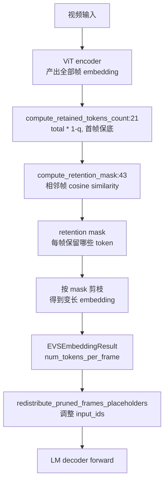

# 12.5 EVS 视频剪枝

## 定位

EVS（Embedding-level Video Similarity pruning）是一种基于帧间相似度的 video token 剪枝机制：视频 encoder 产出全部帧的 embedding 后，按相邻帧的 cosine similarity 丢弃冗余 token，只保留信息量大的 token。这在保持视频理解质量的同时大幅减少 token 数量。EVS 位于 `multimodal/evs/` 子目录，与 Qwen2.5-VL/Qwen3-VL 等视频模型配合使用。

## 职责

- `evs_core.py`：实现核心剪枝算法——计算相邻帧 embedding 的 cosine similarity，按剪枝率 `q` 决定保留 token 数量，生成 retention mask。
- `evs_module.py`：定义 `EVS` 抽象模块（`torch.nn.Module`）和 `EVSConfig`，子类实现 `create_evs_config`；定义 `EVSEmbeddingResult` 携带每帧实际保留的 token 数。
- `evs_processor.py`：`EVSProcessor` 在 prompt 构造阶段根据剪枝率分配 placeholder token 数量，并在 embedding 产出后 redistribut placeholder spans。

## 关键类与函数

| 名称 | 定义位置 | 说明 |
|---|---|---|
| `compute_retained_tokens_count` | `multimodal/evs/evs_core.py:21` | 按剪枝率 `q` 计算保留 token 数，首帧全保留 |
| `compute_retention_mask` | `multimodal/evs/evs_core.py:43` | 计算每帧的 retention mask（哪些 token 保留） |
| `tokens_per_frame` | `multimodal/evs/evs_core.py:103` | 提取每帧 token 数 |
| `replace_offsets_with_tokens_per_frame` | `multimodal/evs/evs_core.py:124` | 用实际 token 数替换 placeholder offset |
| `EVSEmbeddingResult` | `multimodal/evs/evs_module.py:46` | 剪枝后 embedding 结果，含 `num_tokens_per_frame` |
| `EVSConfig` | `multimodal/evs/evs_module.py:98` | 配置：`video_pruning_rate`/`spatial_merge_size` |
| `EVS` | `multimodal/evs/evs_module.py:108` | 抽象 `nn.Module`，子类实现 `create_evs_config` |
| `EVSProcessor` | `multimodal/evs/evs_processor.py:48` | 处理 placeholder 分配与 post-pruning redistribution |

## 数据流 / 控制流

`compute_retention_mask` 将 video embedding reshape 为 `[T, H', W', D]`，对相邻帧做 cosine similarity，相似度高的 token 被丢弃。首帧始终全保留（`min_num_tokens = tokens_per_frame`），确保视频起始信息不丢失。剪枝后的 embedding 各帧长度不同，`EVSEmbeddingResult.redistribute_pruned_frames_placeholders` 负责用实际 token 数重新调整 `input_ids` 中的 placeholder span，使 LM decoder 正确消费变长 embedding。

`EVSProcessor` 在 prompt 构造时若 EVS 启用，按 `video_pruning_rate` 预分配较少的 placeholder（`static_size_data_items`），为后续 redistribution 留出空间。

## 子模块树

- `multimodal/evs/evs_core.py` — 核心剪枝算法（纯函数）
- `multimodal/evs/evs_module.py` — `EVS` 模块、`EVSConfig`、`EVSEmbeddingResult`
- `multimodal/evs/evs_processor.py` — `EVSProcessor` placeholder 管理
- `multimodal/evs/README.md` — 模型集成指南

## 交叉引用

- 上游: [12.2 每模型处理器](12.2-per-model-processors.md) — 视频模型 processor 与 EVS 集成
- 上游: [12.4 ViT CUDA Graph](12.4-vit-cuda-graph.md) — ViT encoder 产出 embedding
- 下游: [`03.4.1 Scheduler`](../03-orchestration/03.4.1-scheduler-structure.md) — 剪枝后 token 数影响调度
- 相关: [`09.8 encode server`](../09-disaggregation/09.8-encode-server-grpc.md) — EVS embedding 可在 encode server 中产出

## 进一步阅读

- 源码: `python/sglang/srt/multimodal/evs/`
- 集成文档: `python/sglang/srt/multimodal/evs/README.md`
