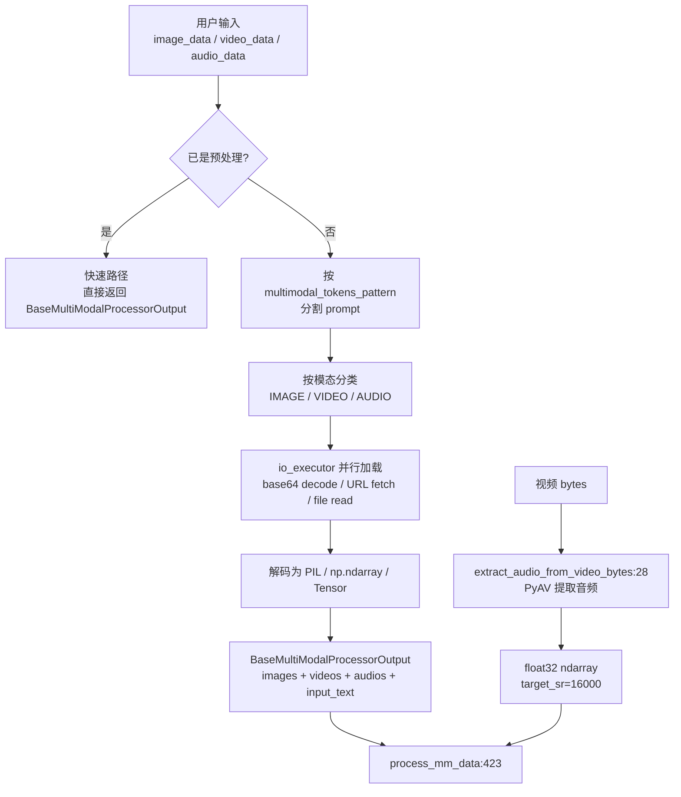

# 12.6 媒体加载

## 定位

媒体加载是多模态处理的第一步：将用户提供的 base64 字符串、URL、文件路径或原始字节解码为 PIL Image / numpy array / torch Tensor。`BaseMultimodalProcessor.load_mm_data` 是统一入口，`audio_from_video.py` 提供视频音频提取的专用路径。加载阶段还负责按 special token 正则分割 prompt，确定每个媒体的插入位置。

## 职责

- `load_mm_data`：解析 prompt 中的 special token，分割文本段与媒体段，按模态分类加载到 images/videos/audios 列表。
- `extract_audio_from_video_bytes`：使用 PyAV（进程内 FFmpeg 绑定）从视频字节中提取音频轨道，避免 subprocess fork 导致 CUDA 上下文崩溃。
- 支持多种输入格式：base64 编码图像、HTTP URL（异步下载）、本地文件路径、`video:` 前缀路径、原始 bytes。
- 提供快速路径：当所有输入已是预处理数据（`_all_mm_data_is_preprocessed`）时跳过解码直接返回。

## 关键类与函数

| 名称 | 定义位置 | 说明 |
|---|---|---|
| `load_mm_data` | `multimodal/processors/base_processor.py:812` | 统一媒体加载入口，返回 `BaseMultiModalProcessorOutput` |
| `extract_audio_from_video_bytes` | `multimodal/audio_from_video.py:28` | PyAV 提取视频音频为 float32 waveform |
| `validate_mm_data` | `multimodal/processors/base_processor.py`（位置待核） | 校验输入数据合法性 |
| `_all_mm_data_is_preprocessed` | `multimodal/processors/base_processor.py`（位置待核） | 检测输入是否已是预处理张量 |

## 数据流 / 控制流

`load_mm_data` 首先校验输入（`validate_mm_data`），然后检查是否可以走快速路径。若 prompt 是 token id list 且所有媒体已预处理，直接封装返回。否则用 `multimodal_tokens.get_combined_regex()` 将 prompt 分割为文本段和 media 段，在 `io_executor`（线程池）上并行加载每个媒体项。图像支持 base64/URL/文件路径，视频以 `video:` 前缀标识，音频支持 bytes/base64。

`extract_audio_from_video_bytes` 使用 PyAV（而非 subprocess）打开视频字节流，遍历 audio stream 解码为 mono float32 waveform，重采样到 `target_sr`（默认 16000）。PyAV 的进程内设计避免了 fork 导致 CUDA driver crash 的问题。

## 子模块树

- `multimodal/processors/base_processor.py` — `load_mm_data` 加载逻辑
- `multimodal/audio_from_video.py` — PyAV 视频音频提取
- `multimodal/internvl_utils.py` — InternVL 专用动态预处理（`dynamic_preprocess`/`video_to_pixel_values`）

## 交叉引用

- 上游: [12.1 基础处理器](12.1-base-mm-processor.md) — `load_mm_data` 是 processor 生命周期第一步
- 下游: [12.2 每模型处理器](12.2-per-model-processors.md) — 各模型 processor 覆盖加载行为
- 相关: [`03.3.3 TokenizerManager tokenize+mm`](../03-orchestration/03.3.3-tm-tokenize-mm.md) — tokenize 阶段调用加载

## 进一步阅读

- 源码: `python/sglang/srt/multimodal/processors/base_processor.py:812`、`python/sglang/srt/multimodal/audio_from_video.py`
