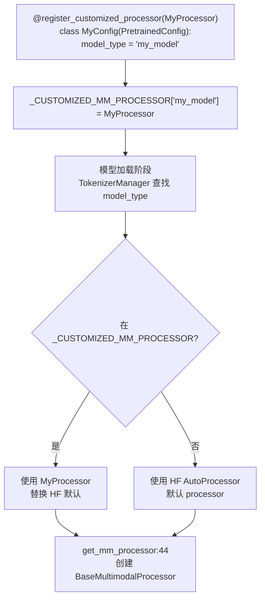

# 12.7 自定义处理器注册

## 定位

`customized_mm_processor_utils.py` 提供了一种在 model config 类级别注册自定义 HF processor 的机制。当某个模型需要使用不同于 HuggingFace 默认的 processor 时，通过 `@register_customized_processor` 装饰器将自定义 processor 类绑定到 config 的 `model_type`，在加载时覆盖默认选择。

## 职责

- 维护全局映射 `_CUSTOMIZED_MM_PROCESSOR`，从 `model_type` 字符串到自定义 `ProcessorMixin` 子类。
- 提供 `register_customized_processor` 装饰器工厂，在 config 类定义时自动注册。
- 在模型加载阶段，TokenizerManager 通过 `_CUSTOMIZED_MM_PROCESSOR` 查找是否需要使用自定义 processor 替换 HF 默认 processor。

## 关键类与函数

| 名称 | 定义位置 | 说明 |
|---|---|---|
| `_CUSTOMIZED_MM_PROCESSOR` | `multimodal/customized_mm_processor_utils.py:6` | 全局 dict: `model_type -> ProcessorMixin` |
| `register_customized_processor` | `multimodal/customized_mm_processor_utils.py:9` | 装饰器工厂，接收 processor_class，返回 config 装饰器 |

## 数据流 / 控制流

`register_customized_processor` 是一个装饰器工厂：调用 `register_customized_processor(MyProcessor)` 返回一个 `decorator`，该 decorator 接收 config 类，检查其是否有 `model_type` 属性，然后将映射写入 `_CUSTOMIZED_MM_PROCESSOR`。这个机制允许模型开发者在 config 定义处声明自定义 processor，无需修改 SGLang 的 processor 分发逻辑。

注册后的 processor 仍会通过 `get_mm_processor` 包装为 `BaseMultimodalProcessor` 子类——`_CUSTOMIZED_MM_PROCESSOR` 影响的是传给 processor 的 `_processor` 参数（HF processor 实例），而非 SGLang 的处理器类本身。

## 子模块树

- `multimodal/customized_mm_processor_utils.py` — 注册工具（35 行，单一职责）

## 交叉引用

- 上游: [12.2 每模型处理器](12.2-per-model-processors.md) — `get_mm_processor` 使用 `_CUSTOMIZED_MM_PROCESSOR`
- 相关: [12.1 基础处理器](12.1-base-mm-processor.md) — `BaseMultimodalProcessor.__init__` 接收 `_processor` 参数
- 相关: [`05 模型加载`](../05-model-loading/index.md) — 模型 config 与 processor 的关联

## 进一步阅读

- 源码: `python/sglang/srt/multimodal/customized_mm_processor_utils.py`
