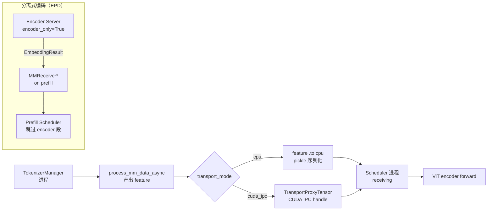

# 12.8 多模态传输

## 定位

多模态传输解决 feature 张量从 TokenizerManager 进程到 Scheduler 进程的跨进程传递问题。SGLang 支持两种 `transport_mode`：CPU pickle（默认）和 CUDA-IPC（零拷贝共享 GPU 内存）。在 disaggregation（EPD）模式下，embedding 还通过 HTTP/gRPC/RDMA 从独立 encoder server 传输到 prefill server。本页覆盖传输模式选择、`get_mm_processor` 分发入口，以及与分离式编码的集成。

## 职责

- `BaseMultimodalProcessor` 在 `__init__` 中接收 `transport_mode`，决定 feature 传输策略。
- `managers/multimodal_processor.py` 的 `get_mm_processor` 按 `hf_config.architectures` 匹配处理器并在实例化时传入 `transport_mode`。
- CPU 模式：feature 张量 `.to("cpu")` 后随 ScheduleBatch pickle 序列化到 scheduler 进程。
- CUDA-IPC 模式：feature 留在 GPU，通过 `TransportProxyTensor` 的 IPC handle 零拷贝共享到 scheduler 进程。
- EPD 模式：encoder server 产出 `EmbeddingResult`，prefill 侧通过 `encode_receiver.py` 的 `MMReceiverHTTP`/`MMReceiverGrpc`/`MMReceiverRDMA` 接收。

## 关键类与函数

| 名称 | 定义位置 | 说明 |
|---|---|---|
| `PROCESSOR_MAPPING` | `managers/multimodal_processor.py:13` | 模型架构 → 处理器类映射 |
| `get_mm_processor` | `managers/multimodal_processor.py:44` | 按 architectures 查找并实例化处理器，传入 `transport_mode` |
| `transport_mode` 参数 | `multimodal/processors/base_processor.py:190` | processor 构造参数，`"cpu"` / `"cuda_ipc"` |
| `mm_feature_transport` | `multimodal/processors/base_processor.py:195` | 从 server_args 解析的实际传输模式 |
| `use_cuda_ipc` | `multimodal/processors/base_processor.py:200` | 是否启用 CUDA-IPC 传输 |
| `MMReceiverBase`/`MMReceiverHTTP`/`MMReceiverGrpc` | `disaggregation/encode_receiver.py:1410/1998/2194` | prefill 侧接收 encoder embedding |
| `MooncakeEmbeddingPool` | `disaggregation/encode_receiver.py:1220` | GPU-direct RDMA 零拷贝 embedding 池 |

## 数据流 / 控制流

`get_mm_processor` 在 TokenizerManager 初始化时被调用，按 `hf_config.architectures` 从 `PROCESSOR_MAPPING` 匹配处理器类，并传入从 `_determine_tensor_transport_mode` 解析的 `transport_mode`。processor 在 `process_mm_data` 中根据 `use_cuda_ipc` 决定是否将 feature 留在 GPU（`keep_mm_feature_on_device`）或移到 CPU。

EPD 模式下，encoder server 独立运行 ViT encoder 产出 `EmbeddingResult`，prefill server 通过 `encode_receiver.py` 的 receiver 接收。`MMReceiverRDMA` 利用 `MooncakeEmbeddingPool` 实现 GPU-direct RDMA 零拷贝——encoder 直接写到预注册的 GPU buffer slot，prefill 侧切片视图使用，省去 D2D copy。

## 子模块树

- `managers/multimodal_processor.py` — processor 分发入口（83 行）
- `managers/mm_utils.py` — `TransportProxyTensor` 传输基础设施（见 [12.3](12.3-mm-utils.md)）
- `disaggregation/encode_receiver.py` — EPD 模式 embedding 接收

## 交叉引用

- 上游: [`03.3 TokenizerManager`](../03-orchestration/03.3.1-tokenizer-manager.md) — 初始化时调 `get_mm_processor`
- 相关: [12.3 多模态工具函数](12.3-mm-utils.md) — `TransportProxyTensor` 实现
- 相关: [`09.8 encode server`](../09-disaggregation/09.8-encode-server-grpc.md) — EPD encoder server 与 receiver
- 相关: [`03.4.1 Scheduler`](../03-orchestration/03.4.1-scheduler-structure.md) — scheduler 侧接收 feature 并排入 batch

## 进一步阅读

- 源码: `python/sglang/srt/managers/multimodal_processor.py`、`python/sglang/srt/disaggregation/encode_receiver.py`
