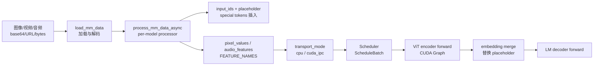

# 12 多模态（Multimodal）

## 子系统定位

多模态子系统负责将图像、视频、音频等非文本输入转换为模型可消费的 embedding 序列，并将其插入到 token 序列的正确位置。它覆盖从原始媒体加载、按模型特定的预处理、特征拼接、ViT CUDA Graph 加速、视频 token 剪枝（EVS），到跨进程特征传输（CUDA-IPC）与分离式编码（EPD）的完整链路。该子系统与 [`03 编排`](../03-orchestration/index.md) 的 TokenizerManager（在 tokenize 阶段调用 processor）、[`04 模型执行`](../04-model-execution/index.md) 的 ModelRunner（在 forward 中跑 ViT encoder）、[`09 分离式推理`](../09-disaggregation/index.md) 的 encode server 紧密协作。

## media to features pipeline

process_mm_data_async 是每模型 processor 的抽象入口，返回 input_ids 与多模态 feature 张量；feature 经 TransportProxyTensor 传输到 scheduler 进程后，由 ViT encoder 编码为 embedding，在 forward 中替换占位 token 的 hidden states。

## 子系统导航

- [12.1 基础处理器](12.1-base-mm-processor.md) — `BaseMultimodalProcessor` 抽象基类、`process_mm_data`/`process_mm_data_async`/`load_mm_data` 生命周期
- [12.2 每模型处理器](12.2-per-model-processors.md) — `processors/` 49 个子类、`PROCESSOR_MAPPING` 注册与分发
- [12.3 多模态工具函数](12.3-mm-utils.md) — `materialize_multimodal_features`、`TransportProxyTensor`、padding 模式
- [12.4 ViT CUDA Graph](12.4-vit-cuda-graph.md) — `ViTCudaGraphRunner`/`InternViTCudaGraphRunner`，Qwen2.5 windowed attention、Qwen3 deepstack
- [12.5 EVS 视频剪枝](12.5-evs-video.md) — `evs_core`/`evs_module`/`evs_processor`，相似度 token 剪枝
- [12.6 媒体加载](12.6-media-loading.md) — `load_mm_data`、`extract_audio_from_video_bytes`、图像/视频/音频加载
- [12.7 自定义处理器注册](12.7-custom-processor-registration.md) — `register_customized_processor`、`_CUSTOMIZED_MM_PROCESSOR`
- [12.8 多模态传输](12.8-mm-transport.md) — `transport_mode` CPU/CUDA-IPC、`get_mm_processor`、disaggregation encode receiver

## 交叉引用

- 上游: [`03.3 TokenizerManager`](../03-orchestration/03.3.1-tokenizer-manager.md) — 在_tokenize_request 中调用 processor
- 上游: [`03.4.1 Scheduler`](../03-orchestration/03.4.1-scheduler-structure.md) — ScheduleBatch 携带 multimodal_inputs
- 下游: [`04.1 ModelRunner`](../04-model-execution/04.1-model-runner.md) — ViT encoder forward
- 相关: [`09.8 encode server`](../09-disaggregation/09.8-encode-server-grpc.md) — EPD 分离编码
- 相关: [`06.3.6 attention-vision`](../06-layers/06.3.6-attn-vision.md) — ViT 内部注意力后端

## 进一步阅读

- 源码: `python/sglang/srt/multimodal/`
- EVS 文档: `python/sglang/srt/multimodal/evs/README.md`
