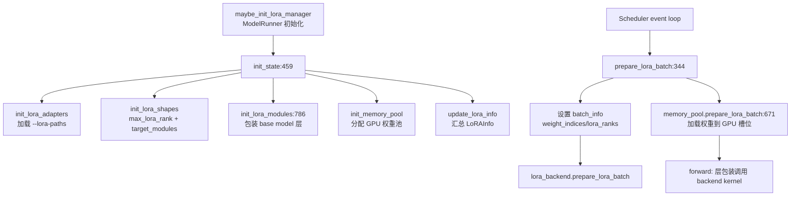

# 13.1 LoRAManager

## 定位

`LoRAManager` 是 LoRA 子系统的核心管理器，运行在 Scheduler 进程中，负责 LoRA 适配器的加载、GPU 权重池管理、层包装初始化与每 batch 的 LoRA 准备。它由 ModelRunner 在 `maybe_init_lora_manager` 中初始化，贯穿整个服务生命周期。

## 职责

- `init_state`：初始化适配器字典、形状信息、内存池、层包装模块。从 `--lora-paths` 推断 `target_modules` 与 `max_lora_rank`。
- `load_lora_adapter`：从磁盘加载 LoRA adapter 权重到 CPU 缓存，校验与 base model 兼容性。
- `init_lora_modules`：扫描 base model 的所有 `nn.Module`，为 `target_modules` 中匹配的层创建 `BaseLayerWithLoRA` 包装。
- `prepare_lora_batch`：每次 forward 前设置 batch info（`weight_indices`/`lora_ranks`/`scalings`），将 batch 涉及的适配器加载到 GPU 权重池。
- `validate_lora_batch`：检查 batch 中的 LoRA ID 数量不超过 `max_loras_per_batch`，且不超过内存池 vacancy。

## 关键类与函数

| 名称 | 定义位置 | 说明 |
|---|---|---|
| `LoRAManager` | `lora/lora_manager.py:57` | 核心管理器类 |
| `load_lora_adapter` | `lora/lora_manager.py:166` | 从路径加载适配器，返回 `LoRAUpdateOutput` |
| `validate_lora_batch` | `lora/lora_manager.py:297` | 校验 batch LoRA ID 是否可载入内存池 |
| `prepare_lora_batch` | `lora/lora_manager.py:344` | 设置 batch info + 调 `memory_pool.prepare_lora_batch` |
| `init_state` | `lora/lora_manager.py:459` | 初始化适配器/形状/模块/内存池 |
| `init_lora_modules` | `lora/lora_manager.py:786` | 扫描 base model，创建 LoRA 层包装 |

## 数据流 / 控制流

`init_state` 按 `init_lora_adapters` → `init_lora_shapes` → `init_lora_modules` → `init_memory_pool` → `update_lora_info` 顺序执行。`init_lora_modules` 遍历 `base_model.named_modules()`，对名称匹配 `target_modules` 的层用 `get_lora_layer`（见 [13.5](13.5-layer-wrappers.md)）创建对应的 `*WithLoRA` 包装。tied embedding 场景下会为 `lm_head` 创建共享权重的独立 `ParallelLMHead` 对象。

每次 forward 前，`prepare_lora_batch` 构建 `weight_indices`（每个请求对应的适配器 slot index）、`lora_ranks`/`scalings` 数组，调用 `memory_pool.prepare_lora_batch` 将新适配器权重拷贝到 GPU 槽位，再调 `lora_backend.prepare_lora_batch` 设置 CUDA Graph 所需的 batch info buffer。

## 子模块树

- `lora/lora_manager.py` — 核心管理器
- `lora/lora_config.py:25` — `LoRAConfig` 适配器配置解析
- `lora/lora.py:43/54` — `LoRALayer`/`LoRAAdapter` 权重容器
- `lora/mem_pool.py` — GPU 内存池（见 [13.4](13.4-memory-pool-eviction.md)）
- `lora/layers.py` — 层包装（见 [13.5](13.5-layer-wrappers.md)）

## 交叉引用

- 上游: [`04.1 ModelRunner`](../04-model-execution/04.1-model-runner.md) — `maybe_init_lora_manager` 初始化
- 上游: [`03.4.1 Scheduler`](../03-orchestration/03.4.1-scheduler-structure.md) — 每次调度调 `prepare_lora_batch`
- 下游: [13.4 内存池与淘汰](13.4-memory-pool-eviction.md) — `LoRAMemoryPool`
- 下游: [13.5 层包装](13.5-layer-wrappers.md) — `init_lora_modules` 创建的包装
- 下游: [13.6 Kernel 后端](13.6-backends.md) — `lora_backend` 执行

## 进一步阅读

- 源码: `python/sglang/srt/lora/lora_manager.py`
