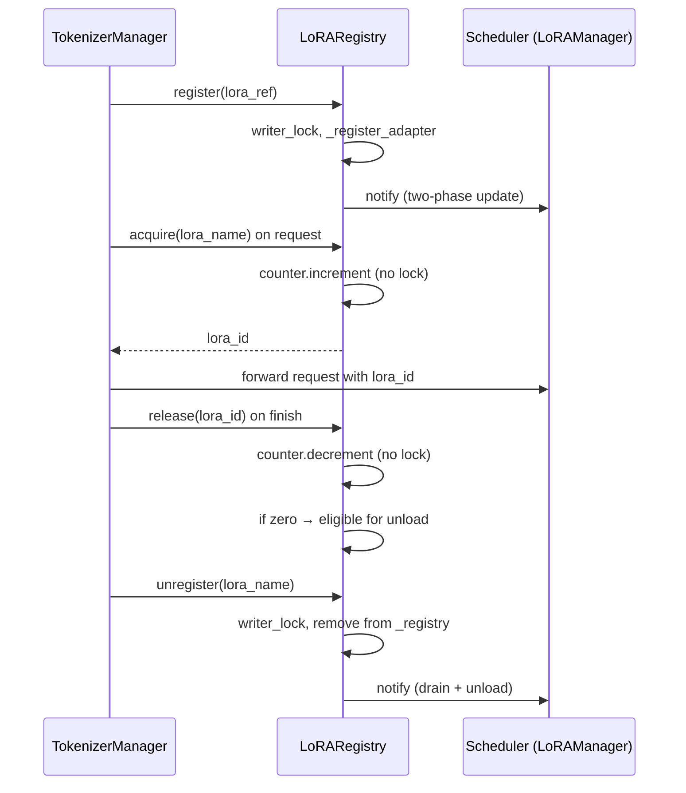

# 13.2 注册表与引用计数

## 定位

`LoRARegistry` 运行在 TokenizerManager 进程，作为所有 LoRA 适配器的全局真相源（single source of truth）。它跟踪每个适配器的引用计数（正在服务的请求数），支持动态注册/注销，并在 Scheduler 与 TokenizerManager 之间维护两阶段一致性模型。`LoRARef` 是适配器的不可变引用记录，携带全局唯一的 `lora_id`。

## 职责

- `LoRARef`：不可变 `msgspec.Struct`，携带 `lora_id`/`lora_name`/`lora_path`/`pinned`，为多节点环境提供确定性 ID 生成（`deterministic_id`）。
- `LoRARegistry`：维护 `lora_name → LoRARef` 的有序字典（LRU 序）与 `lora_id → ConcurrentCounter` 引用计数表。
- `register`/`unregister`：在写锁下增删适配器记录。
- `acquire`/`release`：在请求开始/结束时增减引用计数，支持并发非阻塞。
- `lru_lora_name`：返回最近最少使用的适配器名，供淘汰决策使用。

## 关键类与函数

| 名称 | 定义位置 | 说明 |
|---|---|---|
| `LoRARef` | `lora/lora_registry.py:28` | 不可变适配器引用记录，`frozen=True` |
| `LoRARegistry` | `lora/lora_registry.py:65` | 注册表，持有 `_registry_lock`/`_registry`/`_counters` |
| `register` | `lora/lora_registry.py:99` | 在写锁下注册新 `LoRARef` |
| `unregister` | `lora/lora_registry.py:109` | 在写锁下注销适配器，返回待同步的 `lora_id` |
| `acquire` | `lora/lora_registry.py:126` | 增加引用计数，返回 `lora_id` |
| `release` | `lora/lora_registry.py:167` | 减少引用计数 |
| `lru_lora_name` | `lora/lora_registry.py:221` | 返回 LRU 适配器名（可排除 pinned） |

## 数据流 / 控制流

`LoRARegistry` 使用 `RWLock`（异步读写锁）保护注册/注销操作，`ConcurrentCounter` 保证引用计数增减的线程安全且无锁。注册操作在写锁下进行，阻塞新 acquire 但不影响已 acquire 的请求；acquire/release 不持有写锁，仅操作 `ConcurrentCounter`，实现高并发。

`_registry` 是 `OrderedDict`，按 LRU 序存储——`acquire` 时将适配器移到末尾（最近使用），`lru_lora_name` 从头部返回最旧。`pinned` 适配器在 `lru_lora_name(exclude_pinned=True)` 中被跳过，不会被自动淘汰。

两阶段一致性模型：TokenizerManager 的注册/注销通过通知机制传递到 Scheduler，Scheduler 侧的 `LoRAManager` 在后续 batch 中感知变化并加载/卸载适配器权重。

## 交叉引用

- 上游: [`03.3 TokenizerManager`](../03-orchestration/03.3.1-tokenizer-manager.md) — 持有 `LoRARegistry` 实例
- 下游: [13.1 LoRAManager](13.1-lora-manager.md) — Scheduler 侧消费 `lora_id`
- 下游: [13.3 Drainer](13.3-drainer-overlap-loader.md) — drain 基于 registry 引用计数
- 相关: [13.4 内存池与淘汰](13.4-memory-pool-eviction.md) — LRU 淘汰与 registry LRU 对应

## 进一步阅读

- 源码: `python/sglang/srt/lora/lora_registry.py`
- RWLock: `python/sglang/srt/utils/aio_rwlock.py`
- ConcurrentCounter: `python/sglang/srt/utils.py`
