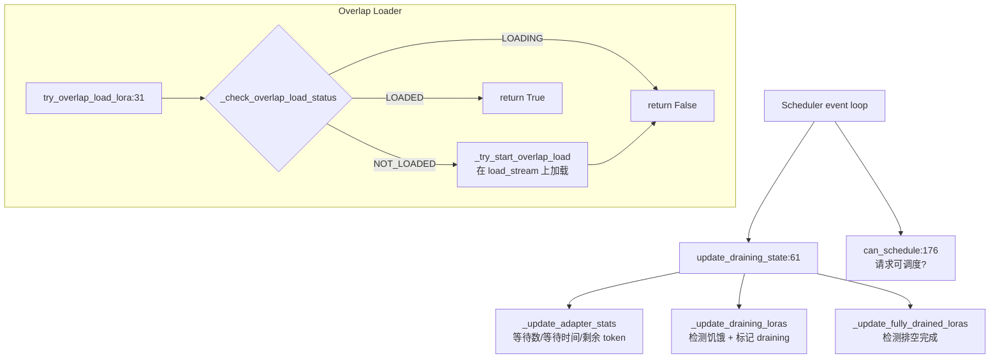

# 13.3 Drainer 与 Overlap Loader

## 定位

`LoRADrainer` 和 `LoRAOverlapLoader` 是 LoRA 子系统中两个优化调度与加载延迟的组件。Drainer 监控等待队列中适配器的饥饿状态，在 `max_loras_per_batch` 槽位满时排空旧适配器为新适配器腾位。Overlap Loader 利用独立 CUDA Stream 在 forward 执行的同时异步加载后续适配器权重，隐藏加载延迟。

## 职责

- `LoRADrainer`：跟踪每个适配器的等待请求数、最大等待时间、运行请求最大剩余 token 数；检测饥饿适配器并标记运行中适配器为 draining；`can_schedule` 判断请求是否可在当前 batch 调度。
- `AdapterStats`：每适配器统计容器，`is_starving` 判断是否超过等待阈值。
- `LoRAOverlapLoader`：在独立 `CudaStream` 上异步加载适配器权重到内存池，用 `CudaEvent` 跟踪加载完成状态；`try_overlap_load_lora` 检查状态并尝试启动异步加载。

## 关键类与函数

| 名称 | 定义位置 | 说明 |
|---|---|---|
| `AdapterStats` | `lora/lora_drainer.py:29` | 每适配器统计：等待数/最大等待时间/最大剩余 token |
| `LoRADrainer` | `lora/lora_drainer.py:46` | 排空管理器 |
| `update_draining_state` | `lora/lora_drainer.py:61` | 更新统计、标记 draining、检测完成排空 |
| `can_schedule` | `lora/lora_drainer.py:176` | 判断请求是否可调度（适配器未在 draining 或已在池中） |
| `LoRAOverlapLoadStatus` | `lora/lora_overlap_loader.py:15` | 加载状态枚举：LOADED/LOADING/NOT_LOADED |
| `LoRAOverlapLoader` | `lora/lora_overlap_loader.py:21` | 异步加载器，持有 `load_stream`/`lora_to_overlap_load_event` |
| `try_overlap_load_lora` | `lora/lora_overlap_loader.py:31` | 检查加载状态，尝试启动异步加载或返回已就绪 |

## 数据流 / 控制流

Drainer 在每个 schedule step 调用 `update_draining_state`：先重置所有 `AdapterStats`，遍历 waiting queue 统计等待请求数和最大等待时间，遍历 running reqs 统计最大剩余 token。若运行中适配器数已达 `max_loras_per_batch` 且某适配器饥饿（等待时间超过 `max_wait_time_secs`），则将最小剩余 token 的运行中适配器标记为 draining——不再接受新请求，等其当前请求完成后释放槽位。

Overlap Loader 在 `try_overlap_load_lora` 中先排干已完成的异步加载（`_drain_completed_overlap_loads`），然后检查目标适配器状态：NOT_LOADED 时若有内存池空位则启动异步加载（在 `load_stream` 上执行权重拷贝），用 `CudaEvent` 标记完成；LOADING 时返回 False 等待；LOADED 时返回 True。主 forward stream 在使用权重前 `wait_event` 确保加载完成。

## 子模块树

- `lora/lora_drainer.py` — 排空管理器（191 行）
- `lora/lora_overlap_loader.py` — 异步加载器（93 行）

## 交叉引用

- 上游: [`03.4.1 Scheduler`](../03-orchestration/03.4.1-scheduler-structure.md) — Scheduler 调用 drainer 与 overlap loader
- 下游: [13.1 LoRAManager](13.1-lora-manager.md) — `enable_lora_overlap_loading` 控制是否启用
- 相关: [13.4 内存池与淘汰](13.4-memory-pool-eviction.md) — overlap loader 依赖内存池空位
- 相关: [13.9 TRT-LLM 实验](13.9-trtllm-experimental-lora.md) — 两流 overlap 是 overlap loader 的进阶版

## 进一步阅读

- 源码: `python/sglang/srt/lora/lora_drainer.py`、`python/sglang/srt/lora/lora_overlap_loader.py`
