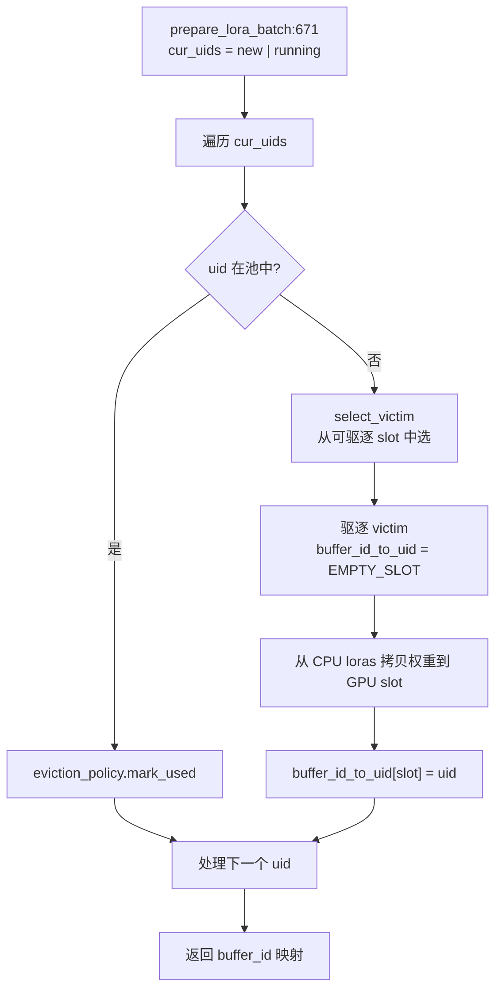

# 13.4 内存池与淘汰策略

## 定位

`LoRAMemoryPool` 管理 GPU 上预分配的 LoRA 权重缓冲区，将 `max_loras_per_batch` 个适配器的 A/B 权重按 slot 存储。当 batch 需要的适配器不在池中时，按淘汰策略驱逐最旧适配器腾出 slot。`EvictionPolicy` 抽象了淘汰策略选择，支持 LRU 与 FIFO 两种实现。

## 职责

- `LoRAMemoryPool`：预分配每层每模块的 A/B 权重 buffer，按 `buffer_id` 索引；`prepare_lora_batch` 将适配器权重从 CPU 拷贝到空闲或被驱逐的 GPU slot。
- `EmptySlot`/`EMPTY_SLOT`：标记未占用的 buffer slot，区分"空"与"有适配器"状态。
- `EvictionPolicy`：抽象策略接口，`mark_used`/`select_victim`/`remove` 三个方法。
- `LRUEvictionPolicy`：按访问时间淘汰最久未使用的适配器。
- `FIFOEvictionPolicy`：按插入顺序淘汰最早装入的适配器（向后兼容）。
- `get_eviction_policy`：工厂函数，按名称创建策略实例。

## 关键类与函数

| 名称 | 定义位置 | 说明 |
|---|---|---|
| `EmptySlot` | `lora/mem_pool.py:49` | 空 slot 标记类 |
| `EMPTY_SLOT` | `lora/mem_pool.py:66` | 全局空 slot 哨兵实例 |
| `LoRAMemoryPool` | `lora/mem_pool.py:129` | GPU 权重池管理器 |
| `LoRAMemoryPool.prepare_lora_batch` | `lora/mem_pool.py:671` | 将 batch 适配器权重加载到 GPU slot |
| `EvictionPolicy` | `lora/eviction_policy.py:28` | 淘汰策略抽象基类 |
| `LRUEvictionPolicy` | `lora/eviction_policy.py:47` | LRU 策略，按 `access_order` 淘汰 |
| `FIFOEvictionPolicy` | `lora/eviction_policy.py:90` | FIFO 策略，按 `insertion_order` 淘汰 |
| `get_eviction_policy` | `lora/eviction_policy.py:131` | 工厂函数：`"lru"` / `"fifo"` |

## 数据流 / 控制流

`prepare_lora_batch` 遍历当前 batch 所需的所有 uid（`cur_uids = new_loras | running_loras`）。对已在池中的 uid，调用 `eviction_policy.mark_used` 更新访问时间；对不在池中的 uid，从非 pinned 的占用 slot 中 `select_victim` 选择淘汰目标，将被淘汰 slot 的 `buffer_id_to_uid` 置为 `EMPTY_SLOT`，然后从 CPU `loras` 字典中拷贝 A/B 权重到该 GPU buffer slot。

LRU 策略在 `mark_used` 时将 uid 移到 `OrderedDict` 末尾（最近使用），`select_victim` 从头部返回最旧。FIFO 策略仅按插入顺序淘汰，不更新访问时间。当所有候选都是 pinned 或 batch 全是 LoRA 请求（无 None 基模型）时，`None`（base model slot）也可被淘汰。

内存池在初始化时按 `base_hf_config.num_hidden_layers` × `target_modules` × `max_loras_per_batch` 分配 A/B 权重 buffer，支持 MoE 专家分片（`moe_use_local_expert_ids`）和 `experts_shared_outer_loras` 共享模式。

## 子模块树

- `lora/mem_pool.py` — `LoRAMemoryPool` + `EmptySlot`（1388 行）
- `lora/eviction_policy.py` — `EvictionPolicy`/`LRUEvictionPolicy`/`FIFOEvictionPolicy`（139 行）

## 交叉引用

- 上游: [13.1 LoRAManager](13.1-lora-manager.md) — `fetch_new_loras` 调 `memory_pool.prepare_lora_batch`
- 相关: [13.2 注册表与引用](13.2-lora-registry-ref.md) — registry LRU 与 mem pool eviction 协同
- 相关: [13.3 Drainer](13.3-drainer-overlap-loader.md) — drainer 排空后释放内存池 slot
- 相关: [`08 分布式`](../08-distributed/index.md) — TP/EP 下的权重 buffer 分片

## 进一步阅读

- 源码: `python/sglang/srt/lora/mem_pool.py`、`python/sglang/srt/lora/eviction_policy.py`
