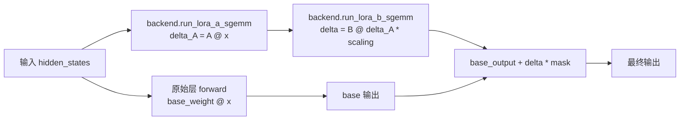

# 13.5 LoRA 层包装

## 定位

`layers.py` 定义了所有 LoRA 层包装类，它们在 forward 中将 base model 的原始线性层输出与 LoRA delta 相加。每种并行线性层类型（Column/Row/QKV/MergedColumn/Replicated）都有对应的 `*WithLoRA` 子类，`get_lora_layer` 工厂函数根据原始层类型返回正确的包装类。

## 职责

- `BaseLayerWithLoRA`：所有 LoRA 层包装的基类，定义 `set_lora`/`set_lora_info` 接口，持有 `lora_backend`/`A_buffer`/`B_buffer` 引用。
- 各 `*WithLoRA` 子类：覆盖 `forward`，调用 backend 的 `run_lora_a_sgemm`/`run_lora_b_sgemm`/`run_qkv_lora`/`run_gate_up_lora` 计算 delta，与 base 输出合并。
- `FusedMoEWithLoRA`：为 MoE 层提供 LoRA delta 注入，通过 `LoRAHooks` 在 gate_up 和 down 之后注入。
- `VocabParallelEmbeddingWithLoRA`/`ParallelLMHeadWithLoRA`：处理 embedding/lm_head 的 LoRA，支持 added tokens。
- `get_lora_layer`：工厂函数，按原始层类名返回对应的 `*WithLoRA` 类。

## 关键类与函数

| 名称 | 定义位置 | 说明 |
|---|---|---|
| `BaseLayerWithLoRA` | `lora/layers.py:34` | 基类，持有 backend/buffer 引用，定义 `set_lora` 接口 |
| `VocabParallelEmbeddingWithLoRA` | `lora/layers.py:62` | embedding 层 LoRA，支持 added tokens |
| `ParallelLMHeadWithLoRA` | `lora/layers.py:235` | lm_head 层 LoRA |
| `ColumnParallelLinearWithLoRA` | `lora/layers.py:422` | 列并行线性层 LoRA |
| `MergedColumnParallelLinearWithLoRA` | `lora/layers.py:491` | 合并列并行（gate+up）LoRA |
| `QKVParallelLinearWithLoRA` | `lora/layers.py:592` | QKV 并行 LoRA |
| `RowParallelLinearWithLoRA` | `lora/layers.py:676` | 行并行 LoRA，all-reduce 后加 delta |
| `ReplicatedLinearWithLoRA` | `lora/layers.py:774` | 复制线性层 LoRA |
| `FusedMoEWithLoRA` | `lora/layers.py:864` | MoE 层 LoRA，通过 hooks 注入 delta |
| `get_lora_layer` | `lora/layers.py:1183` | 工厂函数，按层类型返回包装类 |

## 数据流 / 控制流

每个 `*WithLoRA` 的 `forward` 先调用原始层的 forward 得到 base 输出，然后调用 backend 的 shrink（A 矩阵）和 expand（B 矩阵）kernel 计算 LoRA delta，最后将 delta 与 base 输出相加。`weight_indices`/`lora_ranks`/`scalings` 从 `batch_info` 获取，`token_lora_mapping` 决定每个 token 使用哪个适配器。

`FusedMoEWithLoRA` 的 delta 注入通过 `LoRAHooks`（见 [13.7](13.7-moe-lora-runners.md)）实现：`after_gate_up` 在 gate_up 投影后注入 delta，`after_down` 在 down 投影后注入，避免修改 MoE runner 的核心逻辑。

`get_lora_layer` 在 `init_lora_modules` 中被调用，按原始层的类名（如 `QKVParallelLinear`）匹配返回对应包装类（如 `QKVParallelLinearWithLoRA`）。

## 子模块树

- `lora/layers.py` — 所有 LoRA 层包装定义（1200+ 行）
- `lora/lora.py:43/54` — `LoRALayer`/`LoRAAdapter` 权重容器
- `lora/backend/` — kernel 后端（见 [13.6](13.6-backends.md)）

## 交叉引用

- 上游: [`06.1 Linear`](../06-layers/06.1-linear.md) — 原始层类型定义
- 上游: [`06.4 MoE`](../06-layers/06.4.1-moe-module-flow.md) — `FusedMoEWithLoRA` 包装 MoE 层
- 上游: [`06.11 VocabEmbedding/LMHead`](../06-layers/06.11-vocab-embedding-lmhead.md) — embedding/lm_head 包装
- 下游: [13.1 LoRAManager](13.1-lora-manager.md) — `init_lora_modules` 创建包装
- 下游: [13.6 Kernel 后端](13.6-backends.md) — `forward` 中调用 backend kernel

## 进一步阅读

- 源码: `python/sglang/srt/lora/layers.py`
