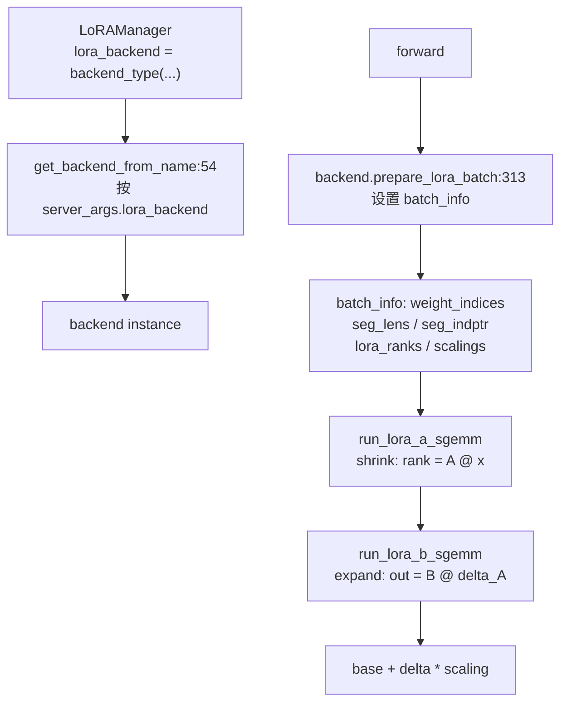

# 13.6 LoRA Kernel 后端

## 定位

LoRA kernel 后端负责实际执行 LoRA A（shrink）和 B（expand）矩阵的 GEMM 计算。`BaseLoRABackend` 定义统一接口，多个子类实现不同硬件/算法的后端：Triton（默认）、cSGMV（分段 SGMM）、Ascend NPU、Torch Native。`backend/lora_registry.py` 提供后端注册与通过名称查找的工厂机制。

## 职责

- `BaseLoRABackend`：定义 `run_lora_a_sgemm`/`run_lora_b_sgemm`/`run_qkv_lora`/`run_gate_up_lora`/`prepare_lora_batch`/`init_cuda_graph_batch_info`/`init_cuda_graph_moe_buffers` 等接口。
- `prepare_lora_batch`：每次 forward 前设置 `batch_info`（`LoRABatchInfo`），包含 `weight_indices`/`seg_lens`/`seg_indptr` 等 CUDA Graph 所需的稳定 buffer。
- `init_cuda_graph_batch_info`：在 CUDA Graph 捕获前预分配最大 batch size 的 batch info buffer。
- `register_lora_backend`/`get_backend_from_name`：后端注册装饰器与查找工厂。

## 关键类与函数

| 名称 | 定义位置 | 说明 |
|---|---|---|
| `BaseLoRABackend` | `lora/backend/base_backend.py:12` | 后端基类，继承 `LoRABackendLmHeadMixing` |
| `init_cuda_graph_batch_info` | `lora/backend/base_backend.py:149` | 预分配 CUDA Graph batch info buffer |
| `init_cuda_graph_moe_buffers` | `lora/backend/base_backend.py:172` | 预分配 MoE LoRA CUDA Graph buffer |
| `prepare_lora_batch` | `lora/backend/base_backend.py:313` | 设置 `batch_info` 供 kernel 使用 |
| `LORA_SUPPORTED_BACKENDS` | `lora/backend/lora_registry.py:8` | 后端名 → 创建函数映射 |
| `register_lora_backend` | `lora/backend/lora_registry.py:11` | 装饰器，注册后端 |
| `get_backend_from_name` | `lora/backend/lora_registry.py:54` | 按名称返回后端类 |
| `TritonLoRABackend` | `lora/backend/triton_backend.py:20` | Triton kernel 后端（默认） |
| `ChunkedSgmvLoRABackend` | `lora/backend/chunked_backend.py:24` | 分段 SGMM 后端（csgmv） |
| `AscendLoRABackend` | `lora/backend/ascend_backend.py:13` | 华为 Ascend NPU 后端 |
| `TorchNativeLoRABackend` | `lora/backend/torch_backend.py:34` | 纯 PyTorch 后端（调试/兼容） |

## 数据流 / 控制流

`get_backend_from_name` 从 `LORA_SUPPORTED_BACKENDS` 中按名称查找注册的工厂函数。注册通过 `@register_lora_backend("triton")` 装饰器完成，已注册的后端有 `"triton"`/`"csgmv"`/`"ascend"`/`"torch_native"`（`"flashinfer"` 已废弃）。

`prepare_lora_batch` 根据 `use_cuda_graph` 标志决定是否将 batch info 写入预分配的 CUDA Graph buffer（`self.cuda_graph_batch_info`），还是在每次 forward 新建。Triton 后端的 `compute_sgemm_routing` 在 CUDA Graph 模式下预计算路由索引，避免 replay 时重算。cSGMV 后端额外分段处理变长序列，支持 prefill 的长序列场景。

`init_cuda_graph_batch_info` 在 warmup 阶段按 `max_bs_in_cuda_graph` 分配 `weight_indices`/`seg_lens`/`seg_indptr` 等固定地址 buffer。

## 子模块树

- `lora/backend/base_backend.py` — `BaseLoRABackend` 基类（447 行）
- `lora/backend/triton_backend.py` — Triton SGMM 后端（默认）
- `lora/backend/chunked_backend.py` — cSGMV 分段后端
- `lora/backend/ascend_backend.py` — Ascend NPU 后端
- `lora/backend/torch_backend.py` — PyTorch 原生后端
- `lora/backend/lora_registry.py` — 后端注册表（61 行）
- `lora/backend/lmhead_mixing.py` — LM head 混合逻辑 mixin
- `lora/utils.py:28` — `LoRABatchInfo` 数据结构

## 交叉引用

- 上游: [13.1 LoRAManager](13.1-lora-manager.md) — 通过 `get_backend_from_name` 创建后端
- 上游: [13.5 层包装](13.5-layer-wrappers.md) — `forward` 中调用 backend kernel
- 相关: [`15 内核`](../15-kernels-hardware/15.2-sgl-kernel-aot.md) — SGMM/cSGMV kernel
- 相关: [`08 分布式`](../08-distributed/index.md) — Ascend NPU 支持

## 进一步阅读

- 源码: `python/sglang/srt/lora/backend/`
