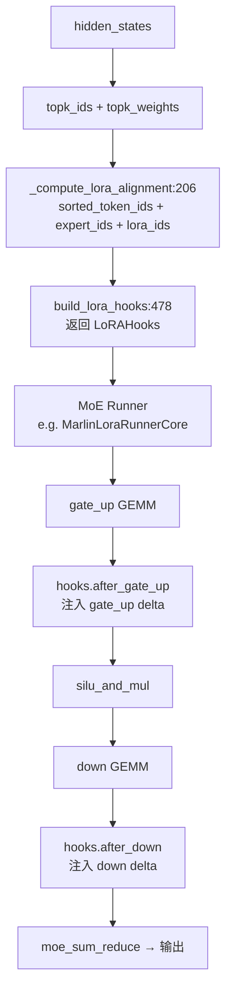

# 13.7 MoE-LoRA Runner

## 定位

MoE-LoRA Runner 将 LoRA delta 注入到 MoE（Mixture-of-Experts）前向计算中。由于 MoE 的 gate_up 和 down 投影按专家分组，LoRA delta 需要按 token-expert 对齐计算。`LoRAInfo` 封装所有 MoE-LoRA 计算所需的权重和映射信息，`LoRAHooks` 提供 delta 注入的回调接口，`build_lora_hooks` 统一构建这些回调。`MarlinLoraRunnerCore` 是使用 Marlin kernel 的 MoE runner 变体。

## 职责

- `LoRAInfo`：dataclass，封装 gate_up/down 的 LoRA A/B 权重、段指针、token-adapter 映射、rank/scaling 配置，以及 MoE 相关的专家数、共享模式、TP 信息。
- `LoRAHooks`：定义 `after_gate_up` 和 `after_down` 两个回调，在 MoE runner 的 gate_up 投影后和 down 投影后注入 LoRA delta。
- `build_lora_hooks`：一次性计算 token-lora mapping 和 alignment tensor，返回捕获了这些信息的闭包。
- `MarlinLoraRunnerCore`：使用 Marlin WNA16 kernel 的 MoE runner，在 gate_up 和 down 之后调用 hooks 注入 delta。

## 关键类与函数

| 名称 | 定义位置 | 说明 |
|---|---|---|
| `LoRAInfo` | `lora/lora_moe_runners.py:150` | MoE-LoRA 权重与映射信息 dataclass |
| `LoRAHooks` | `lora/lora_moe_runners.py:195` | delta 注入回调：`after_gate_up`/`after_down` |
| `build_lora_hooks` | `lora/lora_moe_runners.py:478` | 构建 hooks 闭包，计算 alignment 一次 |
| `_compute_lora_alignment` | `lora/lora_moe_runners.py:206` | 计算 token-expert-lora 对齐 tensor |
| `MarlinLoraRunnerCore` | `lora/lora_moe_runner_marlin.py:40` | Marlin MoE runner，支持 LoRA hooks |

## 数据流 / 控制流

`build_lora_hooks` 首先检查是否需要 LoRA（`lora_info` 为 None 或 `max_lora_rank == 0` 时返回空 hooks）。然后根据 `lora_use_virtual_experts` 选择经典路径或虚拟专家路径：经典路径调 `_compute_lora_alignment` 将 `topk_ids` 转换为 sorted token IDs、expert IDs 和 lora IDs，虚拟专家路径直接使用 `token_lora_mapping`。最后返回两个闭包：`after_gate_up` 在 gate_up 投影后按 lora_ids 对每个 token-expert 段执行 shrink+expand，`after_down` 类似。

`MarlinLoraRunnerCore.run_from_dispatch` 的 pipeline 为：gate_up Marlin GEMM → `hooks.after_gate_up` → silu_and_mul → down Marlin GEMM → `hooks.after_down` → moe_sum_reduce。hooks 参数必传（`assert hooks is not None`），无 LoRA 时传空 `LoRAHooks()` 即可。

`LoRAInfo` 还支持 `experts_shared_outer_loras` 模式——gate_up lora_A 和 down lora_B 共享跨专家（expert_dim=1），减少权重存储。

## 子模块树

- `lora/lora_moe_runners.py` — `LoRAInfo`/`LoRAHooks`/`build_lora_hooks`（556 行）
- `lora/lora_moe_runner_marlin.py` — `MarlinLoraRunnerCore`（200 行）
- `lora/utils.py:12` — `MoELoRABatchInfo` 数据结构

## 交叉引用

- 上游: [13.5 层包装](13.5-layer-wrappers.md) — `FusedMoEWithLoRA` 使用 hooks
- 上游: [`06.4 MoE`](../06-layers/06.4.1-moe-module-flow.md) — MoE runner 调用 hooks
- 相关: [13.4 内存池与淘汰](13.4-memory-pool-eviction.md) — `LoRAInfo` 权重来自内存池
- 相关: [13.9 TRT-LLM 实验](13.9-trtllm-experimental-lora.md) — 实验性 MoE overlap hooks

## 进一步阅读

- 源码: `python/sglang/srt/lora/lora_moe_runners.py`、`python/sglang/srt/lora/lora_moe_runner_marlin.py`
