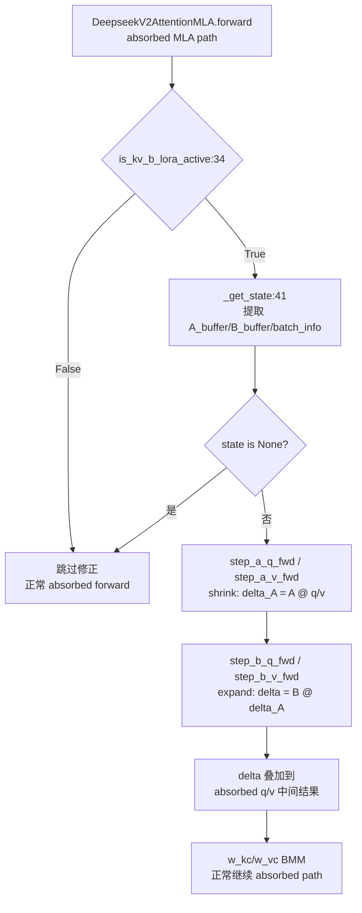

# 13.8 DeepSeek MLA Correction

## 定位

DeepSeek 的 absorbed-MLA（Multi-head Latent Attention）路径在 `DeepseekV2AttentionMLA` 中绕过了 `kv_b_proj.forward()`，将 K/V 贡献折叠进两个 BMM（batched matmul）对预计算的 `w_kc`/`w_vc` 权重。标准的 `ColumnParallelLinearWithLoRA` 包装器永远不会看到这些激活，LoRA delta 会被静默丢弃。`deepseek_mla_correction.py` 提供专用修正函数，在 absorbed 中间结果上注入 `kv_b_proj` 的 LoRA delta。

## 职责

- `is_kv_b_lora_active`：廉价前置检查，在 attention forward 中判断 `kv_b_proj` 是否有 LoRA 适配器，无适配器时跳过整个修正路径。
- `_get_state`：从 attention 模块提取 `A_buffer`/`B_buffer` 和 `batch_info`，若缺失则返回 None。
- 修正函数：调用 `step_a_q_fwd`/`step_a_v_fwd`/`step_b_q_fwd`/`step_b_v_fwd` 等 SGMM 内核，在 absorbed Q 和 V 路径上注入 LoRA delta。

## 关键类与函数

| 名称 | 定义位置 | 说明 |
|---|---|---|
| `is_kv_b_lora_active` | `lora/deepseek_mla_correction.py:34` | 检查 `kv_b_proj.set_lora` 是否为 True |
| `_get_state` | `lora/deepseek_mla_correction.py:41` | 提取 A/B buffer 和 batch_info |
| `step_a_q_fwd` | `kernels/ops/gemm/kv_b_lora_absorbed.py` | Q 路径 shrink delta（A 矩阵） |
| `step_a_v_fwd` | `kernels/ops/gemm/kv_b_lora_absorbed.py` | V 路径 shrink delta |
| `step_b_q_fwd` | `kernels/ops/gemm/kv_b_lora_absorbed.py` | Q 路径 expand delta（B 矩阵） |
| `step_b_v_fwd` | `kernels/ops/gemm/kv_b_lora_absorbed.py` | V 路径 expand delta |

## 数据流 / 控制流

absorbed-MLA 的 forward 将 `kv_b_proj` 的贡献吸收进 `w_kc`/`w_vc` 权重矩阵，通过 BMM 而非标准线性投影计算。当 `kv_b_proj` 被 `ColumnParallelLinearWithLoRA` 包装后，`forward` 不被调用，LoRA delta 无法通过常规路径注入。

`is_kv_b_lora_active` 通过 `getattr(attn_module.kv_b_proj, "set_lora", False)` 检查——这是一个轻量的 `getattr`，在无 LoRA 时仅一次属性查询即跳过。`_get_state` 进一步检查 `A_buffer`/`batch_info` 是否存在，确保修正路径有足够的上下文。

四个 SGMM kernel 函数分两步执行：step_a 是 shrink 阶段（A 矩阵降维），step_b 是 expand 阶段（B 矩阵升维），分别在 Q 和 V 路径上计算 LoRA delta 并叠加到 absorbed 中间结果。

## 子模块树

- `lora/deepseek_mla_correction.py` — 修正函数（117 行）
- `kernels/ops/gemm/kv_b_lora_absorbed.py` — absorbed-MLA SGMM kernel 实现

## 交叉引用

- 上游: [`06.3 Attention`](../06-layers/06.3.1-attn-backend-abstraction.md) — `DeepseekV2AttentionMLA` absorbed path
- 上游: [13.5 层包装](13.5-layer-wrappers.md) — `ColumnParallelLinearWithLoRA` 包装 `kv_b_proj`
- 相关: [13.6 Kernel 后端](13.6-backends.md) — SGMM kernel 的通用接口
- 相关: [13.9 TRT-LLM 实验](13.9-trtllm-experimental-lora.md) — `trtllm_lora_temp/deepseek_mla_correction.py` 实验变体

## 进一步阅读

- 源码: `python/sglang/srt/lora/deepseek_mla_correction.py`
- Kernel: `python/sglang/kernels/ops/gemm/kv_b_lora_absorbed.py`
- 调用方: `python/sglang/srt/models/deepseek_v2.py` 的 `forward_mla.py`
