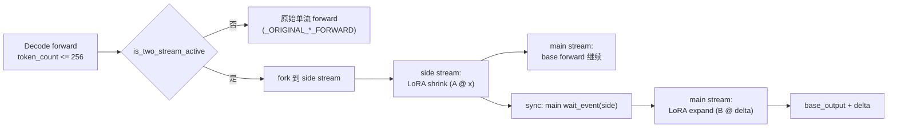

# 13.9 TRT-LLM 实验 LoRA

## 定位

`trtllm_lora_temp/` 是一组实验性 LoRA 优化路径，通过 monkey-patch 在 decode 阶段将 LoRA delta 计算重叠到独立的 side CUDA stream 上，实现 base model forward 与 LoRA delta 的两流并行。由环境变量 `SGLANG_LORA_TWO_STREAM=1` 激活，`SGLANG_EXPERIMENTAL_LORA_OPTI` 作为总开关。该路径主要面向 Qwen3.5（FP8）和 Kimi（NVFP4）的 MoE+LoRA 融合推理。

## 职责

- `install_two_stream_overrides`：在模块加载时通过 monkey-patch 替换 5 个 forward 方法和 3 个 MoE fused experts 函数，启用两流 overlap。
- `is_two_stream_active`：per-batch 门控，仅对 decode-shaped batch（token 数 <= `SGLANG_TWO_STREAM_MAX_TOKENS`，默认 256）启用两流。
- `environ.py`：实验功能环境变量注册表，所有 flag 受 `SGLANG_EXPERIMENTAL_LORA_OPTI` 总开关控制。
- 各子模块实现具体的 overlapped forward 函数：`attention.py`（QKV/Row/Column/Replicated）、`merged_column.py`（gate_up/mamba in_proj）、`moe_overlap.py`（MoE gate_up LoRA）、`lora_dispatch.py`（fused experts 入口）、`lora_layer.py`（层级工具）。

## 关键类与函数

| 名称 | 定义位置 | 说明 |
|---|---|---|
| `install_two_stream_overrides` | `lora/trtllm_lora_temp/__init__.py:127` | monkey-patch 安装两流 override |
| `is_two_stream_active` | `lora/trtllm_lora_temp/__init__.py:33` | per-batch 门控（decode-shaped check） |
| `get_lora_side_stream` | `lora/trtllm_lora_temp/__init__.py:38` | 获取共享 side CUDA stream |
| `experimental_lora_enabled` | `lora/trtllm_lora_temp/environ.py:28` | 总开关检查 |
| `_LoraEnvs` | `lora/trtllm_lora_temp/environ.py:63` | 实验环境变量集合 |
| `lora_envs` | `lora/trtllm_lora_temp/environ.py:128` | `_LoraEnvs` 单例 |

## 子模块树

- `trtllm_lora_temp/__init__.py` — monkey-patch 安装与 side stream 管理
- `trtllm_lora_temp/environ.py` — 实验环境变量注册表（135 行）
- `trtllm_lora_temp/attention.py` — QKV/Row/Column/Replicated overlapped forward（O7/O8/O10/O11）
- `trtllm_lora_temp/merged_column.py` — MergedColumn overlapped forward（O9）
- `trtllm_lora_temp/moe_overlap.py` — MoE gate_up LoRA overlap（O1: FP8/FP4/BF16）
- `trtllm_lora_temp/lora_dispatch.py` — fused experts with LoRA 入口
- `trtllm_lora_temp/lora_layer.py` — LoRA 层级工具
- `trtllm_lora_temp/sgl_backend.py` — SGLang backend 适配
- `trtllm_lora_temp/sgl_fp8_moe.py` — FP8 MoE LoRA 计算
- `trtllm_lora_temp/specialized_expand.py` — 特化 expand kernel
- `trtllm_lora_temp/shared_add_overlap.py` — shared add overlap（O2，默认关闭）
- `trtllm_lora_temp/deepseek_mla_correction.py` — MLA correction 实验变体
- `trtllm_lora_temp/experimental_sgl_trtllm_moe.py` — 实验性 MoE runner

## 数据流 / 控制流

激活后，`install_two_stream_overrides` 保存原始 forward 方法（`_ORIGINAL_QKV_FORWARD` 等），替换为 overlapped 版本。overlapped forward 在 decode batch 中将 LoRA shrink（A 矩阵）fork 到 `lora_side` stream，main stream 继续跑 base forward；expand 前通过 `wait_event` 等待 side stream 完成。非 decode batch（prefill）回退到原始单流实现。

`per-batch gating` 确保 prefill 不受影响——prefill 的长序列与两流 chunked 调度不兼容。`init_lora_two_stream_resources` 在 CUDA Graph capture 前预创建 side stream，避免在 capture region 内创建 stream（driver call 禁忌）。

环境变量分为 common（Qwen3.5 与 Kimi 共享，默认 True）和 non-shared（默认 False 需显式设置）两组。`_GatedBool`/`_GatedInt` 确保总开关关闭时所有 flag 读 False，代码路径与上游字节一致。

## 交叉引用

- 上游: [13.5 层包装](13.5-layer-wrappers.md) — 被 patch 的原始 forward 方法
- 上游: [13.3 Overlap Loader](13.3-drainer-overlap-loader.md) — 两流是 overlap loader 的进阶
- 上游: [13.8 MLA Correction](13.8-deepseek-mla-correction.md) — `deepseek_mla_correction.py` 实验变体
- 相关: [`06.4 MoE`](../06-layers/06.4.1-moe-module-flow.md) — MoE overlap 的 base forward
- 相关: [`15 内核`](../15-kernels-hardware/15.2-sgl-kernel-aot.md) — JIT kernel 支持
- 相关: [sglang-runtime-context skill](.claude/skills/sglang-runtime-context) — `get_stream` 运行时 stream 管理

## 进一步阅读

- 源码: `python/sglang/srt/lora/trtllm_lora_temp/`
- 启动条件: `python/sglang/srt/lora/layers.py` 末尾调 `install_two_stream_overrides`
