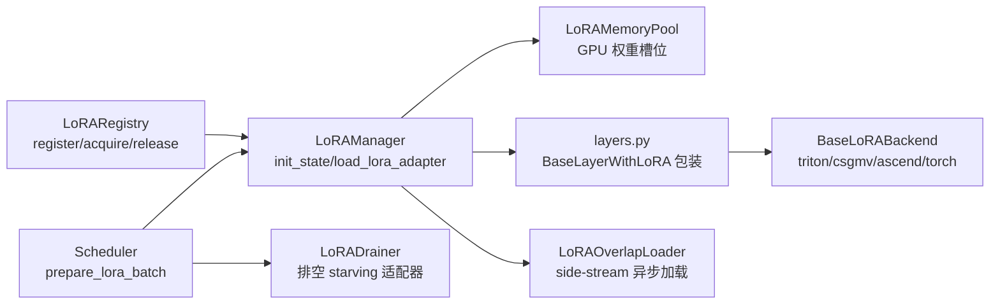

# 13 LoRA 与适配器服务（LoRA Serving）

## 子系统定位

LoRA 子系统为 SGLang 提供多 LoRA 适配器在线服务能力：在同一 base model 上动态加载/卸载多个 LoRA 适配器，每个请求可指定使用不同的适配器，在单次 forward batch 中混合执行不同适配器的推理。子系统覆盖适配器注册表、内存池管理、批量准备、层包装、kernel 后端、MoE-LoRA runner、drainer 排空、overlap 异步加载、MLA correction 与实验性 TRT-LLM 两流 overlap 等全部能力，并与 [`03 编排`](../03-orchestration/index.md) 的 Scheduler、[`04 模型执行`](../04-model-execution/index.md) 的 ModelRunner、[`06 Layers`](../06-layers/index.md) 的线性层/MoE 紧密协作。

## LoRA 池 + wrap + drain 总览

LoRARegistry 在 TokenizerManager 进程跟踪适配器引用计数；LoRAManager 在 Scheduler 进程管理 GPU 权重池与层包装；每个 forward 前 `prepare_lora_batch` 将当前 batch 涉及的适配器加载到池中并设置 batch info；层包装在 forward 中调用 backend kernel 计算 LoRA delta；Drainer 监控适配器饥饿并排空旧适配器腾出槽位。

## 子系统导航

- [13.1 LoRAManager](13.1-lora-manager.md) — 核心管理器、`init_state`/`load_lora_adapter`/`prepare_lora_batch`/`validate_lora_batch`
- [13.2 注册表与引用](13.2-lora-registry-ref.md) — `LoRARef`/`LoRARegistry`、RWLock + ConcurrentCounter
- [13.3 Drainer 与 Overlap Loader](13.3-drainer-overlap-loader.md) — `LoRADrainer`/`AdapterStats`/`LoRAOverlapLoader`
- [13.4 内存池与淘汰](13.4-memory-pool-eviction.md) — `LoRAMemoryPool`/`EMPTY_SLOT`/`EvictionPolicy`(LRU/FIFO)
- [13.5 层包装](13.5-layer-wrappers.md) — `BaseLayerWithLoRA` 及各种 `*WithLoRA` 子类、`get_lora_layer`
- [13.6 Kernel 后端](13.6-backends.md) — `BaseLoRABackend`/`register_lora_backend`/triton/csgmv/ascend/torch
- [13.7 MoE-LoRA Runner](13.7-moe-lora-runners.md) — `LoRAInfo`/`LoRAHooks`/`build_lora_hooks`/`MarlinLoraRunnerCore`
- [13.8 DeepSeek MLA Correction](13.8-deepseek-mla-correction.md) — absorbed-MLA `kv_b_proj` LoRA correction
- [13.9 TRT-LLM 实验 LoRA](13.9-trtllm-experimental-lora.md) — `trtllm_lora_temp/` 两流 overlap 实验路径

## 交叉引用

- 上游: [`03.4.1 Scheduler`](../03-orchestration/03.4.1-scheduler-structure.md) — `prepare_lora_batch` 在 schedule 中调用
- 上游: [`04.1 ModelRunner`](../04-model-execution/04.1-model-runner.md) — `maybe_init_lora_manager` 初始化
- 下游: [`06.1 Linear`](../06-layers/06.1-linear.md) — LoRA 包装层委托 base linear 的权重
- 相关: [`15 内核`](../15-kernels-hardware/15.2-sgl-kernel-aot.md) — SGMM/cSGMV kernel
- 相关: [`08 分布式`](../08-distributed/index.md) — TP/EP 下的 LoRA 权重分片

## 进一步阅读

- 源码: `python/sglang/srt/lora/`
