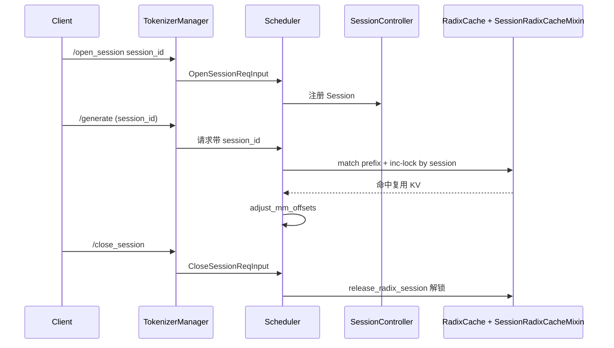

# 14.1 Session 控制器

## 定位

`session/` 子模块让 SGLang 支持跨请求的"会话"：同一 `session_id` 后续请求复用前序生成的 KV，跳过重复 prefill。`SessionController` 是请求准入时的会话状态机，`SessionRadixCacheMixin` 让 RadixCache 识别会话锁引用，`StreamingSession` 提供独立的流式会话缓存视图。控制面经 `TokenizerManager.open_session/close_session` 暴露。

## 职责

- `SessionController` 维护 `session_id → Session` 映射，处理会话打开/关闭/再续、`maybe_reap` 定期回收失效会话。
- `Session` 记录会话累计 token 长度、mm offset、上游 image_inputs，供后续请求恢复。
- `adjust_mm_offsets`：多模态会话里按已有 image token 数平移本请求的 mm offset，避免 vision embedding 位置错乱。
- `SessionRadixCacheMixin.release_radix_session`：会话关闭时按 `session_id` 释放 radix 树上的 inc-lock ref，让对应节点可被淘汰。
- `StreamingSession`：基于 `BasePrefixCache` 的虚拟会话视图，`release_radix_session` 委托给 `inner`。
- 与 `TokenizerControlMixin`/`Scheduler.open_session/close_session` 串成端到端路径。

## 关键类与函数

| 名称 | 定义位置 | 说明 |
|---|---|---|
| `SessionReqNode` | `session/session_controller.py:36` | 会话请求节点 |
| `Session` | `session/session_controller.py:82` | 单会话状态：长度/mm offset/inputs |
| `SessionController` | `session/session_controller.py:353` | 会话总控，`maybe_reap`/registry；Scheduler 调 `self.session_controller` |
| `SessionController.adjust_mm_offsets` | `session/session_controller.py:473` | 按会话历史平移 mm offset |
| `StreamingSession` | `session/streaming_session.py:125` | 流式会话缓存（`BasePrefixCache`） |
| `StreamingSession.release_radix_session` | `session/streaming_session.py:441` | 委托 `inner.release_radix_session` |
| `SessionRadixCacheMixin` | `mem_cache/session_radix_cache.py:23` | 给 RadixCache 加 session inc-lock ref |
| `SessionRadixCacheMixin.release_radix_session` | `mem_cache/session_radix_cache.py:84` | 释放会话持有的 radix 节点 ref，返回释放页数 |
| `BasePrefixCache.release_radix_session` | `mem_cache/base_prefix_cache.py:346` | 默认空实现（非 session 后端） |
| `TokenizerManager.open_session` / `close_session` | `managers/tokenizer_control_mixin.py:857/884` | 控制面入口，扇出到 scheduler |
| `Scheduler.open_session` / `close_session` | `managers/scheduler.py:4381/4387` | router/worker 侧落盘会话状态 |

## 数据流 / 控制流

`RadixCache`（`mem_cache/radix_cache.py:280`）经 `SessionRadixCacheMixin` 在 insert/match 时按 `session_id` 维护一份 inc-lock，避免会话还在用就被 LRU 淘；`release_radix_session` 关闭时一次性归还 ref。非会话后端（ChunkCache 等）继承基类的空实现，调用安全。

## 交叉引用

- 上游: [`02 服务入口`](../02-server-api/index.md)、[`03.3.5 控制面 mixin`](../03-orchestration/03.3.5-tm-control-mixin.md)
- 下游: [`07 KV Cache`](../07-kv-cache/index.md) — RadixCache inc-lock
- 相关: [`12 多模态`](../12-multimodal/index.md) — mm offset 调整
- 相关: [`17 可观测`](../17-observability-ops/index.md) — session 计数指标

## 进一步阅读

- 源码: `python/sglang/srt/session/`、`python/sglang/srt/mem_cache/session_radix_cache.py`
