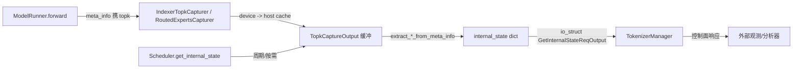

# 14.2 State Capturer

## 定位

`state_capturer/` 把 SGLang 运行时"想给外部快照看"的 per-request topk 状态捕获下来，作为 `get_internal_state` 返回 payload 的一部分。当前主要捕获两类：MoE routed experts 的 topk 路由、DSA indexer 的 topk 索引。它与 `TokenizerControlMixin` 的 `get_internal_state`/`set_internal_state` 控制面路径与 `load_snapshot` 协同。

## 职责

- `BaseTopkCapturer` 提供设备缓存 + 主机缓存的通用 topk 捕获骨架，`TopkCaptureOutput` 描述单次输出。
- `RoutedExpertsCapturer` 捕获每请求的 MoE 路由 experts（每层每 token topk）。
- `IndexerTopkCapturer` 捕获 DSA indexer 的 topk 索引，供离线分析/监督。
- `maybe_capture_indexer_topk`/`extract_*_from_meta_info` 把捕获的张量从 forward meta_info 里捞出来。
- 捕获的数据经 `Scheduler.get_internal_state` 打包成 `internal_state` dict，由 `GetInternalStateReqOutput`（io_struct:1845）回传给 `TokenizerManager`。

## 关键类与函数

| 名称 | 定义位置 | 说明 |
|---|---|---|
| `BaseDeviceCache` / `BaseHostCache` | `state_capturer/base.py:20/54` | 设备/主机缓存基类 |
| `TopkCaptureOutput` | `state_capturer/base.py:80` | 单次捕获输出描述 |
| `BaseTopkCapturer` | `state_capturer/base.py:100` | 通用 topk 捕获骨架 |
| `RoutedExpertsCapturer` | `state_capturer/routed_experts.py:19` | MoE routed experts 捕获 |
| `get_global_experts_capturer` / `set_global_experts_capturer` | `state_capturer/routed_experts.py:136/142` | 进程级单例读写 |
| `disable_routed_experts_capture_for_draft` | `state_capturer/routed_experts.py:159` | draft 模型禁用捕获 |
| `IndexerTopkCapturer` | `state_capturer/indexer_topk.py:15` | DSA indexer topk 捕获 |
| `maybe_capture_indexer_topk` | `state_capturer/indexer_topk.py:59` | forward 期间按需捕获 |
| `create_indexer_capturer` | `state_capturer/indexer_topk.py:85` | 构造捕获器 |
| `Scheduler.get_internal_state` / `set_internal_state` | `managers/scheduler.py:3858/3904` | 控制面落点 |
| `TokenizerManager.get_internal_state` / `set_internal_state` | `managers/tokenizer_control_mixin.py:803/812` | 经 communicator 扇出 |

## 数据流 / 控制流

capture 的开关与范围由运行时控制：`set_global_*_capturer` 在需要时挂上、不需要时置 None 零开销；draft 模型默认经 `disable_routed_experts_capture_for_draft` 关闭以免污染统计。`load_snapshot`（`managers/load_snapshot.py`）的 `internal_state` 字段通过同一条 `get_internal_state` 路径聚合多个 scheduler 的状态，形成全局快照。

## 交叉引用

- 上游: [`03.3.5 控制面 mixin`](../03-orchestration/03.3.5-tm-control-mixin.md) — `get/set_internal_state` 扇出
- 下游: [`04.1 ModelRunner`](../04-model-execution/04.1-model-runner.md) — forward meta_info 来源
- 相关: [`06 Layers`](../06-layers/index.md) — MoE router / DSA indexer
- 相关: [`17 可观测`](../17-observability-ops/index.md) — `load_snapshot` 指标

## 进一步阅读

- 源码: `python/sglang/srt/state_capturer/`、`python/sglang/srt/managers/load_snapshot.py`
