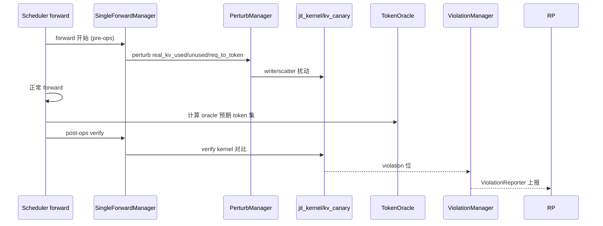

# 14.3 KV Canary

## 定位

`kv_canary/` 是 SGLang 的 KV cache 正确性"金丝雀"：它在真实推理流里主动扰动 KV pool/req_to_token 槽位、下一轮前向验证输出 token 是否仍落在 oracle 预期集合内，从而在硬件/内核隐性错误暴露到用户前捕获。它覆盖普通 KV、SWA、DSA、req_to_token 多类 pool，内核在 `jit_kernel/kv_canary/`。

## 职责

- `CanaryManager`（`kv_canary/runner/canary_manager.py:42`）是单点总控：装配 endpoint、kernel launcher、violation/health/enable_warner、stats_logger、future_tensor。
- `install_canary`（`kv_canary/api.py:30`）入点：patch `ModelRunner.forward`，把 `SingleForwardManager` 注入每个 forward。
- `CanaryEndpoint`（`kv_canary/endpoint.py:31`）描述"在哪段 buffer、哪个 group 上做什么验证"；`build_endpoints_from_group` 按 pool 类型组装。
- `SingleForwardManager`（`kv_canary/single_forward_manager/manager.py:58`）分阶段（pre-ops / in-graph / post-ops）执行单 forward 的 canary。
- `PerturbManager` 与 `perturb/` 子目录实现扰动：`real_kv_used/unused/post_forward`、`req_to_token`、`next_token_swap` 等。
- `ViolationManager`/`ViolationReporter`/`SwaDivergenceReporter` 收集并汇报偏差；`PeriodicCanaryStatsLogger` 输出周期统计。
- `jit_kernel/kv_canary/` 提供 verify/write/scatter/plan 的 Triton 内核（含 `_ref` torch 参考实现）。

## 关键类与函数

| 名称 | 定义位置 | 说明 |
|---|---|---|
| `install_canary` | `kv_canary/api.py:30` | 入点，patch model forward |
| `_patch_model_forward` | `kv_canary/api.py:103` | forward hook 注入 |
| `CanaryConfig` / `CanaryMode` | `kv_canary/config.py:23/16` | 配置与模式枚举 |
| `CanaryManager` | `kv_canary/runner/canary_manager.py:42` | 总控 |
| `CanaryEndpoint` / `build_endpoints_from_group` | `kv_canary/endpoint.py:31/186` | 验证端点 |
| `SingleForwardManager` | `kv_canary/single_forward_manager/manager.py:58` | 单 forward 三阶段 |
| `SweepOrchestrator` | `kv_canary/runner/sweep.py:20` | 全 pool sweep |
| `ViolationManager` / `ViolationReporter` | `kv_canary/runner/violation_manager.py:13` / `kv_canary/runner/violation_reporter.py:20` | 偏差收集/上报 |
| `PerturbManager` | `kv_canary/perturb/manager.py:22` | 扰动总管 |
| `TokenOracle` / `HashOracle` | `kv_canary/token_oracle/oracle.py:9/18` | 确定"预期 token"集 |
| `attach_canary_buffers` | `kv_canary/pool_patcher/api.py:38` | 把 canary buffer 挂到 pool 类型 |
| 内核 `verify`/`write`/`scatter_req_token_ids`/`plan` | `jit_kernel/kv_canary/`（位置待核） | Triton + ref 实现 |

## 数据流 / 控制流

canary 设计为"可叠加在真实流量上"：默认模式只在不影响用户的 slot（unused cache、即将被覆盖的预槽）上扰动；sweep 模式则系统遍历 radix 树/active slot 做大范围巡检。`TokenOracle` 用确定性哈希（`_splitmix64_tensor`）生成"该 req 在该位应输出的 token 集"，避免依赖 sampler 真值；canary sampler（`_OracleSampler`）替换真实 sampler 保证可复现。

## 交叉引用

- 上游: [`04.1 ModelRunner`](../04-model-execution/04.1-model-runner.md) — forward 被 patch
- 下游: [`07 KV Cache`](../07-kv-cache/index.md) — pool/req_to_token 扰动对象
- 下游: [`15.4 jit_kernel`](../15-kernels-hardware/15.4-jit-kernel.md) — `jit_kernel/kv_canary`
- 相关: [`17 可观测`](../17-observability-ops/index.md) — violation/stats 上报

## 进一步阅读

- 源码: `python/sglang/srt/kv_canary/`、`python/sglang/jit_kernel/kv_canary/`
