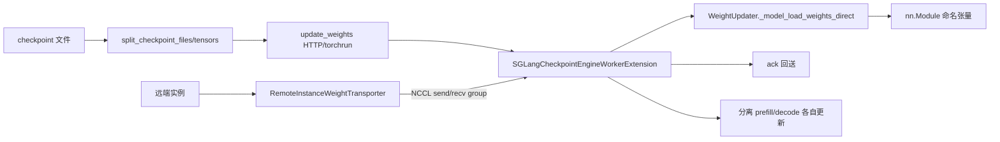

# 14.4 Checkpoint Engine

## 定位

`checkpoint_engine/` 是 SGLang 在线权重更新的承载层：通过一个挂在每 worker 上的 `SGLangCheckpointEngineWorkerExtension`，外部训练/同步进程可把新权重分片直送各 TP rank，零停机切模型。它与 [`08 分布式`](../08-distributed/index.md) 的 `RemoteInstanceWeightTransporter` 协作做跨实例 NCCL 权重输送，并提供 `examples/checkpoint_engine/` 作为端到端示例。

## 职责

- `SGLangCheckpointEngineWorkerExtension`（接口）+ `...Impl`：暴露在 worker 进程上的扩展，接收 update 请求、按 name→tensor 列表装载、回 ack。
- `update.py`：示例驱动脚本，`update_weights` 经 HTTP/NCCL 把 checkpoint 分片推给运行中 server；`split_checkpoint_files`/`split_tensors` 按拓扑切片；`run_with_torchrun` 支持多 worker 并发。
- 与 `WeightUpdater`（`model_runner_components/weight_updater.py:36`）对接：后者是 ModelRunner 侧的权重落地器，`_model_load_weights_direct` 直接写 named tensors。
- 与 `RemoteInstanceWeightTransporter`（`model_runner_components/remote_instance_weight_transporter.py:21`）协作：跨实例经 NCCL send/recv group 把源实例权重流到目标实例。
- 与 [09 分离](../09-disaggregation/index.md) 协同：PD 拓扑下可分别更新 prefill/decode 权重，保持一致。

## 关键类与函数

| 名称 | 定义位置 | 说明 |
|---|---|---|
| `SGLangCheckpointEngineWorkerExtension` | `checkpoint_engine/checkpoint_engine_worker.py:36` | 扩展接口 |
| `SGLangCheckpointEngineWorkerExtensionImpl` | `checkpoint_engine/checkpoint_engine_worker.py:92` | 实现 |
| `update_weights` | `examples/checkpoint_engine/update.py:137` | 示例：推送新权重到运行 server |
| `split_checkpoint_files` / `split_tensors` | `examples/checkpoint_engine/update.py:74/87` | 按拓扑切片 |
| `check_sglang_ready` | `examples/checkpoint_engine/update.py:49` | 等待 server 就绪 |
| `run_with_torchrun` / `main` | `examples/checkpoint_engine/update.py:199/240` | torchrun 多 worker 入口 |
| `WeightUpdater` | `model_runner_components/weight_updater.py:36` | ModelRunner 侧权重落地 |
| `_model_load_weights_direct` | `model_runner_components/weight_updater.py:357` | 直接写 named tensors |
| `LocalSerializedTensor` | `model_runner_components/weight_updater.py:363` | 本地序列化张量 |
| `RemoteInstanceWeightTransporter` | `model_runner_components/remote_instance_weight_transporter.py:21` | 跨实例 NCCL 权重输送 |
| `WeightExporter` | `model_runner_components/weight_exporter.py:18` | 权重导出（反向） |

## 数据流 / 控制流

在线更新的两种来源：本地 checkpoint（`update_weights` 经 HTTP 把切片送 worker extension）与远端实例（`RemoteInstanceWeightTransporter` 经预建的 NCCL group 流式同步）。两者最终都落到 `WeightUpdater._model_load_weights_direct`，按 `(name, tensor)` 直接写 Module，跳过完整 reload。`LocalSerializedTensor` 处理大张量的跨进程 IPC 序列化。

## 交叉引用

- 上游: [`02 服务入口`](../02-server-api/index.md) — `/update_weights` 端点
- 上游: [`08 分布式`](../08-distributed/index.md) — NCCL send/recv group
- 下游: [`05 模型加载`](../05-model-loading/index.md) — `WeightUpdater` 与加载链
- 相关: [`09 分离`](../09-disaggregation/index.md) — PD 分别更新
- 相关: [`04.5 runner components`](../04-model-execution/04.5-runner-components.md)

## 进一步阅读

- 源码: `python/sglang/srt/checkpoint_engine/`、`python/sglang/srt/model_executor/model_runner_components/weight_updater.py`、`python/sglang/srt/model_executor/model_runner_components/remote_instance_weight_transporter.py`
- 示例: `examples/checkpoint_engine/`
