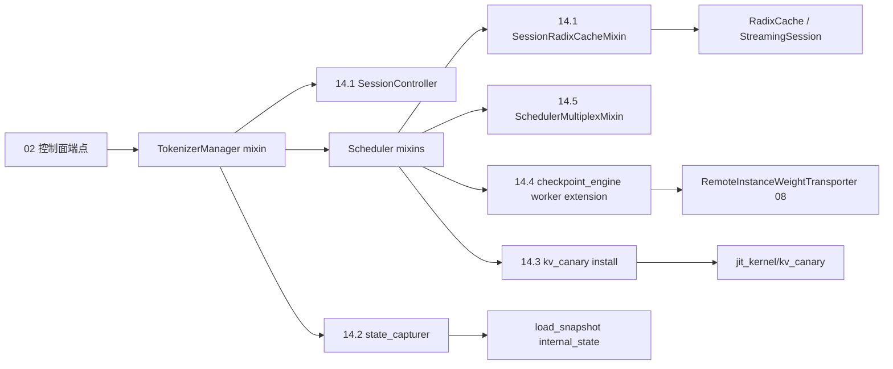

# 14 会话状态与检查点

## 子系统定位

本子系统覆盖 SGLang 在"请求之外"维护的会话与运行时状态：长会话的 KV 复用与 mm offset 调整、内部状态快照读写、KV 正确性 canary 巡检、在线权重更新检查点引擎、以及把多种"虚拟 scheduler"在同一进程内复用的 multiplex。这些能力大多挂在 `TokenizerManager`/`Scheduler` 的 mixin 上，共享 [`07 KV Cache`](../07-kv-cache/index.md) 的 radix 树与 [`08 分布式`](../08-distributed/index.md) 的并行组，并经 [`02 服务入口`](../02-server-api/index.md) 暴露控制面端点。

## 子系统边界

## 子系统导航

- [14.1 session 控制器](14.1-session-controller.md) — `SessionController`/`Session`/`StreamingSession`/`SessionRadixCacheMixin`
- [14.2 state capturer](14.2-state-capturer.md) — `RoutedExpertsCapturer`/`IndexerTopkCapturer` 与 `get/set_internal_state`
- [14.3 KV canary](14.3-kv-canary.md) — KV 正确性巡检与 `jit_kernel/kv_canary`
- [14.4 checkpoint engine](14.4-checkpoint-engine.md) — 在线权重更新与 `RemoteInstanceWeightTransporter`
- [14.5 multiplex](14.5-multiplex.md) — `SchedulerMultiplexMixin` 与 PD 复用 SM/流

## 交叉引用

- 上游: [`02 服务入口`](../02-server-api/index.md) — `/open_session` 等控制端点
- 上游: [`03.3 TokenizerManager`](../03-orchestration/03.3.1-tokenizer-manager.md)、[`03.4.1 Scheduler`](../03-orchestration/03.4.1-scheduler-structure.md)
- 下游: [`07 KV Cache`](../07-kv-cache/index.md) — RadixCache/session lock ref
- 下游: [`08 分布式`](../08-distributed/index.md) — 权重 transporter、SM 切分
- 相关: [`09 分离`](../09-disaggregation/index.md) — checkpoint 与 PD 协同
- 相关: [`17 可观测`](../17-observability-ops/index.md) — load_snapshot 指标

## 进一步阅读

- 源码: `python/sglang/srt/{session,state_capturer,kv_canary,checkpoint_engine,multiplex}/`
