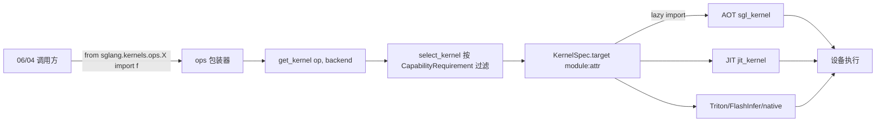

# 15.1 内核三层架构

## 定位

SGLang 的算子调用面与实现面之间有明确分层：调用方应只依赖公开命名空间 `sglang.kernels.ops.*`，而实现可以落在三个来源之一——AOT 预编译 wheel `sgl_kernel`、JIT 首用编译 `sglang.jit_kernel`、或纯 `torch`/Triton/FlashInfer 等。本页说明三层关系与"新内核该进哪层"的决策规则（源自 RFC #29630 与两个贡献 skill）。

## 职责

- **公开层 `sglang.kernels`**：统一 import 入口，只记元数据，惰性加载后端，CPU-only 机器也能 import。
- **AOT 层 `sgl_kernel`**：提前编译进 wheel，注册为 `torch.ops.sgl_kernel.*`，覆盖依赖 CUTLASS/大 C++ 工程的重内核。
- **JIT 层 `sglang.jit_kernel`**：首用编译，跑在 TVM-FFI 之上，适合不依赖大 C++ 工程、需要快速迭代的轻内核。
- 由 `KernelBackend` 枚举表达"来源"，配合 `CapabilityRequirement` 表达"能在哪些设备跑"——来源与设备解耦。

## 关键类与函数

| 名称 | 定义位置 | 说明 |
|---|---|---|
| `KernelBackend` | `python/sglang/kernels/spec.py:29` | 内核来源枚举（TORCH/TRITON/JIT/AOT/CUTE_DSL/FLASHINFER/DEEPGEMM/AITER/TORCH_NPU） |
| `DeviceType` | `python/sglang/kernels/spec.py:53` | 设备族枚举（CUDA/HIP/NPU/CPU） |
| `CapabilityRequirement` | `python/sglang/kernels/spec.py:119` | 一条"设备+可选 arch 窗口"约束，OR 语义 |
| `KernelSpec` | `python/sglang/kernels/spec.py:203` | 一条 `op`+`backend` 的实现记录与 `module:attr` 惰性 target |
| `KernelRegistry` | `python/sglang/kernels/registry.py:17` | 进程级 `op → KernelSpec list` 字典 |
| `register_kernel` | `python/sglang/kernels/registry.py:69` | 元数据注册（不 import 后端） |
| `select_kernel` | `python/sglang/kernels/selector.py:38` | 按设备可用性硬过滤，确定化返回固定调用路径 |
| `get_kernel` | `python/sglang/kernels/selector.py:92` | 解析并缓存 callable（`ops.*` 包装器用） |
| `BaseFusedOp` | `python/sglang/kernels/fused_op.py:181` | 单算子多后端契约，`forward()` 自动选最优可用后端 |

## 选层决策

| 信号 | 去向 |
|---|---|
| 依赖 CUTLASS 或大 C++ 工程、要进 wheel/torch op | `sgl-kernel` AOT |
| 不依赖大工程、需要快速迭代 | `jit_kernel` JIT |
| 依赖 flashinfer 或经 flashinfer 提供的 CUTLASS | 仍可放 `jit_kernel` |
| 已有 Triton 实现 | 直接作 `BaseFusedOp.forward_triton` |

`BaseFusedOp` 的 `DEFAULT_PRIORITY`（`fused_op.py:79`）顺序为 AOT → JIT → FLASHINFER → DEEPGEMM → CUTE_DSL → AITER → TORCH_NPU → TRITON → TORCH，自动选最优；`SGLANG_FORCE_FUSED_OP_BACKEND=torch` 可一键回退到参考实现做数值二分。

## 数据流 / 控制流

`ops.*` 包装器调 `get_kernel` → `select_kernel` 在注册表里按设备硬过滤得到唯一 `KernelSpec` → `KernelSpec.load()` 才真正 import 后端模块。多后端算子走 `BaseFusedOp.forward`，按 `priority` 与 `backend_eligible` 选后端，失败回退 `forward_native`。

## 交叉引用

- 详见: [15.2 sgl-kernel AOT](15.2-sgl-kernel-aot.md) / [15.3 kernels 命名空间](15.3-kernels-namespace.md) / [15.4 jit_kernel](15.4-jit-kernel.md) / [15.8 skills](15.8-adding-kernels-skills.md)
- 上游: [`06 Layers`](../06-layers/index.md) — 调用 `ops.*`
- 相关: [`16.4 environ`](../16-config-runtime/16.4-environ.md) — `SGLANG_FORCE_FUSED_OP_BACKEND`
- 相关 skill: `.claude/skills/add-jit-kernel`、`.claude/skills/add-sgl-kernel`

## 进一步阅读

- 规范: `python/sglang/kernels/README.md`
- RFC: <https://github.com/sgl-project/sglang/issues/29630>
- 选择器: `python/sglang/kernels/selector.py:38`
