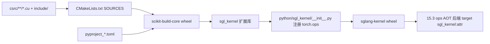

# 15.2 sgl-kernel AOT

## 定位

`sgl-kernel/` 是 SGLang 的提前编译（AOT）内核库，发布为 `sglang-kernel` PyPI wheel，import 路径 `sgl_kernel`。它承载依赖 CUTLASS 或大型 C++ 工程的重内核，通过 `torch.ops.sgl_kernel.*` 注册暴露给运行时，是 [15.3 kernels 命名空间](15.3-kernels-namespace.md) `AOT` 后端的主要实现来源，也是 [06 Layers](../06-layers/index.md) 注意力/MoE/量化的稳定轮边界。

## 职责

- 在 `csrc/` 下按算子类别组织 CUDA/C++ 实现：allreduce、attention、gemm、moe、quantization、elementwise、speculative、mamba、memory、kvcacheio、grammar、spatial、expert_specialization、infllm_v2、cpu。
- 通过 `csrc/common_extension.cc`（CUDA）/`common_extension_rocm.cc`/`common_extension_musa.cc` 把算子注册到 `torch.library`，`flash_extension.cc`/`flashmla_extension.cc`/`spatial_extension.cc` 为扩展 op。
- `python/sgl_kernel/` 包装 `torch.ops.sgl_kernel.*`，提供 Python 友好签名与 `__init__.py` 重导出。
- 多平台构建：`pyproject.toml`（CUDA）、`pyproject_rocm.toml`、`pyproject_musa.toml`、`pyproject_cpu.toml`、`setup_metal.py`/`setup_musa.py`/`setup_rocm.py`。
- `include/sgl_kernel_ops.h` 集中 C++ 声明，`include/utils.h` 提供 `DISPATCH_PYTORCH_DTYPE_TO_CTYPE_*` 宏。

## 关键类与函数

| 名称 | 定义位置 | 说明 |
|---|---|---|
| `TORCH_LIBRARY_FRAGMENT(sgl_kernel, m)` | `sgl-kernel/csrc/common_extension.cc` | op schema + dispatch 注册 |
| `DISPATCH_PYTORCH_DTYPE_TO_CTYPE_FLOAT_FP16` | `sgl-kernel/include/utils.h` | FP16/BF16/FP32 dtype 派发宏 |
| `_load_architecture_specific_ops` | `sgl-kernel/python/sgl_kernel/load_utils.py` | 按架构加载 ops 库 |
| `_preload_cuda_library` | `sgl-kernel/python/sgl_kernel/load_utils.py` | 预加载 libcudart |
| `CMakeLists.txt` `SOURCES` | `sgl-kernel/CMakeLists.txt:1` | 源文件清单（需字母序） |
| 版本 | `sgl-kernel/python/sgl_kernel/version.py` | wheel 版本字符串 |

`python/sgl_kernel/__init__.py` 在 macOS arm64 只载入 Metal 扩展，其余平台按模块（`allreduce`/`attention`/`cutlass_moe`/`elementwise`/`gemm`/`moe`/`quantization`/`sampling`/`speculative`/`mamba`/`memory`/`kvcacheio`/`grammar`/`spatial` 等）批量 `from X import *`。

## 子模块树

- `sgl-kernel/`
  - `csrc/` — CUDA/C++ 实现，按类别子目录
    - `allreduce/` `attention/` `gemm/` `moe/` `quantization/` `elementwise/` `speculative/` `mamba/` `memory/` `kvcacheio/` `grammar/` `spatial/` `expert_specialization/` `infllm_v2/` `cpu/` `musa/` `metal/` `cutlass_extensions/`
    - `common_extension.cc`（CUDA）/`_rocm.cc`/`_musa.cc`
    - `flash_extension.cc`/`flashmla_extension.cc`/`spatial_extension.cc`
  - `include/` — `sgl_kernel_ops.h`/`utils.h` 等公共头
  - `python/sgl_kernel/` — Python 包装与重导出
  - `pyproject.toml`/`pyproject_rocm.toml`/`pyproject_musa.toml`/`pyproject_cpu.toml`/`setup_metal.py`/`setup_musa.py`/`setup_rocm.py`
  - `cmake/` `Dockerfile` `Makefile` `build.sh` `tests/` `benchmark/`

## 构建流

`make build`（或 `setup_*.py`）经 scikit-build-core 编译 `SOURCES` 中的 `.cu`，产出扩展库；`__init__.py` 加载库并把 op 注册到 `torch.ops.sgl_kernel`，再由 `python/sgl_kernel/*` 各模块提供 Python 包装。`ops.*` 包装器用 `KernelSpec(target="sgl_kernel:attr")` 惰性解析到这些函数。

## 交叉引用

- 上游: [15.1 三层架构](15.1-kernel-three-layer.md) — AOT 层定位
- 下游: [15.3 kernels 命名空间](15.3-kernels-namespace.md) — `AOT` 后端 target 指向 `sgl_kernel:attr`
- 相关: [15.5 platforms](15.5-platforms.md) — `_load_architecture_specific_ops` 按平台选库
- 相关: [`06.15 deep_gemm`](../06-layers/06.15-deep-gemm-wrapper.md) — 经 AOT/JIT 调 DeepGEMM
- 相关 skill: `.claude/skills/add-sgl-kernel`

## 进一步阅读

- 源码: `sgl-kernel/`
- 说明: `sgl-kernel/README.md`
- 构建配置: `sgl-kernel/CMakeLists.txt`
- 注册: `sgl-kernel/csrc/common_extension.cc`
