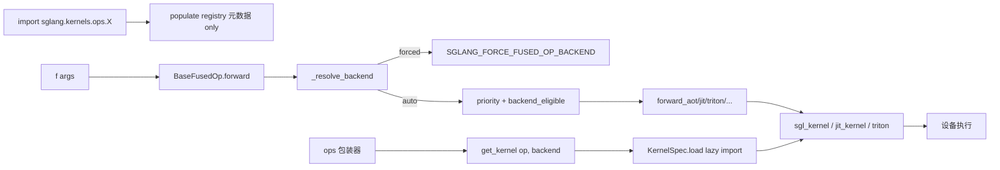

# 15.3 kernels 命名空间

## 定位

`python/sglang/kernels/` 是 SGLang 唯一的公开内核 import 面（RFC #29630）。运行时代码与测试应 `from sglang.kernels.ops.<group> import f`，而实现仍可留在 `sglang.jit_kernel` / `sgl_kernel` / Triton 模块。本层只维护元数据与惰性解析，把"算子调用"与"后端实现来源"彻底解耦，并提供统一正确性测试与一键回退。

## 职责

- `spec.py` 定义 `KernelSpec`/`KernelBackend`/`CapabilityRequirement`/`PlatformInfo` 等无依赖描述符。
- `registry.py` 提供进程级 `KernelRegistry` 与 `register_kernel`，只存元数据。
- `selector.py` 提供 `select_kernel`（设备硬过滤、确定化）与 `get_kernel`（解析+缓存 callable）。
- `fused_op.py` 定义 `BaseFusedOp`：单算子多后端契约，一个 `forward()` 背后多个 `forward_<backend>`。
- `ops/` 17 个分组子包，薄包装器 `forward` 到某个后端。

## 关键类与函数

| 名称 | 定义位置 | 说明 |
|---|---|---|
| `KernelBackend` | `python/sglang/kernels/spec.py:29` | 来源枚举：TORCH/TORCH_COMPILE/TRITON/JIT/AOT/CUTE_DSL/FLASHINFER/DEEPGEMM/AITER/TORCH_NPU |
| `PlatformInfo` | `python/sglang/kernels/spec.py:63` | 运行平台快照，`detect()` 不抛错 |
| `CapabilityRequirement` | `python/sglang/kernels/spec.py:119` | 设备+arch 窗口约束，OR 语义，`is_satisfied_by` |
| `KernelSpec` | `python/sglang/kernels/spec.py:203` | `op`+`backend`+`target="module:attr"`，`load()` 惰性解析 |
| `KernelRegistry` | `python/sglang/kernels/registry.py:17` | `op → [KernelSpec]`，`register`/`get`/`get_backend` |
| `register_kernel` | `python/sglang/kernels/registry.py:69` | 注册元数据，重注册幂等 |
| `select_kernel` | `python/sglang/kernels/selector.py:38` | 唯一可用→直返；多个→设备过滤；仍多个→需传 `backend=` |
| `get_kernel` | `python/sglang/kernels/selector.py:92` | `_resolve` lru_cache 后返回 callable |
| `BaseFusedOp` | `python/sglang/kernels/fused_op.py:181` | `forward_native` 必填；`forward_torch_compile` 自动派生 |
| `DEFAULT_PRIORITY` | `python/sglang/kernels/fused_op.py:79` | 自动选后端优先级（AOT 优先，TORCH 兜底） |
| `register_fused_op` | `python/sglang/kernels/fused_op.py:324` | 把实例所有后端写进 registry |
| `get_fused_op_backend`/`set_fused_op_backend` | `python/sglang/kernels/fused_op.py:108`/`:123` | `SGLANG_FORCE_FUSED_OP_BACKEND` 全局强制 |
| `enable_fused_op_trace` | `python/sglang/kernels/fused_op.py:145` | 记录 op/backend/shape 的调用追踪 |

## 子模块树

- `python/sglang/kernels/`
  - `spec.py` — 描述符
  - `registry.py` — 进程级注册表
  - `selector.py` — `select_kernel`/`get_kernel`
  - `fused_op.py` — `BaseFusedOp` 多后端契约
  - `ops/` — 17 分组包装器：`activation`/`attention`/`communication`/`diffusion`/`embeddings`/`gemm`/`grammar`/`kvcache`/`layernorm`/`mamba`/`memory`/`moe`/`quantization`/`sampling`/`spatial`/`speculative`

`ops/` 中已实质填充的组（如 `layernorm`/`activation`/`gemm`/`kvcache`/`moe`/`quantization`）是薄包装，其余组为占位，实现仍在 `jit_kernel`/`sgl_kernel`/`triton_ops`，后续阶段迁移。

## 数据流 / 控制流

`BaseFusedOp.__init__` 缓存可用后端集合与 `priority` 子序；`forward()` 先看强制后端，否则按序找第一个 `backend_eligible`（`CapabilityRequirement` 对 `PlatformInfo` 的 OR 检查）。`ops.*` 薄包装则直接 `get_kernel(op, backend).load()` 命中缓存，第一次调用才 import 真后端。`SGLANG_FORCE_FUSED_OP_BACKEND=torch` 可把所有 fused op 退回参考实现，方便数值二分。

## 交叉引用

- 上游: [15.1 三层架构](15.1-kernel-three-layer.md) — 命名空间层定位
- 实现: [15.2 sgl-kernel](15.2-sgl-kernel-aot.md) / [15.4 jit_kernel](15.4-jit-kernel.md) — 后端 target 来源
- 上游: [`06 Layers`](../06-layers/index.md) — `ops.*` 调用方
- 相关: [`16.4 environ`](../16-config-runtime/16.4-environ.md) — `SGLANG_FORCE_FUSED_OP_BACKEND`

## 进一步阅读

- 源码: `python/sglang/kernels/`
- 规范: `python/sglang/kernels/README.md`
- RFC: <https://github.com/sgl-project/sglang/issues/29630>
