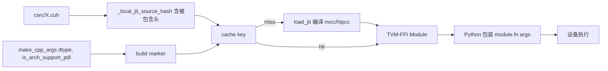

# 15.4 jit_kernel

## 定位

`python/sglang/jit_kernel/` 是 SGLang 的 JIT（首用编译）内核层，跑在 TVM-FFI 之上。它适合不依赖 CUTLASS 等大 C++ 工程的轻量 CUDA 内核，编译结果按内容哈希缓存，首用编译、后续命中缓存。`sgl_kernel` 共用的 C++ 抽象头（`utils.cuh`/`tensor.h`/`vec.cuh` 等）也复制在这里，使 JIT 源能直接复用 `TensorMatcher`/`LaunchKernel`/`AlignedVector`。

## 职责

- `csrc/` 存放 `.cuh` 内核源与 `elementwise/`/`gemm/`/`moe/`/`attention/`/`dsa/`/`deepseek_v32/`/`deepseek_v4/`/`diffusion/`/`distributed/`/`kvcacheio/`/`kv_canary/`/`lora/`/`lplb/`/`minimax/`/`ngram_corpus/`/`sparse_mla_*`/`trtllm_lora_temp/` 等分类。
- `include/sgl_kernel/` 提供共用设备/主机抽象（`TensorMatcher`、`LaunchKernel`、`DTypeTrait`、`AlignedVector`、`tile::Memory`、`warp`/`cta`/`atomic`/`math`/`runtime`）。
- Python 包装按算子拆成模块（如 `activation.py`/`all_reduce.py`/`dsa/`/`dsv3_fused_a_gemm.py`/`moe_*.py`/`ngram_*.py`/`hicache.py`/`lplb/`/`diffusion/`/`triton/`/`cutedsl_*.py`），用 `cache_once`+`load_jit` 编译并缓存。
- `utils/` 提供 `load_jit`/`make_cpp_args`/`cache_once`/`is_arch_support_pdl`/`get_jit_cuda_arch` 等编译工具。
- `benchmark/` 提供 `marker` 框架（非 `triton.testing.do_bench`）。

## 关键类与函数

| 名称 | 定义位置 | 说明 |
|---|---|---|
| `cache_once` | `python/sglang/jit_kernel/utils/common.py:27` | 编译缓存装饰器（兼容 `torch.compile`，替代 `lru_cache`） |
| `make_cpp_args` | `python/sglang/jit_kernel/utils/compile.py:132` | 把 `torch.dtype` 等转 C++ 模板实参，构造 build marker |
| `load_jit` | `python/sglang/jit_kernel/utils/compile.py:170` | 编译并加载 TVM-FFI 模块，按源哈希缓存 |
| `_local_jit_source_hash` | `python/sglang/jit_kernel/utils/compile.py:35` | 源+被包含头内容哈希，作为 cache key |
| `get_jit_cuda_arch`/`is_arch_support_pdl` | `python/sglang/jit_kernel/utils/arch.py` | 目标架构/PDL 能力探测 |
| `is_hip_runtime`/`is_musa_runtime` | `python/sglang/jit_kernel/utils/common.py` | 跨平台运行时识别 |
| KERNEL_PATH | `python/sglang/jit_kernel/utils/compile.py:16` | csrc根路径 |

`load_jit` 第一组实参构成唯一 build marker（同 marker=同缓存二进制），`cuda_wrappers=[(export_name, kernel_symbol)]` 把 `TVM_FFI_DLL_EXPORT_TYPED_FUNC` 符号暴露给 Python。运行时标量（如 `factor`）应保持运行时传入，仅把真正需要模板特化的旋钮进 build marker。

## 子模块树

- `python/sglang/jit_kernel/`
  - `csrc/` — `.cuh` 源，按类别子目录（elementwise/gemm/moe/attention/dsa/dsv3/dsv4/diffusion/distributed/kvcacheio/lora/lplb/minimax/ngram_corpus 等）
  - `include/sgl_kernel/` — 共用 C++ 抽象头
  - `utils/` — `arch.py`/`common.py`/`compile.py`/`deps.py`
  - 算子包装 `.py`：`activation.py`/`all_reduce.py`/`flash_attention*.py`/`fp8_*.py`/`moe_*.py`/`ngram_*.py`/`norm.py`/`rope.py`/`kvcache.py`/`hisparse.py`/`hicache.py` 等
  - `dsa/` `dsv3*` `dsv4/` `dsv32/` `minimax_m3/` `diffusion/` `triton/` `cutedsl_*.py` `lplb/` `kv_canary/` — 模型/特性专用
  - `benchmark/` — `marker.py`/`utils.py`，`tests/` `__main__.py`（生成 clangd 配置）

## 编译流

首次调用通过 `cache_once` 的包装器组装 build marker，`load_jit` 按源内容哈希（含 `include/sgl_kernel/*` 依赖）定位缓存，未命中才编译。PDL（Programmatic Dependent Launch，SM90+）由 `is_arch_support_pdl()` 决定是否作为模板实参传入；`device::PDLWaitPrimary`/`PDLTriggerSecondary` 在内核内协同。

## 交叉引用

- 上游: [15.1 三层架构](15.1-kernel-three-layer.md) — JIT 层定位
- 下游: [15.3 kernels 命名空间](15.3-kernels-namespace.md) — `JIT` 后端 target 指向 `jit_kernel` 模块
- 相关: [`06.4.3 MoE runner`](../06-layers/06.4.3-moe-runner.md) / [`06.15 deep_gemm`](../06-layers/06.15-deep-gemm-wrapper.md) — JIT 内核消费方
- 相关: [19.5 测试体系](../19-build-ci-dev/19.5-test-system.md) — `test/registered/jit/` + `run_suite.py`
- 相关 skill: `.claude/skills/add-jit-kernel`

## 进一步阅读

- 源码: `python/sglang/jit_kernel/`
- 编译入口: `python/sglang/jit_kernel/utils/compile.py:170`
- 共用头: `python/sglang/jit_kernel/include/sgl_kernel/`
- 开发指南: `docs_new/docs/developer_guide/development_jit_kernel_guide.mdx`
