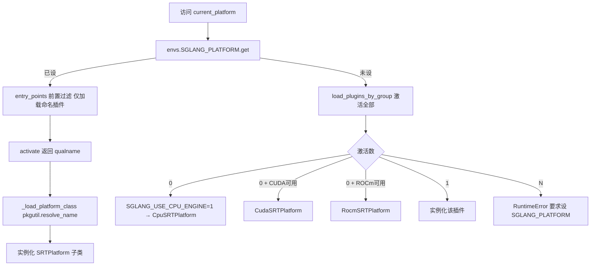

# 15.5 platforms

## 定位

`python/sglang/srt/platforms/` 是 SRT（LLM 推理）平台抽象层，屏蔽设备身份查询、能力位、子系统工厂选择与配置生命周期。`current_platform` 是模块级 lazy 单例，首次访问时按 `entry_points` + `SGLANG_PLATFORM` 发现并实例化。内置 CUDA/ROCm/CPU 三种，其余厂商通过 OOT 插件注册到 `sglang.srt.platforms` 组。

## 职责

- `interface.py` `SRTPlatform`：SRT 专属基类，继承 `DeviceMixin`，定义 `apply_server_args_defaults`、子系统工厂（attention backend/graph runner/mha/mla,dsa KV pool/paged allocator/compile backend/piecewise backend/quantization config）、能力位（`supports_fp8`/`support_cuda_graph`/`support_piecewise_cuda_graph`）、`init_backend`、`get_dispatch_key_name`。
- `device_mixin.py` `DeviceMixin`/`PlatformEnum`/`DeviceCapability`：跨子系统（SRT + 多模态）共用的设备身份与基本操作，`[Active]`/`[Planned]` 标注哪些方法已被 core 调用。
- `cuda.py`/`rocm.py`/`cpu.py`：内置平台实现，各自的 `DeviceMixin` + `SRTPlatform` 组合。
- `__init__.py`：`_resolve_platform` 发现逻辑 + `current_platform` lazy `__getattr__`。

## 关键类与函数

| 名称 | 定义位置 | 说明 |
|---|---|---|
| `PlatformEnum` | `python/sglang/srt/platforms/device_mixin.py:38` | CUDA/ROCM/CPU/XPU/MUSA/NPU/TPU/MPS/OOT/UNSPECIFIED |
| `DeviceCapability` | `python/sglang/srt/platforms/device_mixin.py:65` | `(major, minor)` NamedTuple，可比较 |
| `DeviceMixin` | `python/sglang/srt/platforms/device_mixin.py:94` | 设备身份/能力/操作 mixin，`is_cuda()`/`get_device_capability` 等 |
| `SRTPlatform` | `python/sglang/srt/platforms/interface.py:26` | SRT 基类，工厂方法 + 能力位 + 生命周期 |
| `CudaDeviceMixin`/`CudaSRTPlatform` | `python/sglang/srt/platforms/cuda.py:15` | CUDA 平台 |
| `RocmSRTPlatform` | `python/sglang/srt/platforms/rocm.py` | ROCm 平台 |
| `CpuSRTPlatform` | `python/sglang/srt/platforms/cpu.py` | CPU 平台 |
| `current_platform` | `python/sglang/srt/platforms/__init__.py:154` | lazy 单例（`__getattr__` 触发 `_resolve_platform`） |
| `_resolve_platform` | `python/sglang/srt/platforms/__init__.py:44` | 发现+实例化逻辑 |
| `PLATFORM_PLUGINS_GROUP` | `python/sglang/srt/plugins.py` | entry_points 组名 `sglang.srt.platforms` |

## 发现流

`SGLANG_PLATFORM` 走"前置过滤"：只在 entry_points 中找命名插件并 `load()`，其余插件模块永不被导入（避免拖入其依赖）。自动发现则激活全部插件，按激活数决策：0 个回退内置，1 个直接用，N 个抛错要求显式选择。`activate()` 返回 None 表示硬件不可用。

## 交叉引用

- 上游: [15.1 三层架构](15.1-kernel-three-layer.md) — 平台对内核可用性的影响
- 下游: [15.6 hardware_backend](15.6-hardware-backend.md) — 厂商后端常配套 OOT platform 插件
- 相关: [`04.1 ModelRunner`](../04-model-execution/04.1-model-runner.md) — `current_platform` 驱动 graph runner / KV pool 选择
- 相关: [`16.3 RuntimeContext`](../16-config-runtime/16.3-runtime-context.md) / [`16.7 plugins`](../16-config-runtime/16.7-plugins.md) — 插件组与 entry_points
- 相关: [`16.4 environ`](../16-config-runtime/16.4-environ.md) — `SGLANG_PLATFORM`/`SGLANG_USE_CPU_ENGINE`

## 进一步阅读

- 源码: `python/sglang/srt/platforms/`
- 发现逻辑: `python/sglang/srt/platforms/__init__.py:44`
- 基类: `python/sglang/srt/platforms/interface.py:26`
