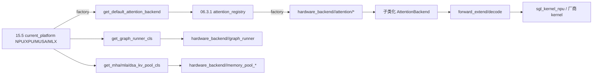

# 15.6 hardware_backend

## 定位

`python/sglang/srt/hardware_backend/` 按设备族组织厂商专属实现：注意力后端、量化 kernel、graph runner、memory pool、MoE、模块等。它把"平台身份"（[15.5 platforms](15.5-platforms.md)）落地为具体算子路径，是 Ascend NPU、Intel XPU、Moore Threads MUSA、Apple MLX、CPU、GPU 厂商扩展的归宿。注意力后端均子类化 [`06.3.1 AttentionBackend`](../06-layers/06.3.1-attn-backend-abstraction.md)。

## 职责

- `npu/`（Ascend）：`attention/`（全/DSV4/GDN/hybrid linear/torch native）、`dsv4/`、`graph_runner/`、`moe/`、`modules/`、`batch_invariant_ops/`、`quantization/`、`allocator_npu.py`、`memory_pool_npu.py`、`cmo.py` 等，最完整的厂商树。
- `xpu/`（Intel）：`graph_runner/`、`kernels/`、`__init__.py`。
- `musa/`（Moore Threads）：`attention/`、`kernels/`、`layers/`、`utils/`、`__init__.py`。
- `mlx/`（Apple）：`aot.py`、`model_runner.py`/`model_runner_stub.py`、`scheduler_mixin.py`、`tp_worker.py`、`profiler.py`、`moe/`、`kv_cache/`、`parent_watchdog.py`，独立推理路径。
- `cpu/` `gpu/`：仅 `quantization/`（`awq_kernels.py`/`gptq_kernels.py` 等）。

## 关键类与函数

| 名称 | 定义位置 | 说明 |
|---|---|---|
| `AscendAttnBackend` | `hardware_backend/npu/attention/ascend_backend.py:287` | Ascend 全注意力后端，子类化 `AttentionBackend` |
| `DeepseekV4AscendAttnBackend` | `hardware_backend/npu/attention/ascend_dsv4_backend.py:961` | DSV4 注意力后端 |
| `AscendGDNAttnBackend` | `hardware_backend/npu/attention/ascend_gdn_backend.py:33` | GDN 线性注意力 |
| `AscendHybridLinearAttnBackend` | `hardware_backend/npu/attention/ascend_hybrid_linear_attn_backend.py:220` | hybrid 线性注意力 |
| `AscendTorchNativeAttnBackend` | `hardware_backend/npu/attention/ascend_torch_native_backend.py:10` | torch native 回退 |
| `AscendMamba2AttnBackend` | `hardware_backend/npu/attention/ascend_hybrid_linear_attn_backend.py:216` | Mamba2 后端 |

NPU 路径还依赖 `sgl_kernel_npu.attention.sinks_attention`（`ascend_backend.py:8`），属独立厂商内核库（对应 `KernelBackend.TORCH_NPU`）。MLX 走 `aot.py` 提前编译与 `parent_watchdog.py` 进程管理，相对独立。

## 子模块树

- `hardware_backend/`
  - `npu/` — `attention/`（ascend_backend/dsv4/gdn/hybrid_linear/torch_native/mla_preprocess）、`dsv4/`、`graph_runner/`、`moe/`、`modules/`、`batch_invariant_ops/`、`quantization/`、`allocator_npu.py`、`memory_pool_npu.py`、`cmo.py`、`utils.py`
  - `xpu/` — `graph_runner/`、`kernels/`、`__init__.py`
  - `musa/` — `attention/`、`kernels/`、`layers/`、`utils/`、`__init__.py`
  - `mlx/` — `aot.py`、`model_runner.py`/`_stub.py`、`scheduler_mixin.py`、`tp_worker.py`、`profiler.py`、`moe/`、`kv_cache/`、`parent_watchdog.py`
  - `cpu/quantization/` `gpu/quantization/`

## 控制流

平台插件的工厂方法把后端字符串（如 ascend）注册到 `attention_registry`，`ModelRunner.init_attention_backends` 解析时实例化 `hardware_backend/<dev>/attention` 下具体类；graph runner / KV pool / allocator 同理由 `get_*_cls` 返回厂商实现。NPU 树最深，覆盖 DSV4/MLA/GDN/hybrid 等多条注意力路径。

## 交叉引用

- 上游: [15.5 platforms](15.5-platforms.md) — `current_platform` 工厂选择
- 上游: [`06.3.1 注意力后端抽象`](../06-layers/06.3.1-attn-backend-abstraction.md) — `AttentionBackend` ABC
- 上游: [`04.1 ModelRunner`](../04-model-execution/04.1-model-runner.md) — `init_attention_backends`
- 相关: [`16.7 plugins`](../16-config-runtime/16.7-plugins.md) — OOT 平台插件注册
- 相关: [`19.2 Docker`](../19-build-ci-dev/19.2-docker.md) — 厂商镜像构建

## 进一步阅读

- 源码: `python/sglang/srt/hardware_backend/`
- Ascend 注意力: `python/sglang/srt/hardware_backend/npu/attention/ascend_backend.py:287`
