# 15.7 deep_gemm wrapper

## 定位

`layers/deep_gemm_wrapper/` 是 SGLang 对 DeepGEMM 库（FP8/FP4 grouped-GEMM）的统一门面，承接 [`06.4.3 MoeRunner`](../06-layers/06.4.3-moe-runner.md) 的 JIT FP8/FP4 路径。本页是该模块在 15 子系统的视角，与 [`06.15 deep_gemm_wrapper`](../06-layers/06.15-deep-gemm-wrapper.md)（06 Layers 视角）同源，此处侧重其作为"内核执行面入口"的定位。

## 职责

- `configurer.py` 计算 `ENABLE_JIT_DEEPGEMM` 全局开关（读 `envs.SGLANG_ENABLE_JIT_DEEPGEMM`）。
- `compile_utils.py` 负责 DeepGEMM kernel 分类、JIT 编译（带缓存）、warmup executor、PP 场景 warmup、运行期钩子。
- `entrypoint.py` 暴露 grouped/singleton GEMM 入口（FP8/FP4/BF16/TF32/MX-FP8）与 SM 数量配置。
- `update_deep_gemm_config` 把 `ServerArgs` 选项写入运行时配置。

## 关键类与函数

| 名称 | 定义位置 | 说明 |
|---|---|---|
| `ENABLE_JIT_DEEPGEMM` | `layers/deep_gemm_wrapper/configurer.py:35` | 全局 JIT DeepGEMM 开关 |
| `_compute_enable_deep_gemm` | `layers/deep_gemm_wrapper/configurer.py:17` | 读 `envs.SGLANG_ENABLE_JIT_DEEPGEMM` 计算 enable |
| `DeepGemmKernelType` | `layers/deep_gemm_wrapper/compile_utils.py:101` | kernel 类型枚举 |
| `_maybe_compile_deep_gemm_one_type_all` | `layers/deep_gemm_wrapper/compile_utils.py:114` | JIT 编译（带缓存） |
| `_compile_deep_gemm_one_type_all` | `layers/deep_gemm_wrapper/compile_utils.py:159` | 实际编译入口 |
| `_BaseWarmupExecutor` 及子类 | `layers/deep_gemm_wrapper/compile_utils.py:230` | warmup 执行器 |
| `deep_gemm_execution_hook`/`_deep_gemm_execution_hook` | `layers/deep_gemm_wrapper/compile_utils.py:403`/`:413` | 运行期钩子 |
| `pp_parallel_deep_gemm_warmup` | `layers/deep_gemm_wrapper/compile_utils.py:421` | PP 场景 warmup |
| `grouped_gemm_nt_f8f8bf16_masked` | `layers/deep_gemm_wrapper/entrypoint.py:27` | FP8 masked grouped GEMM |
| `grouped_gemm_nt_bf16_masked`/`_contig` | `layers/deep_gemm_wrapper/entrypoint.py:89`/`:142` | BF16 grouped GEMM |
| `gemm_nt_f8f8bf16` | `layers/deep_gemm_wrapper/entrypoint.py:153` | FP8 单 GEMM |
| `gemm_nt_mxfp8_f8f8bf16` | `layers/deep_gemm_wrapper/entrypoint.py:174` | MX-FP8 GEMM |
| `configure_deep_gemm_num_sms` | `layers/deep_gemm_wrapper/entrypoint.py:236` | SM 数量配置 |

## 子模块树

- `layers/deep_gemm_wrapper/`
  - `__init__.py` — 包入口
  - `entrypoint.py` — grouped/singleton GEMM 入口
  - `compile_utils.py` — JIT 编译 + warmup executor + 钩子
  - `configurer.py` — `ENABLE_JIT_DEEPGEMM` 计算

## 控制流

```mermaid
flowchart LR
    ENV["envs.SGLANG_ENABLE_JIT_DEEPGEMM"] --> CFG["_compute_enable_deep_gemm:17"]
    CFG --> EN["ENABLE_JIT_DEEPGEMM:35"]
    EN --> ENTRY["entrypoint if ENABLE_JIT_DEEPGEMM"]
    ENTRY --> CMP["_maybe_compile_deep_gemm_one_type_all:114"]
    CMP --> WARM["_BaseWarmupExecutor:230"]
    WARM --> RK["DeepGemmRunnerCore moe_runner/deep_gemm.py:140"]
    RK --> GEMM["grouped_gemm_nt_f8f8bf16_masked:27"]
    GEMM --> OUT["MoE expert output"]
    SA["ServerArgs"] --> UDC["update_deep_gemm_config:49"]
    UDC --> CFG
```

启动期 `_compute_enable_deep_gemm` 读 `SGLANG_ENABLE_JIT_DEEPGEMM` 决定是否启用 JIT；启用则 `entrypoint` 调 `_maybe_compile_deep_gemm_one_type_all` 把所有 `DeepGemmKernelType` 编译并 warmup。运行期 `DeepGemmRunnerCore.run_moe_core` 选对应入口（FP8/FP4/BF16）送 token+expert weight，结果回到 `FusedMoE` 主流程。`pp_parallel_deep_gemm_warmup` 在 PP>1 时按阶段预热。`deep_gemm_execution_hook` 允许在执行点插入额外逻辑。

## 交叉引用

- 双生: [`06.15 deep_gemm_wrapper`](../06-layers/06.15-deep-gemm-wrapper.md) — 06 Layers 视角（同模块）
- 上游: [`06.4.3 MoE runner`](../06-layers/06.4.3-moe-runner.md) — `DeepGemmRunnerCore`
- 下游: [15.4 jit_kernel](15.4-jit-kernel.md) — JIT 编译框架共用
- 相关: [`16.4 environ`](../16-config-runtime/16.4-environ.md) — `SGLANG_ENABLE_JIT_DEEPGEMM`
- 相关 skill: `.claude/skills/add-jit-kernel`

## 进一步阅读

- 源码: `python/sglang/srt/layers/deep_gemm_wrapper/`
- 入口: `python/sglang/srt/layers/deep_gemm_wrapper/entrypoint.py:27`
- 开关: `python/sglang/srt/layers/deep_gemm_wrapper/configurer.py:35`
- 编译: `python/sglang/srt/layers/deep_gemm_wrapper/compile_utils.py:114`
