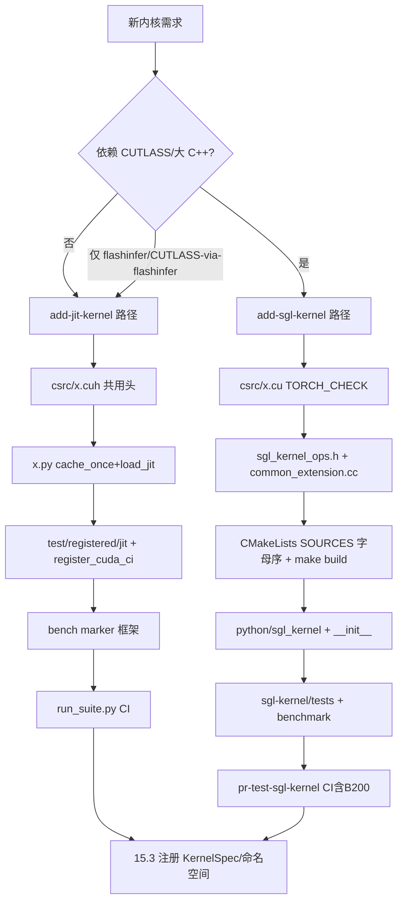

# 15.8 添加内核 skills

## 定位

SGLang 用两个 `.claude/skills` 规范新内核贡献流程：`add-jit-kernel`（轻量 JIT）与 `add-sgl-kernel`（重型 AOT）。两者都给出"目标—决策—实现—测试—基准"全链路，并明确何时用哪条路径。本页汇总两者的流程与决策规则，是 [15.1 三层架构](15.1-kernel-three-layer.md) 选层决策的操作化版。

## 职责

- `add-jit-kernel/SKILL.md`：教如何在 `python/sglang/jit_kernel/` 加轻量 CUDA 内核，含共用 C++ 抽象（`TensorMatcher`/`LaunchKernel`/`AlignedVector`/`tile::Memory`/`warp`/`DTypeTrait`）、Python 包装（`cache_once`+`load_jit`）、`test/registered/jit/` 测试与 `benchmark/marker` 框架。
- `add-sgl-kernel/SKILL.md`：教如何在 `sgl-kernel/` 加重型 AOT 内核，含 `csrc/` 实现、`include/sgl_kernel_ops.h` 声明、`common_extension.cc` 注册、`CMakeLists.txt` 加源（字母序）、`python/sgl_kernel/` 包装、`sgl-kernel/tests/` + `sgl-kernel/benchmark/`，以及 `make build` 与 `pr-test-sgl-kernel.yml`/`sgl-kernel-b200-test`。
- 共同强调：每个新内核必须带测试 + 基准。

## 决策规则

| 信号 | 路径 | skill |
|---|---|---|
| 不依赖 CUTLASS / 大 C++ 工程 | `jit_kernel` | `add-jit-kernel` |
| 依赖 CUTLASS / 大 C++ 工程，或要进 wheel/torch op | `sgl-kernel` AOT | `add-sgl-kernel` |
| 依赖 flashinfer 或经 flashinfer 提供的 CUTLASS | 仍可 `jit_kernel` | `add-jit-kernel` |

两条 skill 的开头都把"优先 `jit_kernel`"列为第一条规则。

## 关键流程对照

| 步骤 | add-jit-kernel | add-sgl-kernel |
|---|---|---|
| 实现 | `jit_kernel/csrc/<grp>/x.cuh`，用 `sgl_kernel/` 共用头 | `sgl-kernel/csrc/<grp>/x.cu`，`TORCH_CHECK`+`DISPATCH_*` |
| 声明 | （TVM-FFI `cuda_wrappers`） | `include/sgl_kernel_ops.h` + `common_extension.cc` `m.def/m.impl` |
| 构建 | `load_jit` 首用编译 | `CMakeLists.txt` 加 `SOURCES`（字母序）+ `make build` |
| Python | `jit_kernel/x.py` `cache_once`+`load_jit` | `python/sgl_kernel/x.py` → `__init__.py` 重导出 |
| 测试 | `test/registered/jit/test_x.py` + `register_cuda_ci` | `sgl-kernel/tests/test_x.py` |
| 基准 | `test/registered/jit/benchmark/bench_x.py`（`marker`） | `sgl-kernel/benchmark/bench_x.py`（`triton.testing`） |
| CI 套件 | `base-b-kernel-unit-test-1-gpu-large` 等（`run_suite.py`） | `pr-test-sgl-kernel.yml` 含 B200 |

## 流程图

两条路径最终都应回到 [15.3 kernels 命名空间](15.3-kernels-namespace.md)：为新增 callable 在 `ops/<group>` 加薄包装并注册 `KernelSpec`，让运行时统一从 `sglang.kernels.ops.*` 导入（RFC #29630 审阅规则）。`jit_kernel` 测试须注册 `register_cuda_ci` 并用字面量 `est_time`/`stage`/`runner_config`，供 `run_suite.py` 静态 AST 收集；`sgl-kernel` 基准用 `triton.testing.perf_report` + `is_in_ci()` 缩小 sweep。

## 交叉引用

- 上游: [15.1 三层架构](15.1-kernel-three-layer.md) / [15.2 sgl-kernel](15.2-sgl-kernel-aot.md) / [15.4 jit_kernel](15.4-jit-kernel.md) / [15.3 命名空间](15.3-kernels-namespace.md)
- 相关: [19.3 CI 工作流](../19-build-ci-dev/19.3-ci-workflows.md) — kernel CI 套件
- 相关: [19.5 测试体系](../19-build-ci-dev/19.5-test-system.md) — `run_suite.py`/`register_cuda_ci`
- 相关: [19.8 贡献约定](../19-build-ci-dev/19.8-contribution-conventions.md) — skills 汇总
- 相关 skill: `.claude/skills/add-jit-kernel`、`.claude/skills/add-sgl-kernel`

## 进一步阅读

- JIT skill: `.claude/skills/add-jit-kernel/SKILL.md`
- AOT skill: `.claude/skills/add-sgl-kernel/SKILL.md`
- JIT 指南: `docs_new/docs/developer_guide/development_jit_kernel_guide.mdx`
- CI 发现: `test/run_suite.py`
