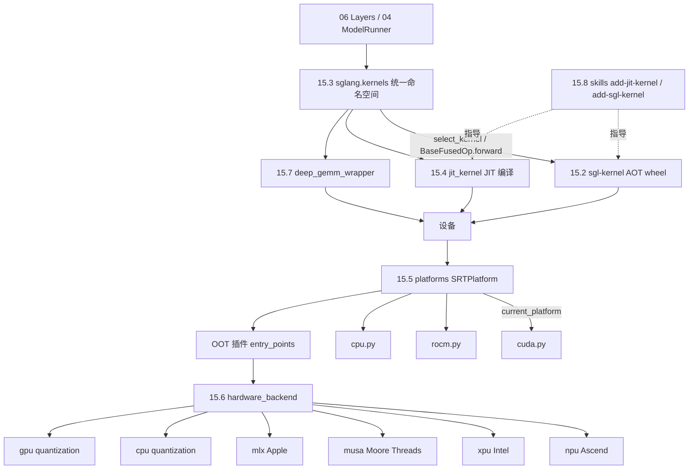

# 15 内核与硬件后端

## 定位

子系统 15 的主体是 SGLang 与加速器硬件之间的"执行面"。它把 [`06 Layers`](../06-layers/index.md) 与 [`04 ModelRunner`](../04-model-execution/04.1-model-runner.md) 发出的注意力、MoE、量化、GEMM、normalize、采样等张量算子，落到具体设备上：CUDA、ROCm、Ascend NPU、Intel XPU、Moore Threads MUSA、Apple MLX、CPU。本子系统负责三层内核的分层与注册、平台抽象、硬件后端适配，把"算什么"与"在哪个设备上跑、用哪个内核实现"解耦。

## 职责

- 把内核按来源分三层：AOT 预编译 `sgl_kernel` wheel、JIT 首用编译 `sglang.jit_kernel`、以及统一公开命名空间 `sglang.kernels`（RFC #29630）。
- 提供平台抽象 `platforms/`（`SRTPlatform` 基类 + CUDA/ROCm/CPU 内置 + OOT 插件发现），屏蔽设备身份、能力位、子系统工厂选择。
- 提供硬件后端 `hardware_backend/`，按设备组织注意力后端、量化 kernel、graph runner、memory pool 等厂商实现（Ascend/XPU/MUSA/MLX/CPU/GPU）。
- 提供 DeepGEMM FP8/FP4 grouped-GEMM 门面（与 [06.15](../06-layers/06.15-deep-gemm-wrapper.md) 同模块的 15 视角）。
- 通过两个 skill（`add-jit-kernel` / `add-sgl-kernel`）规范新内核贡献流程。

## 子系统边界图

## 子系统内导航

| 编号 | 页面 | 一句话定位 |
|---|---|---|
| 15.1 | [内核三层架构](15.1-kernel-three-layer.md) | AOT/JIT/命名空间三层关系与选层决策 |
| 15.2 | [sgl-kernel AOT](15.2-sgl-kernel-aot.md) | `sgl-kernel/` 预编译 wheel，csrc 分类与多平台构建 |
| 15.3 | [kernels 命名空间](15.3-kernels-namespace.md) | `python/sglang/kernels/` 公开 API、registry/selector/BaseFusedOp |
| 15.4 | [jit_kernel](15.4-jit-kernel.md) | `python/sglang/jit_kernel/` 首用编译内核与 TVM-FFI cache |
| 15.5 | [platforms](15.5-platforms.md) | `SRTPlatform`/`DeviceMixin` 平台抽象与 lazy `current_platform` |
| 15.6 | [hardware_backend](15.6-hardware-backend.md) | 厂商硬件后端：Ascend/XPU/MUSA/MLX/CPU/GPU |
| 15.7 | [deep_gemm wrapper](15.7-deep-gemm-wrapper.md) | DeepGEMM FP8/FP4 grouped-GEMM 门面（15 视角） |
| 15.8 | [添加内核 skills](15.8-adding-kernels-skills.md) | 重内核到 sgl-kernel、轻内核到 jit_kernel 的贡献流程 |

## 交叉引用

- 上游: [`04 ModelRunner`](../04-model-execution/04.1-model-runner.md) / [`06 Layers`](../06-layers/index.md) — 发起算子调用
- 依赖: [`16 配置与运行时`](../16-config-runtime/index.md) — `SGLANG_*` 开关、`ServerArgs` 驱动内核选择
- 相关: [`08 分布式`](../08-distributed/index.md) — allreduce/通信内核与平台 distributed backend
- 相关 skill: `.claude/skills/add-jit-kernel`、`.claude/skills/add-sgl-kernel`

## 进一步阅读

- 统一命名空间规范: `python/sglang/kernels/README.md`
- 内核库: `sgl-kernel/README.md`
- RFC: <https://github.com/sgl-project/sglang/issues/29630>
